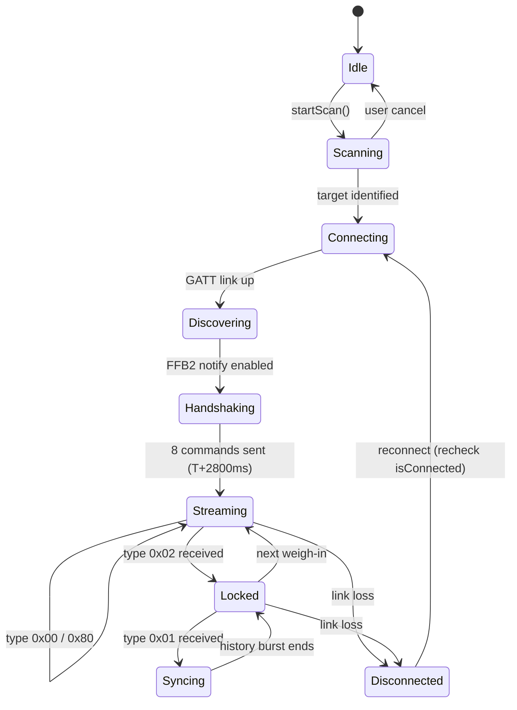

# AFU-WL-TZ-A1 · BLE 协议技术规格

**文档类型**：实现规格（Implementation Specification）  
**目标读者**：需要从零实现客户端或审计本实现的专业开发者  
**规范性级别**：每个条目标注 `MUST`（必须）/ `SHOULD`（应当）/ `MAY`（可选），遵循 RFC 2119 语义  
**参照实现**：`lib/core/protocol.dart` · `lib/ble/scale_ble.dart`（Flutter/Dart）  
**证据体系**：`[HCI]` 官方 App HCI 抓包 · `[OTA]` 本机 BLE 空中抓包 · `[SRC]` 参考实现源码 · `[T]` 受控实验

> 教学向的同主题文档见 [PROTOCOL.md](PROTOCOL.md)（通俗版）。本文不重复概念解释，只给规格。

---

## 0. 术语与符号

| 记号 | 含义 |
| --- | --- |
| `d[n]` | 通知载荷第 n 字节（0-based）|
| `f[n]` | 帧（frame）第 n 字节（0-based），帧长恒 20 |
| `>>n` / `<<n` | 右移 / 左移 n 位（无符号）|
| `\|` | 按位或（用于拼接位域）|
| `&` | 按位与（用于掩码提取）|
| `0xNN` | 十六进制字面量 |
| LE / BE | Little-Endian / Big-Endian |
| PDU | Protocol Data Unit，此处指一帧 20 字节载荷 |
| T_HS | 握手序列总时长，实现取 8 × 400ms ≈ 3.2s |

---

## 1. 发现层（Discovery）

### 1.1 广播 PDU 组成

| 字段 | AD Type | 值 | 规范性 | 证据 |
| --- | --- | --- | --- | --- |
| Flags | `0x01` | 标准 | — | OTA |
| Complete Local Name | `0x09` | `AFU-WL-TZ-A1` | MUST 用于身份判定 | OTA |
| Complete List of 16-bit Service UUIDs | `0x03` | `0xFFB0`, `0x1530` | MAY 用于身份判定 | OTA |
| Manufacturer Specific Data | `0xFF` | Company ID `0x27AC` (LE: `AC 27`) + payload | MAY | OTA |
| Service Data - 16-bit UUID | `0x16` | UUID `0x27AC` (LE: `AC 27`) + 6B MAC (reversed) + `0x01` | **MUST 用于提取真实地址** | OTA |

### 1.2 真实地址提取（关键）

装备广播地址（`peripheral.remoteId`）**不保证等于设备静态 MAC**。真实 MAC 取自 Service Data：

```
Service Data AD 结构：
  [0] = 0x16                      // AD Type: Service Data 16-bit
  [1] = 0xAC, [2] = 0x27          // Service UUID 0x27AC (LE)
  [3] = 0x24 [4] = 0x76 [5] = 0x07
  [6] = 0xAB [7] = 0x82 [8] = 0xB0   // ← 6 字节，顺序为 MAC 的逆序
  [9] = 0x01                      // 固定标志

还原算法：
  mac = reverse(serviceData[3..8])
  → B0:82:AB:07:76:24
```

- `MUST` 对 6 字节做逆序后再格式化，直接顺序读取会得到错误地址。
- `MUST NOT` 假定 Manufacturer Data 前缀存在（`[SRC]` WeighTrace 文档声称含 `AC 27` 前缀，实测无）。

### 1.3 扫描策略

| 参数 | 规格 | 依据 |
| --- | --- | --- |
| 服务过滤（`startScan([uuid])`）| `MUST NOT` 使用 | `[T]` MIUI 上 240s 无结果；全扫 + 回调筛选 < 1s |
| 扫描模式 | 全量扫描，回调侧三重谓词判定 | `[T]` |
| 超时 | 无硬超时；由 UI 层在 5s 后提示用户触发重扫 | 实现约定 |

身份谓词（任一命中即判定为目标设备）：

```
isTarget(scanResult) =
    scanResult.advertisementData.advName.contains("AFU-WL")
 || scanResult.advertisementData.serviceData.containsKey(Guid("27AC"))
 || scanResult.advertisementData.serviceUuids.contains(Guid("FFB0"))
```

### 1.4 Android 平台约束

| 约束 | 说明 | 规避 |
| --- | --- | --- |
| `neverForLocation` 标志 | 携带该标志的 `BLUETOOTH_SCAN` 会使用系统 denylist，本设备广播被静默丢弃 | Manifest `MUST NOT` 声明该 flag；logcat 症状 `Skipping data matching denylist` |
| 权限组合 | Android 12+ 需 `BLUETOOTH_SCAN` + `BLUETOOTH_CONNECT`；≤11 需 `ACCESS_FINE_LOCATION` | 运行时按 `SDK_INT` 分支申请 |

---

## 2. 传输层（GATT）

### 2.1 服务与特征值

```
Primary Service 0000FFB0-0000-1000-8000-00805F9B34FB
├── Characteristic 0000FFB1-...   Properties: WRITE (with response)
│                                 Permissions: Write
└── Characteristic 0000FFB2-...   Properties: NOTIFY
                                  Permissions: Read
                                  CCCD: 00002902-...
```

### 2.2 写模式约束（实现陷阱）

| 模式 | 支持 | 证据 |
| --- | --- | --- |
| `WRITE`（ATT_WRITE_REQ / 有响应）| ✅ 必需 | `[T]` 8/8 成功 |
| `WRITE_NO_RESPONSE`（ATT_WRITE_CMD）| ❌ 抛 `PlatformException(not supported)` | `[T]` 8/8 失败 |

- `MUST` 使用带响应写入。
- 每条写入需等待 GATT 确认后再发下一条，间隔 `SHOULD >= 400ms`（实测低于此值偶有丢包）。

### 2.3 通知订阅

```
await characteristic.setNotifyValue(true);   // 写 CCCD = 0x0001
// 之后所有 RX 通过 onValueReceived 回调，载荷长度恒 20
```

- `MUST` 在发送握手序列**之前**完成订阅，否则握手期间的上行包会丢失（秤不缓存重发）。

### 2.4 辅助服务

| 服务 | 特征值 | 值 | 用途 |
| --- | --- | --- | --- |
| `0x180A` DIS | `0x2A29` | `ICOMON` | 制造商 |
| | `0x2A24` | `FG2313UWB-D` | 型号 |
| | `0x2A26` | `1.2.3` | 固件版本 |
| | `0x2A28` | `1.3.0` | 软件版本 |
| `0x180F` BAS | `0x2A19` | — | **不存在**，读取返回值无意义（实测 `77`）|

---

## 3. 帧编码规范

### 3.1 结构定义

```
 0                   1                   2                             18      19
 +--------+--------+-----------------------------------------+--------+--------+
 |  0xAC  | devType|            payload[16]                 |  tail  | cksum  |
 +--------+--------+-----------------------------------------+--------+--------+
 |<--------------------- 20 octets ------------------------->|
```

| 偏移 | 长度 | 字段 | 编码 | 说明 |
| --- | --- | --- | --- | --- |
| `f[0]` | 1 | SOF | `0xAC` 固定 | 帧起始符 |
| `f[1]` | 1 | DeviceType | TX `0x27` / RX `0x29` | 发送方自身类型，非目标类型 |
| `f[2..17]` | 16 | Payload | 命令相关 | 超长部分被截断（`MUST` 丢弃超出 16B 的内容）|
| `f[18]` | 1 | Tail | 命令标识 | 与 `payload[0]` 语义相关但**独立编码** |
| `f[19]` | 1 | Checksum | `Σ f[2..18] mod 256` | **含 tail，不含自身** |

### 3.2 校验和（规范性定义）

```
checksum = (Σ f[i] for i in [2, 18]) & 0xFF
```

- `MUST` 覆盖 `f[2]` 至 `f[18]`（含尾字节）。
- `MUST NOT` 覆盖 `f[0]`、`f[1]`、`f[19]`。
- `MUST` 对接收帧做同样校验，不匹配则丢弃该 PDU（`SHOULD` 记录日志但不重试）。

### 3.3 字节序约定（与命令相关，非全局）

| 数据域 | 序 | 位置 |
| --- | --- | --- |
| Unix 时间戳（`08`、`D0`）| **BE** | `payload[1..4]` |
| 历史包时间戳 | **BE** | `d[3..6]` |
| 体重（实时/稳定包）| BE 语义的差分编码 | `d[3..5]` |
| 体重（锁定包）| BE | `d[10..12]` |
| 阻抗 | BE | `d[4..5]` / `d[6..7]`（锁定包）|
| 体重（`01`/`D0` 写入）| **BE** | 按字段定义 |

> 体重存在**两套编码**，位置与偏移量都不同，实现 `MUST` 按包类型分别处理。
---

## 4. 命令集规格（TX）

### 4.0 通用约束

| 项 | 规格 |
| --- | --- |
| 设备类型 `f[1]` | `0x27`（不是 0x29；改用 0x29 时阻抗不触发）|
| 发送间隔 | 400ms（MUST，低于此值观察到丢包）|
| 写入模式 | WRITE with response（见 §2.2）|
| Payload 上限 | 16 字节，超出截断 |
| 未使用字节 | MUST 填 `0x00`（非垃圾值）|

### 4.1 命令 08 对时（tail 0xDF）

```
f[2..7] = 08  t3  t2  t1  t0  tz
            |   +-------+----+   +-- UTC 偏移/15 分钟，u8
            |       +------------- Unix 时间戳（秒），u32 BE
            +--------------------- 子命令 0x08
f[8..17] = 全 0x00
f[18] = 0xDF      f[19] = checksum
```

| 字段 | 偏移 | 长度 | 编码 | 约束 |
| --- | --- | --- | --- | --- |
| subcmd | `p[0]` | 1 | `0x08` | 固定 |
| timestamp | `p[1..4]` | 4 | u32 BE | Unix epoch 秒 |
| utcQuarters | `p[5]` | 1 | u8 | `(utcOffsetMinutes / 15) & 0xFF` |

**utcQuarters 计算示例**

```
utcQuarters = truncate(utcOffsetMinutes / 15) & 0xFF

中国   UTC+8    = +480 min   ->  480/15 = 32  = 0x20
日本   UTC+9    = +540 min   ->  540/15 = 36  = 0x24
尼泊尔 UTC+5:45 = +345 min   ->  345/15 = 23  = 0x17
```

### 4.2 命令 01 用户信息（tail 0xD1）

```
f[2..9] = 01  00  01  HH  WH  WL  AA  SS
            |   |   |   |   +--+    |   +-- 性别：1=男 2=女
            |   |   |   |     |     +------ 年龄 u8
            |   |   |   |     +------------ 体重 x100，u16 BE
            |   |   |   +------------------ 身高 cm，u8 取整
            |   |   +---------------------- 固定 0x01
            |   +-------------------------- 保留 0x00
            +------------------------------ 子命令 0x01
```

| 字段 | 偏移 | 长度 | 取值范围 | 编码 |
| --- | --- | --- | --- | --- |
| subcmd | `p[0]` | 1 | `0x01` | — |
| reserved | `p[1]` | 1 | `0x00` | — |
| magic | `p[2]` | 1 | `0x01` | 固定 |
| height | `p[3]` | 1 | 1..255 | cm，**取整截断**（168.6 -> 168）|
| weight | `p[4..5]` | 2 | 0..65535 | `round(kg * 100)`，u16 BE |
| age | `p[6]` | 1 | 1..255 | 整数年 |
| sex | `p[7]` | 1 | 1 / 2 | **1=男，2=女**（不是布尔 0/1）|

- MUST 使用 1/2 而非布尔值，性别错配会导致体脂算法整体偏移。
- 体重来源优先级：成员档案 -> 最近测量记录 -> 60kg 兜底。
### 4.3 命令 02 用户槽位（tail 0xD1）

此命令写**两个**用户槽位，各 7 字节。秤按体重接近度选择使用哪个槽位的参数。

```
f[2..17] = 02 00 | 01 h1 w1H w1L a1 s1 00 | 02 h2 w2H w2L a2 s2 00
           +--+--+  +----------+-----------+  +----------+-----------+
              |              |                           |
              |              +-- 槽位1（7 字节）          +-- 槽位2（7 字节）
              +-- 子命令 02 + 保留 00

payload 恰好 16 字节，无剩余空间
```

**槽位结构（7 字节，两槽同构）**

| 槽内偏移 | 长度 | 字段 | 约束 |
| --- | --- | --- | --- |
| +0 | 1 | slotIndex | `0x01`（槽1）/ `0x02`（槽2）|
| +1 | 1 | height | cm，u8 |
| +2..3 | 2 | weight | `round(kg*100)`，u16 BE |
| +4 | 1 | age | u8 |
| +5 | 1 | sex | 1=男 / 2=女 |
| +6 | 1 | reserved | `0x00` |

- SHOULD 填真实成员参数（相比全 0 能提升秤屏显示一致性）。
- 单成员时两槽 SHOULD 写同一参数。
- 官方 App 仅在解绑时发送此命令；本实现每次连接都发，用于覆盖秤内残留配置。
  潜在副作用见 §8。

### 4.4 命令 D0 完整握手（tail 0xD0）

单帧携带全部上下文，是触发数据流的关键帧。

```
f[2..17] = t3 t2 t1 t0 | tz | 00 | 01 | HH | WH WL | AA | SS | TH TL | 03 | 00
           ++--+--+--+   |    |    |    |    +-+-+   |    |    +-+-+   |   +-- 保留
                 |        |    |    |    |      |     |    |      |     +------ 固定 0x03
                 |        |    |    |    |      |     |    |      +------------ 目标体重 x100, u16 BE
                 |        |    |    |    |      |     |    +------------------- 性别
                 |        |    |    |    |      |     +------------------------ 年龄
                 |        |    |    |    |      +------------------------------ 体重 x100, u16 BE
                 |        |    |    |    +------------------------------------- 身高 cm
                 |        |    |    +------------------------------------------ 槽位 0x01
                 |        |    +----------------------------------------------- 单位 0x00 = kg
                 |        +---------------------------------------------------- utcQuarters
                 +------------------------------------------------------------- Unix 秒 u32 BE
```

| 偏移 | 长度 | 字段 | 编码 | 约束 |
| --- | --- | --- | --- | --- |
| `p[0..3]` | 4 | timestamp | u32 BE | Unix 秒 |
| `p[4]` | 1 | utcQuarters | u8 | 同 §4.1 |
| `p[5]` | 1 | unit | u8 | `0x00` = kg（其他值未验证）|
| `p[6]` | 1 | slotIndex | u8 | `0x01` |
| `p[7]` | 1 | height | u8 | cm |
| `p[8..9]` | 2 | weight | u16 BE | kg x100 |
| `p[10]` | 1 | age | u8 | 整数年 |
| `p[11]` | 1 | sex | u8 | 1/2 |
| `p[12..13]` | 2 | targetWeight | u16 BE | kg x100，缺省 `round(weight*0.75)` |
| `p[14]` | 1 | marker | u8 | `0x03` 固定 |
| `p[15]` | 1 | reserved | u8 | `0x00` |
### 4.5 命令 06 配置查询（tail 0xDF）

```
f[2] = 0x06，f[3..17] = 0x00
```

响应：秤连推 5 个 `type=0x06` 包（`d[2]=0x06`，含索引 00..04），内容重复度高，本实现不解析。

### 4.6 命令 04 D6 / 04 D8（tail 0xDF）

```
f[2..3] = 04 D6   ->  提升实时包频率（实测 26 -> 77 包/次测量）
f[2..3] = 04 D8   ->  请求历史记录；本实现发两次（冗余保险）
```

- **04 D6 不是阻抗开关**。受控 A/B 对照实验：有无 04D6，无物理接触时阻抗均为 0，
  仅观测到实时包频率变化。阻抗只由电极导通决定。
- 04 D8 不是历史推送的必要条件（见 §6.4 触发条件）。

### 4.7 完整命令序列时序

```
时刻      命令         payload + tail
-------  ----------   ------------------------------------------
T+0ms    08 对时      08 t3 t2 t1 t0 tz                    DF
T+400    01 用户      01 00 01 HH WH WL AA SS              D1
T+800    02 槽位      02 00 01 h1 w1H w1L a1 s1 00 02 ...  D1
T+1200   D0 握手      t3 t2 t1 t0 tz 00 01 HH WH WL AA SS TH TL 03 00   D0
T+1600   06 查询      06                                     DF
T+2000   04D6         04 D6                                  DF
T+2400   04D8 #1      04 D8                                  DF
T+2800   04D8 #2      04 D8                                  DF
```

- 顺序 MUST 严格按此表；缺少 `01` 用户帧时阻抗不触发（受控实验）。
- 每条 MUST 等待前一条 GATT 写响应后再发送下一条。

---

## 5. 通知包规格（RX）

### 5.1 通用判别

```
if d.length < 13 or d[0] != 0xAC:  DROP
pktType = d[2]
```

| `d[2]` | 类型名 | 触发时机 | 频率 |
| --- | --- | --- | --- |
| `0x00` | 实时包（Weighing / Realtime）| 测量开始后持续 | 100~150ms（发 04D6 后约 77 pkt/次）|
| `0x80` | 稳定包（Stable）| 体重读数稳定 | 低，随后转 0x02 |
| `0x02` | 锁定包（Locked / Final）| 测量完成，含最终阻抗 | 循环约 6s |
| `0x01` | 历史包（History）| 握手完成后按需推送 | 突发 |
| `0x06` | 配置块（Config）| 应答 `06` 查询 | 连推 5 包 |

### 5.2 `type=0x00` 实时包

| 偏移 | 长度 | 字段 | 解码公式 |
| --- | --- | --- | --- |
| `d[3..5]` | 3 | weightRaw | `((d[3]-0x68)<<16 \| d[4]<<8 \| d[5])` |
| `d[8..9]` | 2 | adcRaw | 单组 ADC 原始值（实时阶段，非最终阻抗）|
| `d[11]` | 1 | batteryOrState | 低 7 位为电量；值 `0x64`(100) 表示测量完成状态 |

**体重换算**

```
weightKg = weightRaw / 1000
注意：此式与锁定包不同（偏移量为 0x68 而非 0x680000，位置为 d[3..5]）
```

**电量采信条件**

```
if pktType == 0x00 and batteryRaw > 0 and batteryRaw < 100:
    battery = batteryRaw & 0x7F
else:
    忽略（测量中 d[11] 会变成 0x64 状态标志）
```

### 5.3 `type=0x80` 稳定包

结构与 `0x00` 相同。`d[11] >= 100` 视作进入阻抗测量阶段。

### 5.4 `type=0x02` 锁定包（核心）

```
偏移:  0     1     2     3     4     5     6     7     8     9    10    11    12
     +-----+-----+-----+-----+-----+-----+-----+-----+-----+-----+-----+-----+-----+
     | AC  | 29  | 02  | ??  |  i1H|  i1L|  i2H|  i2L| ??  | ??  |  wH |  wL |  wL |
     +-----+-----+-----+-----+-----+-----+-----+-----+-----+-----+-----+-----+-----+
                                 +-----+-----+      +-----+-----+     +-----+-----+
                                   阻抗1              阻抗2             体重 x3
```

| 字段 | 偏移 | 长度 | 解码 |
| --- | --- | --- | --- |
| impedance1 | `d[4..5]` | 2 | `(d[4]<<8) \| d[5]`，单位 Ω |
| impedance2 | `d[6..7]` | 2 | `(d[6]<<8) \| d[7]`，单位 Ω |
| weight | `d[10..12]` | 3 | `(((d[10]<<16) \| (d[11]<<8) \| d[12]) - 0x680000) / 1000` |

**边界条件**

| 条件 | 处理 |
| --- | --- |
| `d.length < 13` | MUST 丢弃 |
| impedance 均为 0 | 有效状态，表示无电极导通，体成分不可算 |
| weightRaw < 0 | 非法，`MUST` 丢弃（负体重）|
| weightKg < 20 | 视为轻踩/无效，`SHOULD` 标记为不完整测量 |

**测试向量**（实测抓包）

```
输入：ac 29 02 00 01 ae 01 83 01 80 68 d9 c6 ...
  impedance1 = (0x01<<8)|0xAE = 430
  impedance2 = (0x01<<8)|0x83 = 387
  weightRaw  = (0x68<<16)|(0xD9<<8)|0xC6 = 0x68D9C6 = 6871494
  weightRaw  = 6871494 - 0x680000(6815744) = 55750
  weightKg   = 55.75
输出：impedance=[430,387], weight=55.75kg
```

### 5.5 `type=0x01` 历史包

| 字段 | 偏移 | 长度 | 解码 |
| --- | --- | --- | --- |
| timestamp | `d[3..6]` | 4 | `(d[3]<<24 \| d[4]<<16 \| d[5]<<8 \| d[6])`，u32 BE，Unix 秒 |
| weight | `d[8..10]` | 3 | `(((d[8]<<16) \| (d[9]<<8) \| d[10]) - 0x680000) / 1000` |
| impedance1 | `d[11..12]` | 2 | `(d[11]<<8) \| d[12]` |
| impedance2 | `d[13..14]` | 2 | `(d[13]<<8) \| d[14]` |

**去重要求**

```
同一逻辑记录最多可被投递 3 次（BLE 重传）。
实现 MUST 以 (timestamp, weightKg) 为幂等键去重后再入库。
```

### 5.6 `type=0x06` 配置块

应答 `06` 查询，连推 5 包，含索引 `d[?]=00..04`。本实现不解析，仅日志记录。
---

## 6. 状态机与生命周期



### 6.1 状态转移条件

| 从 | 到 | 条件 | 备注 |
| --- | --- | --- | --- |
| Idle | Scanning | 用户触发 | — |
| Scanning | Connecting | 身份谓词命中（§1.3）| MUST 先停止扫描再连接，否则 Android 上连接易失败 |
| Connecting | Discovering | GATT 连接建立 + MTU 协商完成 | — |
| Discovering | Handshaking | FFB2 `setNotifyValue(true)` 成功 | MUST 在握手前完成 |
| Handshaking | Streaming | 第 8 条命令写入成功 | 总耗时约 2.8s |
| Streaming | Locked | 收到 `d[2]=0x02` | 可结束测量会话 |
| Locked | Syncing | 收到 `d[2]=0x01` | 历史推送可能与锁定包交错 |
| any | Disconnected | GATT 断开事件 | MUST 复查 `isConnected`，见 §8.3 |

### 6.2 测量阶段判定（供 UI 层消费）

```
phase = "done"        if lastPktType == 0x02
      = "impedance"   if lastPktType in (0x00, 0x80) and d[11] >= 100
      = "weighing"    otherwise
```

---

## 7. 时序参数汇总

| 参数 | 值 | 性质 | 依据 |
| --- | --- | --- | --- |
| 广播间隔 | 999ms | 设备行为 | OTA |
| 握手命令间隔 | 400ms | **实现约束** | 受控实验，低于此值丢包 |
| 握手总时长 | ~2800ms | 推导 | 7 × 400ms |
| 实时包间隔 | 100~150ms | 设备行为 | OTA（发 04D6 后加快）|
| 锁定包循环 | ~6s | 设备行为 | OTA |
| 连接后首包延迟 | 450ms | 实现选择 | 等待 GATT 稳定后发握手 |
| 通知超时判定 | 建议 15s | 实现选择 | 超时则提示用户重试 |
| 历史包批间隔 | 无固定间隔 | 设备行为 | 突发推送 |

---

## 8. 已知偏差与实验性设计

### 8.1 deviceType 取值（`0x27` vs `0x29`）

| 值 | 结果 | 依据 |
| --- | --- | --- |
| `0x27` | 正常工作，阻抗触发 | 官方 HCI + 本实现 |
| `0x29` | 未观察到阻抗触发 | 受控实验 |

- `f[1]` MUST 发 `0x27`。
- 注意 `ScaleProtocol.frame()` 的默认参数为 `0x29`，调用方 MUST 显式传 `0x27`（本实现已如此）。

### 8.2 `02` 用户槽位每连接发送（实验性）

| 项 | 说明 |
| --- | --- |
| 官方行为 | 仅在解绑设备时发送 |
| 本实现 | 每次连接都发 |
| 动机 | 覆盖秤内残留用户配置（曾出现身高卡在 111cm 无法更新的情况）|
| 风险 | 未完全评估。若观察到历史记录被反复重推，应优先怀疑此项 |
| 回退方案 | 改为仅在解绑流程中发送 |

### 8.3 连接状态抖动

GATT 建立瞬间，`connectionState` 可能短暂误报 `disconnected`。

```
错误做法: onDisconnected -> 立即 scheduleReconnect()
  后果: 同一会话握手两次 -> 秤视为新同步会话 -> 历史被重推

正确做法: onDisconnected -> if (!isConnected) scheduleReconnect()
  并加 _connecting 并发守卫
```

### 8.4 校验和范围分歧

| 来源 | 范围 | 结果 |
| --- | --- | --- |
| 部分参考文档 | `Σ f[2..17]`（仅 payload）| 校验失败 |
| 实测正确 | `Σ f[2..18]`（**含 tail**）| 通过 |

### 8.5 电量读取

| 来源 | 值 | 是否可信 |
| --- | --- | --- |
| BAS `0x2A19` | 77% | 否（服务不存在，返回值无意义）|
| 实时包 `d[11] & 0x7F` | 10% | 是（915 条采样众数）|

### 8.6 历史记录不可删除

官方 29 条写命令已全量审计，**不存在**删除/清空指令。

```
后果: 秤标记已同步后，任何客户端都无法重新获取该记录。
约束: 客户端 MUST 在连接生命周期内避免异常退出，否则记录永久丢失。
```

---

## 9. 兼容性矩阵

| 维度 | 已验证 | 未验证 |
| --- | --- | --- |
| 秤型号 | AFU-WL-TZ-A1（FG2313UWB-D）| 其他 ICOMON 型号 |
| 固件 | 1.2.3 / 软件 1.3.0 | 其他版本 |
| Android | 12~15（MIUI/HyperOS 实测）| 其他厂商定制 ROM |
| BLE 库 | flutter_blue_plus 1.35 | react-native-ble-plx（性能不符，见 §10.2）|
| 语言/平台 | Flutter (Android) | iOS（协议层可复用，BLE 层需重写）|

---

## 10. 一致性测试清单

实现方完成下列条目后，可认为与本规格一致：

### 10.1 发现与连接

- [ ] 广播名解析出 `AFU-WL-TZ-A1`
- [ ] Service Data 逆序还原出正确 MAC
- [ ] 不使用 UUID 前置过滤仍能在 5s 内发现设备
- [ ] 未声明 `neverForLocation`，扫描无 denylist 记录
- [ ] FFB2 通知在握手前订阅成功

### 10.2 帧编码

- [ ] 帧长恒为 20 字节，`f[0]=0xAC`
- [ ] `f[1]=0x27`
- [ ] 校验和覆盖 `f[2..18]`
- [ ] payload 超 16 字节被截断

### 10.3 命令序列

- [ ] 8 条命令顺序正确
- [ ] 相邻命令间隔 >= 400ms
- [ ] 全部使用带响应写入
- [ ] `01` 帧性别字段使用 1/2
- [ ] `D0` 帧 `p[14]=0x03`

### 10.4 解析

- [ ] 锁定包测试向量还原 `55.75kg` / `[430, 387]Ω`
- [ ] 实时包体重公式产出与锁定包一致（同一次测量内）
- [ ] 历史包时间戳按 u32 BE 解析
- [ ] 历史包按 `(timestamp, weight)` 去重
- [ ] 电量仅从 `type=0x00` 且 `d[11] < 100` 采信
- [ ] 阻抗为 0 时不计算体成分且标记为不完整

### 10.5 生命周期

- [ ] 断线重连前复查 `isConnected`，不产生双握手
- [ ] 连接异常退出前已落库所有已解析记录

---

## 11. 最小参考实现骨架

```dart
// 帧编码
Uint8List frame(List<int> payload, {required int tail}) {
  final f = Uint8List(20);
  f[0] = 0xAC;
  f[1] = 0x27;                                  // 注意：不是 0x29
  for (var i = 0; i < payload.length && i + 2 < 18; i++) {
    f[2 + i] = payload[i] & 0xFF;
  }
  f[18] = tail;
  var sum = 0;
  for (var i = 2; i < 19; i++) sum = (sum + f[i]) & 0xFF;   // 含 tail
  f[19] = sum;
  return f;
}

// 锁定包解析
({double weightKg, int i1, int i2})? parseLocked(Uint8List d) {
  if (d.length < 13 || d[0] != 0xAC || d[2] != 0x02) return null;
  final i1 = (d[4] << 8) | d[5];
  final i2 = (d[6] << 8) | d[7];
  final raw = ((d[10] << 16) | (d[11] << 8) | d[12]) - 0x680000;
  if (raw < 0) return null;
  return (weightKg: raw / 1000, i1: i1, i2: i2);
}
```

---

## 12. 与教学版的对应关系

| 本规格章节 | 教学版章节 |
| --- | --- |
| §1 发现层 | PROTOCOL.md §2 在空气里找到它 |
| §2 传输层 | PROTOCOL.md §3 拿到两个信箱 |
| §3 帧编码 | PROTOCOL.md §4 信封格式 |
| §4 命令集 | PROTOCOL.md §5 八条命令 |
| §5 通知包 | PROTOCOL.md §6 读懂秤回的话 |
| §6 状态机 | PROTOCOL.md §7 完整时间线 |
| §8 已知偏差 | PROTOCOL.md §8 十个坑 |
| §10 测试清单 | —（教学版无）|
