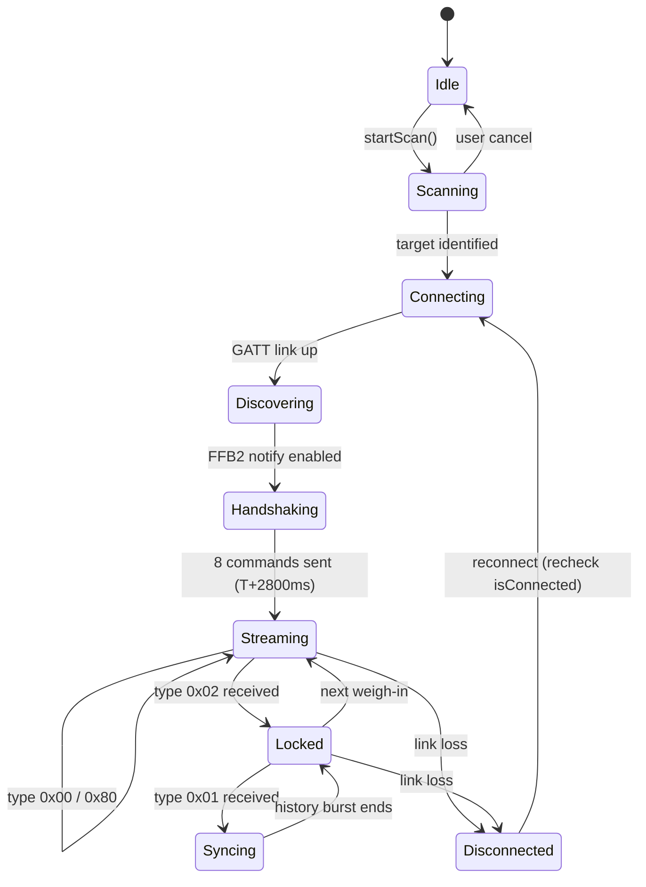

# AFU-WL-TZ-A1 · Technische Spezifikation des BLE-Protokolls

**Dokumenttyp**: Implementierungsspezifikation (Implementation Specification)  
**Zielgruppe**: professionelle Entwickler, die einen Client von Grund auf implementieren oder diese Implementierung auditieren müssen  
**Normative Stufe**: jeder Punkt ist mit `MUST` (zwingend) / `SHOULD` (sollte) / `MAY` (optional) gekennzeichnet, gemäß der Semantik von RFC 2119  
**Referenzimplementierung**: `lib/core/protocol.dart` · `lib/ble/scale_ble.dart` (Flutter/Dart)  
**Belegsystem**: `[HCI]` HCI-Mitschnitt der offiziellen App · `[OTA]` BLE-Funkmitschnitt des eigenen Geräts · `[SRC]` Quellcode der Referenzimplementierung · `[T]` kontrolliertes Experiment

> Ein didaktisch ausgerichtetes Dokument zum selben Thema ist [PROTOCOL.md](PROTOCOL.md) (verständliche Fassung). Dieses Dokument wiederholt keine Begriffserklärungen, sondern liefert ausschließlich die Spezifikation.

---

## 0. Begriffe und Notation

| Notation | Bedeutung |
| --- | --- |
| `d[n]` | das n-te Byte der Benachrichtigungs-Nutzlast (0-basiert) |
| `f[n]` | das n-te Byte des Frames (0-basiert); die Framelänge ist immer 20 |
| `>>n` / `<<n` | um n Bit nach rechts / nach links schieben (vorzeichenlos) |
| `\|` | bitweises ODER (zum Zusammenfügen von Bitfeldern) |
| `&` | bitweises UND (zum Ausblenden über eine Maske) |
| `0xNN` | hexadezimales Literal |
| LE / BE | Little-Endian / Big-Endian |
| PDU | Protocol Data Unit, hier ein Frame mit 20 Byte Nutzlast |
| T_HS | Gesamtdauer der Handshake-Sequenz; die Implementierung setzt 8 × 400ms ≈ 3.2s |

---

## 1. Discovery-Schicht (Discovery)

### 1.1 Aufbau des Advertising-PDU

| Feld | AD Type | Wert | Normativ | Beleg |
| --- | --- | --- | --- | --- |
| Flags | `0x01` | Standard | — | OTA |
| Complete Local Name | `0x09` | `AFU-WL-TZ-A1` | MUST für die Identitätsprüfung | OTA |
| Complete List of 16-bit Service UUIDs | `0x03` | `0xFFB0`, `0x1530` | MAY für die Identitätsprüfung | OTA |
| Manufacturer Specific Data | `0xFF` | Company ID `0x27AC` (LE: `AC 27`) + Payload | MAY | OTA |
| Service Data - 16-bit UUID | `0x16` | UUID `0x27AC` (LE: `AC 27`) + 6B MAC (reversed) + `0x01` | **MUST für die Ermittlung der echten Adresse** | OTA |

### 1.2 Ermittlung der echten Adresse (entscheidend)

Die Advertising-Adresse des Geräts (`peripheral.remoteId`) **ist nicht zwangsläufig gleich der statischen MAC-Adresse**. Die echte MAC stammt aus den Service Data:

```
Aufbau der Service-Data-AD:
  [0] = 0x16                      // AD Type: Service Data 16-bit
  [1] = 0xAC, [2] = 0x27          // Service UUID 0x27AC (LE)
  [3] = 0x24 [4] = 0x76 [5] = 0x07
  [6] = 0xAB [7] = 0x82 [8] = 0xB0   // ← 6 Bytes in umgekehrter MAC-Reihenfolge
  [9] = 0x01                      // feste Kennung

Rekonstruktionsalgorithmus:
  mac = reverse(serviceData[3..8])
  → B0:82:AB:07:76:24
```

- `MUST` die 6 Bytes zuerst umdrehen und erst dann formatieren; liest man sie direkt in Folge, erhält man eine falsche Adresse.
- `MUST NOT` annehmen, dass in den Manufacturer Data ein Präfix vorhanden ist (`[SRC]` die WeighTrace-Dokumentation behauptet ein `AC 27`-Präfix, gemessen wurde keines).

### 1.3 Scan-Strategie

| Parameter | Vorgabe | Grundlage |
| --- | --- | --- |
| Dienstfilter (`startScan([uuid])`) | `MUST NOT` verwenden | `[T]` auf MIUI 240s ohne Ergebnis; vollständiger Scan + Filterung im Callback < 1s |
| Scan-Modus | vollständiger Scan, Entscheidung über drei Prädikate im Callback | `[T]` |
| Timeout | kein hartes Timeout; die UI-Schicht weist nach 5s darauf hin, einen erneuten Scan auszulösen | Implementierungsvereinbarung |

Identitätsprädikat (ein einziger Treffer genügt, um das Gerät als Zielgerät zu werten):

```
isTarget(scanResult) =
    scanResult.advertisementData.advName.contains("AFU-WL")
 || scanResult.advertisementData.serviceData.containsKey(Guid("27AC"))
 || scanResult.advertisementData.serviceUuids.contains(Guid("FFB0"))
```

### 1.4 Plattformbeschränkungen unter Android

| Beschränkung | Erläuterung | Umgehung |
| --- | --- | --- |
| Flag `neverForLocation` | ein `BLUETOOTH_SCAN` mit diesem Flag nutzt die denylist des Systems, das Advertising dieses Geräts wird still verworfen | das Manifest `MUST NOT` dieses Flag deklarieren; Symptom in logcat: `Skipping data matching denylist` |
| Berechtigungskombination | ab Android 12+ `BLUETOOTH_SCAN` + `BLUETOOTH_CONNECT`; bei ≤11 `ACCESS_FINE_LOCATION` | zur Laufzeit abhängig von `SDK_INT` beantragen |

---

## 2. Transportschicht (GATT)

### 2.1 Dienste und Charakteristiken

```
Primary Service 0000FFB0-0000-1000-8000-00805F9B34FB
├── Characteristic 0000FFB1-...   Properties: WRITE (with response)
│                                 Permissions: Write
└── Characteristic 0000FFB2-...   Properties: NOTIFY
                                  Permissions: Read
                                  CCCD: 00002902-...
```

### 2.2 Einschränkung des Write-Modus (Implementierungsfalle)

| Modus | Unterstützt | Beleg |
| --- | --- | --- |
| `WRITE` (ATT_WRITE_REQ / mit Antwort) | ✅ erforderlich | `[T]` 8/8 erfolgreich |
| `WRITE_NO_RESPONSE` (ATT_WRITE_CMD) | ❌ wirft `PlatformException(not supported)` | `[T]` 8/8 fehlgeschlagen |

- `MUST` Writes mit Antwort verwenden.
- jeder Write muss auf die Bestätigung von GATT warten, bevor der nächste gesendet wird; der Abstand ist `SHOULD >= 400ms` (unterhalb dieses Werts wurden gelegentlich Paketverluste beobachtet).

### 2.3 Abonnieren der Benachrichtigungen

```
await characteristic.setNotifyValue(true);   // schreibt CCCD = 0x0001
// danach läuft jeder RX über den onValueReceived-Callback, die Nutzlast ist immer 20 Byte lang
```

- `MUST` das Abonnieren **vor** dem Senden der Handshake-Sequenz abschließen, sonst gehen während des Handshakes Uplink-Pakete verloren (die Waage puffert sie nicht zum erneuten Senden).

### 2.4 Hilfsdienste

| Dienst | Charakteristik | Wert | Zweck |
| --- | --- | --- | --- |
| `0x180A` DIS | `0x2A29` | `ICOMON` | Hersteller |
| | `0x2A24` | `FG2313UWB-D` | Modell |
| | `0x2A26` | `1.2.3` | Firmware-Version |
| | `0x2A28` | `1.3.0` | Software-Version |
| `0x180F` BAS | `0x2A19` | — | **existiert nicht**, der Rückgabewert beim Lesen ist bedeutungslos (gemessen `77`) |

---

## 3. Spezifikation der Frame-Kodierung

### 3.1 Strukturdefinition

```
 0                   1                   2                             18      19
 +--------+--------+-----------------------------------------+--------+--------+
 |  0xAC  | devType|            payload[16]                 |  tail  | cksum  |
 +--------+--------+-----------------------------------------+--------+--------+
 |<--------------------- 20 octets ------------------------->|
```

| Offset | Länge | Feld | Kodierung | Erläuterung |
| --- | --- | --- | --- | --- |
| `f[0]` | 1 | SOF | `0xAC` fest | Startzeichen des Frames |
| `f[1]` | 1 | DeviceType | TX `0x27` / RX `0x29` | der eigene Typ des Senders, nicht der des Ziels |
| `f[2..17]` | 16 | Payload | befehlsabhängig | überzählige Teile werden abgeschnitten (`MUST` Inhalte über 16B verwerfen) |
| `f[18]` | 1 | Tail | Befehlsidentifikation | semantisch mit `payload[0]` verknüpft, aber **eigenständig kodiert** |
| `f[19]` | 1 | Checksum | `Σ f[2..18] mod 256` | **enthält tail, nicht sich selbst** |

### 3.2 Prüfsumme (normative Definition)

```
checksum = (Σ f[i] for i in [2, 18]) & 0xFF
```

- `MUST` `f[2]` bis `f[18]` abdecken (einschließlich des Tail-Bytes).
- `MUST NOT` `f[0]`, `f[1]`, `f[19]` abdecken.
- `MUST` empfangene Frames derselben Prüfung unterziehen; bei Abweichung das PDU verwerfen (`SHOULD` protokollieren, aber nicht wiederholen).

### 3.3 Byte-Reihenfolge (befehlsspezifisch, nicht global)

| Datenfeld | Reihenfolge | Position |
| --- | --- | --- |
| Unix-Zeitstempel (`08`, `D0`) | **BE** | `payload[1..4]` |
| Zeitstempel im Verlaufspaket | **BE** | `d[3..6]` |
| Gewicht (Echtzeit-/Stabilitätspaket) | Differenzkodierung mit BE-Semantik | `d[3..5]` |
| Gewicht (Sperrpaket) | BE | `d[10..12]` |
| Impedanz | BE | `d[4..5]` / `d[6..7]` (Sperrpaket) |
| Gewicht (`01`/`D0`-Write) | **BE** | gemäß Felddefinition |

> Für das Gewicht existieren **zwei Kodierungen**, deren Position und Offset sich unterscheiden; die Implementierung `MUST` beide pakettypabhängig getrennt behandeln.
---

## 4. Spezifikation des Befehlssatzes (TX)

### 4.0 Allgemeine Einschränkungen

| Punkt | Vorgabe |
| --- | --- |
| Gerätetyp `f[1]` | `0x27` (nicht 0x29; bei 0x29 wird die Impedanz nicht ausgelöst) |
| Sendeabstand | 400ms (MUST, unterhalb dieses Werts wurden Paketverluste beobachtet) |
| Write-Modus | WRITE with response (siehe §2.2) |
| Payload-Obergrenze | 16 Byte, darüber wird abgeschnitten |
| unbenutzte Bytes | MUST mit `0x00` füllen (keine Zufallswerte) |

### 4.1 Befehl 08 Zeitabgleich (tail 0xDF)

```
f[2..7] = 08  t3  t2  t1  t0  tz
            |   +-------+----+   +-- UTC-Offset/15 Minuten, u8
            |       +------------- Unix-Zeitstempel (Sekunden), u32 BE
            +--------------------- Unterbefehl 0x08
f[8..17] = alles 0x00
f[18] = 0xDF      f[19] = checksum
```

| Feld | Offset | Länge | Kodierung | Einschränkung |
| --- | --- | --- | --- | --- |
| subcmd | `p[0]` | 1 | `0x08` | fest |
| timestamp | `p[1..4]` | 4 | u32 BE | Unix-Epoch in Sekunden |
| utcQuarters | `p[5]` | 1 | u8 | `(utcOffsetMinutes / 15) & 0xFF` |

**Rechenbeispiel für utcQuarters**

```
utcQuarters = truncate(utcOffsetMinutes / 15) & 0xFF

China   UTC+8    = +480 min   ->  480/15 = 32  = 0x20
Japan   UTC+9    = +540 min   ->  540/15 = 36  = 0x24
Nepal   UTC+5:45 = +345 min   ->  345/15 = 23  = 0x17
```

### 4.2 Befehl 01 Benutzerinformationen (tail 0xD1)

```
f[2..9] = 01  00  01  HH  WH  WL  AA  SS
            |   |   |   |   +--+    |   +-- Geschlecht: 1=männlich 2=weiblich
            |   |   |   |     |     +------ Alter u8
            |   |   |   |     +------------ Gewicht x100, u16 BE
            |   |   |   +------------------ Größe cm, u8 abgeschnitten
            |   |   +---------------------- fest 0x01
            |   +-------------------------- reserviert 0x00
            +------------------------------ Unterbefehl 0x01
```

| Feld | Offset | Länge | Wertebereich | Kodierung |
| --- | --- | --- | --- | --- |
| subcmd | `p[0]` | 1 | `0x01` | — |
| reserved | `p[1]` | 1 | `0x00` | — |
| magic | `p[2]` | 1 | `0x01` | fest |
| height | `p[3]` | 1 | 1..255 | cm, **abgeschnitten** (168.6 -> 168) |
| weight | `p[4..5]` | 2 | 0..65535 | `round(kg * 100)`, u16 BE |
| age | `p[6]` | 1 | 1..255 | ganze Jahre |
| sex | `p[7]` | 1 | 1 / 2 | **1=männlich, 2=weiblich** (kein boolesches 0/1) |

- MUST 1/2 statt boolescher Werte verwenden; eine falsche Geschlechtsangabe verschiebt den gesamten Körperfett-Algorithmus.
- Prioritätsreihenfolge der Gewichtsquelle: Mitgliedsprofil -> letzter Messdatensatz -> 60kg als Rückfallwert.
### 4.3 Befehl 02 Benutzerslots (tail 0xD1)

Dieser Befehl schreibt **zwei** Benutzerslots zu je 7 Bytes. Die Waage wählt anhand der Gewichtsähnlichkeit, die Parameter welches Slots sie verwendet.

```
f[2..17] = 02 00 | 01 h1 w1H w1L a1 s1 00 | 02 h2 w2H w2L a2 s2 00
           +--+--+  +----------+-----------+  +----------+-----------+
              |              |                           |
              |              +-- Slot 1 (7 Bytes)         +-- Slot 2 (7 Bytes)
              +-- Unterbefehl 02 + reserviert 00

payload ist genau 16 Bytes lang, es bleibt kein Platz übrig
```

**Slot-Struktur (7 Bytes, beide Slots gleich aufgebaut)**

| Offset im Slot | Länge | Feld | Einschränkung |
| --- | --- | --- | --- |
| +0 | 1 | slotIndex | `0x01` (Slot 1) / `0x02` (Slot 2) |
| +1 | 1 | height | cm, u8 |
| +2..3 | 2 | weight | `round(kg*100)`, u16 BE |
| +4 | 1 | age | u8 |
| +5 | 1 | sex | 1=männlich / 2=weiblich |
| +6 | 1 | reserved | `0x00` |

- SHOULD echte Mitgliedsparameter eintragen (im Vergleich zu lauter Nullen verbessert das die Übereinstimmung der Anzeige auf der Waage).
- bei nur einem Mitglied SHOULD beide Slots dieselben Parameter erhalten.
- die offizielle App sendet diesen Befehl nur beim Entkoppeln; diese Implementierung sendet ihn bei jeder Verbindung, um Reste der Konfiguration in der Waage zu überschreiben.
  Mögliche Nebenwirkungen siehe §8.

### 4.4 Befehl D0 vollständiger Handshake (tail 0xD0)

Ein einzelner Frame trägt den gesamten Kontext und ist der Schlüsselframe, der den Datenstrom auslöst.

```
f[2..17] = t3 t2 t1 t0 | tz | 00 | 01 | HH | WH WL | AA | SS | TH TL | 03 | 00
           ++--+--+--+   |    |    |    |    +-+-+   |    |    +-+-+   |   +-- reserviert
                 |        |    |    |    |      |     |    |      |     +------ fest 0x03
                 |        |    |    |    |      |     |    |      +------------ Zielgewicht x100, u16 BE
                 |        |    |    |    |      |     |    +------------------- Geschlecht
                 |        |    |    |    |      |     +------------------------ Alter
                 |        |    |    |    |      +------------------------------ Gewicht x100, u16 BE
                 |        |    |    |    +------------------------------------- Größe cm
                 |        |    |    +------------------------------------------ Slot 0x01
                 |        |    +----------------------------------------------- Einheit 0x00 = kg
                 |        +---------------------------------------------------- utcQuarters
                 +------------------------------------------------------------- Unix-Sekunden u32 BE
```

| Offset | Länge | Feld | Kodierung | Einschränkung |
| --- | --- | --- | --- | --- |
| `p[0..3]` | 4 | timestamp | u32 BE | Unix-Sekunden |
| `p[4]` | 1 | utcQuarters | u8 | wie §4.1 |
| `p[5]` | 1 | unit | u8 | `0x00` = kg (andere Werte nicht verifiziert) |
| `p[6]` | 1 | slotIndex | u8 | `0x01` |
| `p[7]` | 1 | height | u8 | cm |
| `p[8..9]` | 2 | weight | u16 BE | kg x100 |
| `p[10]` | 1 | age | u8 | ganze Jahre |
| `p[11]` | 1 | sex | u8 | 1/2 |
| `p[12..13]` | 2 | targetWeight | u16 BE | kg x100, Standardwert `round(weight*0.75)` |
| `p[14]` | 1 | marker | u8 | `0x03` fest |
| `p[15]` | 1 | reserved | u8 | `0x00` |
### 4.5 Befehl 06 Konfigurationsabfrage (tail 0xDF)

```
f[2] = 0x06, f[3..17] = 0x00
```

Antwort: die Waage sendet 5 Pakete mit `type=0x06` hintereinander (`d[2]=0x06`, mit Index 00..04); der Inhalt wiederholt sich stark, diese Implementierung wertet ihn nicht aus.

### 4.6 Befehle 04 D6 / 04 D8 (tail 0xDF)

```
f[2..3] = 04 D6   ->  erhöht die Frequenz der Echtzeitpakete (gemessen 26 -> 77 Pakete pro Messung)
f[2..3] = 04 D8   ->  fordert Verlaufsdatensätze an; diese Implementierung sendet zweimal (Redundanz zur Sicherheit)
```

- **04 D6 ist kein Impedanzschalter**. Im kontrollierten A/B-Vergleich ergab sich mit und ohne 04D6 ohne physischen Kontakt jeweils eine Impedanz von 0,
  beobachtet wurde ausschließlich eine Änderung der Echtzeitpaket-Frequenz. Die Impedanz hängt allein davon ab, ob die Elektroden leitenden Kontakt haben.
- 04 D8 ist keine Voraussetzung für das Nachschieben des Verlaufs (siehe Auslösebedingung in §6.4).

### 4.7 Zeitverlauf der vollständigen Befehlssequenz

```
Zeitpunkt  Befehl         payload + tail                                      
---------  ---------------------------------------------------------          
T+0ms      08 Zeitabgleich08 t3 t2 t1 t0 tz                                   DF
T+400      01 Benutzer    01 00 01 HH WH WL AA SS                             D1
T+800      02 Slots       02 00 01 h1 w1H w1L a1 s1 00 02 ...                 D1
T+1200     D0 Handshake   t3 t2 t1 t0 tz 00 01 HH WH WL AA SS TH TL 03 00     D0
T+1600     06 Abfrage     06                                                  DF
T+2000     04D6           04 D6                                               DF
T+2400     04D8 #1        04 D8                                               DF
T+2800     04D8 #2        04 D8                                               DF
```

- die Reihenfolge `MUST` exakt dieser Tabelle folgen; fehlt der `01`-Benutzerframe, wird die Impedanz nicht ausgelöst (kontrolliertes Experiment).
- jeder Befehl `MUST` auf die GATT-Write-Antwort des vorherigen warten, bevor der nächste gesendet wird.

---

## 5. Spezifikation der Benachrichtigungspakete (RX)

### 5.1 Allgemeine Unterscheidung

```
if d.length < 13 or d[0] != 0xAC:  DROP
pktType = d[2]
```

| `d[2]` | Typbezeichnung | Auslösezeitpunkt | Frequenz |
| --- | --- | --- | --- |
| `0x00` | Echtzeitpaket (Weighing / Realtime) | ab Messbeginn durchgehend | 100~150ms (nach 04D6 etwa 77 pkt pro Messung) |
| `0x80` | Stabilitätspaket (Stable) | die Gewichtsanzeige ist stabil | selten, danach Wechsel zu 0x02 |
| `0x02` | Sperrpaket (Locked / Final) | Messung abgeschlossen, enthält die finale Impedanz | etwa 6s im Kreis |
| `0x01` | Verlaufspaket (History) | wird nach dem Handshake nach Bedarf nachgeschoben | stoßweise |
| `0x06` | Konfigurationsblock (Config) | Antwort auf die `06`-Abfrage | 5 Pakete hintereinander |

### 5.2 Echtzeitpaket `type=0x00`

| Offset | Länge | Feld | Dekodierformel |
| --- | --- | --- | --- |
| `d[3..5]` | 3 | weightRaw | `((d[3]-0x68)<<16 \| d[4]<<8 \| d[5])` |
| `d[8..9]` | 2 | adcRaw | ADC-Rohwert einer Gruppe (in der Echtzeitphase, nicht die endgültige Impedanz) |
| `d[11]` | 1 | batteryOrState | die unteren 7 Bit sind der Akkustand; der Wert `0x64`(100) zeigt den Status „Messung abgeschlossen“ |

**Umrechnung des Gewichts**

```
weightKg = weightRaw / 1000
Achtung: diese Formel ist nicht die des Sperrpakets (Offset 0x68 statt 0x680000, Position d[3..5])
```

**Bedingungen für die Übernahme des Akkustands**

```
if pktType == 0x00 and batteryRaw > 0 and batteryRaw < 100:
    battery = batteryRaw & 0x7F
else:
    ignorieren (während der Messung wird d[11] zum Statusflag 0x64)
```

### 5.3 Stabilitätspaket `type=0x80`

Der Aufbau ist identisch mit `0x00`. `d[11] >= 100` gilt als Eintritt in die Impedanzmessphase.

### 5.4 Sperrpaket `type=0x02` (Kernstück)

```
Offset:  0     1     2     3     4     5     6     7     8     9    10    11    12
     +-----+-----+-----+-----+-----+-----+-----+-----+-----+-----+-----+-----+-----+
     | AC  | 29  | 02  | ??  |  i1H|  i1L|  i2H|  i2L| ??  | ??  |  wH |  wL |  wL |
     +-----+-----+-----+-----+-----+-----+-----+-----+-----+-----+-----+-----+-----+
                             └───────────────────────┘           └─────────────────┘
                               Impedanz1   Impedanz2                 Gewicht ×3
```

| Feld | Offset | Länge | Dekodierung |
| --- | --- | --- | --- |
| impedance1 | `d[4..5]` | 2 | `(d[4]<<8) \| d[5]`, Einheit Ω |
| impedance2 | `d[6..7]` | 2 | `(d[6]<<8) \| d[7]`, Einheit Ω |
| weight | `d[10..12]` | 3 | `(((d[10]<<16) \| (d[11]<<8) \| d[12]) - 0x680000) / 1000` |

**Grenzbedingungen**

| Bedingung | Behandlung |
| --- | --- |
| `d.length < 13` | MUST verwerfen |
| beide Impedanzen sind 0 | gültiger Zustand: es gibt keine leitende Verbindung über die Elektroden, die Körperzusammensetzung ist nicht berechenbar |
| weightRaw < 0 | ungültig, `MUST` verwerfen (negatives Gewicht) |
| weightKg < 20 | gilt als leichtes Antippen bzw. als ungültig, `SHOULD` als unvollständige Messung kennzeichnen |

**Testvektor** (Mitschnitt aus der Praxis)

```
Eingabe: ac 29 02 00 01 ae 01 83 01 80 68 d9 c6 ...
  impedance1 = (0x01<<8)|0xAE = 430
  impedance2 = (0x01<<8)|0x83 = 387
  weightRaw  = (0x68<<16)|(0xD9<<8)|0xC6 = 0x68D9C6 = 6871494
  weightRaw  = 6871494 - 0x680000(6815744) = 55750
  weightKg   = 55.75
Ausgabe: impedance=[430,387], weight=55.75kg
```

### 5.5 Verlaufspaket `type=0x01`

| Feld | Offset | Länge | Dekodierung |
| --- | --- | --- | --- |
| timestamp | `d[3..6]` | 4 | `(d[3]<<24 \| d[4]<<16 \| d[5]<<8 \| d[6])`, u32 BE, Unix-Sekunden |
| weight | `d[8..10]` | 3 | `(((d[8]<<16) \| (d[9]<<8) \| d[10]) - 0x680000) / 1000` |
| impedance1 | `d[11..12]` | 2 | `(d[11]<<8) \| d[12]` |
| impedance2 | `d[13..14]` | 2 | `(d[13]<<8) \| d[14]` |

**Anforderung an die Deduplizierung**

```
Ein und derselbe logische Datensatz kann bis zu 3-mal zugestellt werden (BLE-Wiederholung).
Die Implementierung MUST mit (timestamp, weightKg) als Idempotenzschlüssel deduplizieren, bevor gespeichert wird.
```

### 5.6 Konfigurationsblock `type=0x06`

Antwort auf die `06`-Abfrage, 5 Pakete hintereinander, mit Index `d[?]=00..04`. Diese Implementierung wertet sie nicht aus, sondern protokolliert sie nur.
---

## 6. Zustandsautomat und Lebenszyklus



### 6.1 Bedingungen der Zustandsübergänge

| Von | Nach | Bedingung | Anmerkung |
| --- | --- | --- | --- |
| Idle | Scanning | vom Nutzer ausgelöst | — |
| Scanning | Connecting | Identitätsprädikat trifft zu (§1.3) | MUST zuerst den Scan stoppen und dann verbinden, sonst scheitert die Verbindung unter Android leicht |
| Connecting | Discovering | GATT-Verbindung aufgebaut + MTU-Aushandlung abgeschlossen | — |
| Discovering | Handshaking | `setNotifyValue(true)` auf FFB2 erfolgreich | MUST vor dem Handshake abgeschlossen sein |
| Handshaking | Streaming | der achte Befehl wurde erfolgreich geschrieben | Gesamtdauer etwa 2.8s |
| Streaming | Locked | `d[2]=0x02` empfangen | die Messsitzung kann beendet werden |
| Locked | Syncing | `d[2]=0x01` empfangen | das Nachschieben des Verlaufs kann sich mit Sperrpaketen verzahnen |
| any | Disconnected | GATT-Trennungsereignis | MUST `isConnected` erneut prüfen, siehe §8.3 |

### 6.2 Bestimmung der Messphase (für die UI-Schicht)

```
phase = "done"        if lastPktType == 0x02
      = "impedance"   if lastPktType in (0x00, 0x80) and d[11] >= 100
      = "weighing"    otherwise
```

---

## 7. Zusammenfassung der Zeitparameter

| Parameter | Wert | Art | Grundlage |
| --- | --- | --- | --- |
| Advertising-Intervall | 999ms | Geräteverhalten | OTA |
| Abstand der Handshake-Befehle | 400ms | **Implementierungsauflage** | kontrolliertes Experiment, darunter Paketverluste |
| Gesamtdauer des Handshakes | ~2800ms | abgeleitet | 7 × 400ms |
| Intervall der Echtzeitpakete | 100~150ms | Geräteverhalten | OTA (nach 04D6 schneller) |
| Wiederholungszyklus des Sperrpakets | ~6s | Geräteverhalten | OTA |
| Verzögerung bis zum ersten Paket nach dem Verbinden | 450ms | Implementierungswahl | Handshake erst nach Stabilisierung von GATT senden |
| Timeout für Benachrichtigungen | empfohlen 15s | Implementierungswahl | bei Timeout den Nutzer zu einem neuen Versuch auffordern |
| Abstand zwischen Verlaufspaketen | kein fester Abstand | Geräteverhalten | stoßweises Nachschieben |

---

## 8. Bekannte Abweichungen und experimentelle Entscheidungen

### 8.1 Wert von deviceType (`0x27` vs `0x29`)

| Wert | Ergebnis | Grundlage |
| --- | --- | --- |
| `0x27` | arbeitet normal, die Impedanz wird ausgelöst | offizieller HCI-Mitschnitt + diese Implementierung |
| `0x29` | kein Auslösen der Impedanz beobachtet | kontrolliertes Experiment |

- `f[1]` MUST `0x27` senden.
- Achtung: der Standardparameter von `ScaleProtocol.frame()` ist `0x29`; der Aufrufer MUST `0x27` ausdrücklich übergeben (diese Implementierung macht das bereits so).

### 8.2 `02` Benutzerslots bei jeder Verbindung senden (experimentell)

| Punkt | Erläuterung |
| --- | --- |
| Verhalten der offiziellen App | wird nur beim Entkoppeln des Geräts gesendet |
| diese Implementierung | wird bei jeder Verbindung gesendet |
| Motivation | Reste der Benutzerkonfiguration in der Waage überschreiben (es kam vor, dass die Größe bei 111cm festsaß und nicht aktualisiert werden konnte) |
| Risiko | nicht vollständig bewertet. Wird beobachtet, dass Verlaufsdatensätze immer wieder nachgeschoben werden, ist dies der erste Verdächtige |
| Rückfalloption | nur noch im Entkopplungsablauf senden |

### 8.3 Flattern des Verbindungsstatus

Im Moment des GATT-Aufbaus kann `connectionState` kurz fälschlich `disconnected` melden.

```
Falsch: onDisconnected -> sofort scheduleReconnect()
  Folge: derselbe Sitzungshandshake läuft zweimal -> die Waage wertet das als neue Synchronisierungssitzung -> der Verlauf wird erneut nachgeschoben

Richtig: onDisconnected -> if (!isConnected) scheduleReconnect()
  und zusätzlich eine Nebenläufigkeitssperre _connecting
```

### 8.4 Divergenz beim Prüfsummenbereich

| Quelle | Bereich | Ergebnis |
| --- | --- | --- |
| manche Referenzdokumente | `Σ f[2..17]` (nur Payload) | Prüfung schlägt fehl |
| gemessen korrekt | `Σ f[2..18]` (**einschließlich tail**) | besteht |

### 8.5 Auslesen des Akkustands

| Quelle | Wert | verlässlich |
| --- | --- | --- |
| BAS `0x2A19` | 77% | nein (der Dienst existiert nicht, der Rückgabewert ist bedeutungslos) |
| Echtzeitpaket `d[11] & 0x7F` | 10% | ja (Modalwert über 915 Stichproben) |

### 8.6 Verlaufsdatensätze lassen sich nicht löschen

Alle 29 offiziellen Schreibbefehle wurden vollständig auditiert: es **existiert** kein Lösch- oder Leerungsbefehl.

```
Folge: nachdem die Waage einen Datensatz als synchronisiert markiert hat, kann kein Client ihn erneut abrufen.
Auflage: der Client MUST während des Verbindungslebenszyklus einen außerordentlichen Abbruch vermeiden, sonst geht der Datensatz endgültig verloren.
```

---

## 9. Kompatibilitätsmatrix

| Dimension | verifiziert | nicht verifiziert |
| --- | --- | --- |
| Waagenmodell | AFU-WL-TZ-A1 (FG2313UWB-D) | andere ICOMON-Modelle |
| Firmware | 1.2.3 / Software 1.3.0 | andere Versionen |
| Android | 12~15 (MIUI/HyperOS gemessen) | angepasste ROMs anderer Hersteller |
| BLE-Bibliothek | flutter_blue_plus 1.35 | react-native-ble-plx (Performance unzureichend, siehe §10.2) |
| Sprache/Plattform | Flutter (Android) | iOS (die Protokollschicht ist wiederverwendbar, die BLE-Schicht muss neu geschrieben werden) |

---

## 10. Checkliste für Konsistenztests

Ein Implementierer kann die Übereinstimmung mit dieser Spezifikation als gegeben ansehen, sobald die folgenden Punkte erfüllt sind:

### 10.1 Discovery und Verbindung

- [ ] aus dem Advertising-Namen lässt sich `AFU-WL-TZ-A1` auslesen
- [ ] aus den Service Data ergibt sich durch Umkehrung die korrekte MAC
- [ ] auch ohne UUID-Vorfilterung wird das Gerät in 5s gefunden
- [ ] `neverForLocation` ist nicht deklariert, im Scan taucht kein denylist-Eintrag auf
- [ ] die Benachrichtigungen von FFB2 wurden vor dem Handshake erfolgreich abonniert

### 10.2 Frame-Kodierung

- [ ] die Framelänge ist immer 20 Byte, `f[0]=0xAC`
- [ ] `f[1]=0x27`
- [ ] die Prüfsumme deckt `f[2..18]` ab
- [ ] eine Payload über 16 Byte wird abgeschnitten

### 10.3 Befehlssequenz

- [ ] die Reihenfolge der 8 Befehle stimmt
- [ ] der Abstand benachbarter Befehle ist >= 400ms
- [ ] durchgehend Writes mit Antwort
- [ ] das Geschlechtsfeld im `01`-Frame nutzt 1/2
- [ ] im `D0`-Frame gilt `p[14]=0x03`

### 10.4 Auswertung

- [ ] der Testvektor des Sperrpakets ergibt `55.75kg` / `[430, 387]Ω`
- [ ] die Formel des Echtzeitpakets liefert dasselbe Gewicht wie die des Sperrpakets (innerhalb derselben Messung)
- [ ] Zeitstempel aus Verlaufspaketen werden als u32 BE ausgewertet
- [ ] Verlaufspakete werden anhand `(timestamp, weight)` dedupliziert
- [ ] der Akkustand wird nur aus `type=0x00` und nur bei `d[11] < 100` übernommen
- [ ] bei Impedanz 0 wird keine Körperzusammensetzung berechnet und die Messung als unvollständig gekennzeichnet

### 10.5 Lebenszyklus

- [ ] vor dem Wiederverbinden nach einer Trennung wird `isConnected` erneut geprüft, sodass kein doppelter Handshake entsteht
- [ ] vor einem außerordentlichen Verbindungsabbruch sind alle ausgewerteten Datensätze bereits gespeichert

---

## 11. Minimales Grundgerüst der Referenzimplementierung

```dart
// Frame-Kodierung
Uint8List frame(List<int> payload, {required int tail}) {
  final f = Uint8List(20);
  f[0] = 0xAC;
  f[1] = 0x27;                                  // Achtung: nicht 0x29
  for (var i = 0; i < payload.length && i + 2 < 18; i++) {
    f[2 + i] = payload[i] & 0xFF;
  }
  f[18] = tail;
  var sum = 0;
  for (var i = 2; i < 19; i++) sum = (sum + f[i]) & 0xFF;   // enthält tail
  f[19] = sum;
  return f;
}

// Auswertung des Sperrpakets
({double weightKg, int i1, int i2})? parseLocked(Uint8List d) {
  if (d.length < 13 || d[0] != 0xAC || d[2] != 0x02) return null;
  final i1 = (d[4] << 8) | d[5];
  final i2 = (d[6] << 8) | d[7];
  final raw = ((d[10] << 16) | (d[11] << 8) | d[12]) - 0x680000;
  if (raw < 0) return null;
  return (weightKg: raw / 1000, i1: i1, i2: i2);
}
```

---

## 12. Bezug zur didaktischen Fassung

| Abschnitt dieser Spezifikation | Abschnitt der didaktischen Fassung |
| --- | --- |
| §1 Discovery-Schicht | PROTOCOL.md §2 Sie in der Luft finden |
| §2 Transportschicht | PROTOCOL.md §3 Zwei „Briefkästen“ abholen |
| §3 Frame-Kodierung | PROTOCOL.md §4 Das Format des Umschlags |
| §4 Befehlssatz | PROTOCOL.md §5 Die acht Befehle |
| §5 Benachrichtigungspakete | PROTOCOL.md §6 Die Antworten der Waage lesen |
| §6 Zustandsautomat | PROTOCOL.md §7 Die vollständige Zeitachse |
| §8 Bekannte Abweichungen | PROTOCOL.md §8 Die zehn Fallstricke |
| §10 Testcheckliste | — (in der didaktischen Fassung nicht vorhanden) |