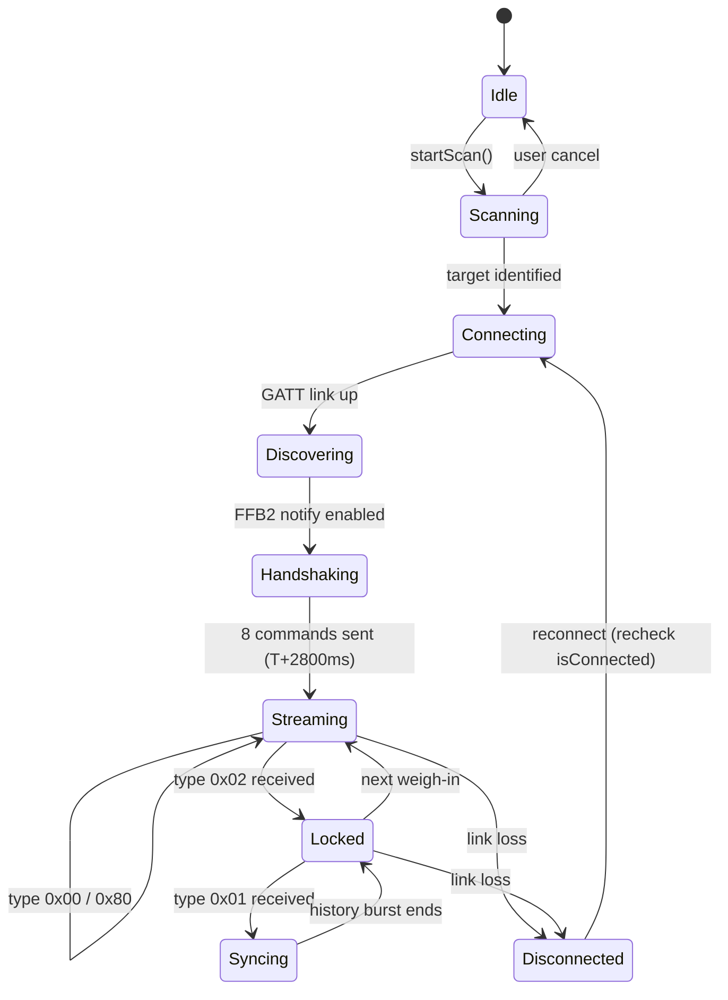

# AFU-WL-TZ-A1 · BLE Protocol Technical Specification

**Document type**: Implementation Specification  
**Target audience**: professional developers who need to implement a client from scratch or audit this implementation  
**Normative level**: every item is marked `MUST` / `SHOULD` / `MAY`, following RFC 2119 semantics  
**Reference implementation**: `lib/core/protocol.dart` · `lib/ble/scale_ble.dart` (Flutter/Dart)  
**Evidence system**: `[HCI]` official app HCI capture · `[OTA]` on-machine BLE over-the-air capture · `[SRC]` reference implementation source · `[T]` controlled experiment

> The teaching-oriented document on the same subject is [PROTOCOL.md](PROTOCOL.md) (plain-language edition). This document does not repeat the concept explanations, it gives the specification only.

---

## 0. Terms and symbols

| Notation | Meaning |
| --- | --- |
| `d[n]` | byte n of the notification payload (0-based) |
| `f[n]` | byte n of the frame (0-based); the frame length is always 20 |
| `>>n` / `<<n` | shift right / shift left by n bits (unsigned) |
| `\|` | bitwise OR (used to concatenate bit fields) |
| `&` | bitwise AND (used for mask extraction) |
| `0xNN` | hexadecimal literal |
| LE / BE | Little-Endian / Big-Endian |
| PDU | Protocol Data Unit; here it means one 20-byte payload frame |
| T_HS | total duration of the handshake sequence; the implementation takes 8 × 400ms ≈ 3.2s |

---

## 1. Discovery layer

### 1.1 Advertising PDU composition

| Field | AD Type | Value | Normativity | Evidence |
| --- | --- | --- | --- | --- |
| Flags | `0x01` | standard | — | OTA |
| Complete Local Name | `0x09` | `AFU-WL-TZ-A1` | MUST for identity matching | OTA |
| Complete List of 16-bit Service UUIDs | `0x03` | `0xFFB0`, `0x1530` | MAY for identity matching | OTA |
| Manufacturer Specific Data | `0xFF` | Company ID `0x27AC` (LE: `AC 27`) + payload | MAY | OTA |
| Service Data - 16-bit UUID | `0x16` | UUID `0x27AC` (LE: `AC 27`) + 6B MAC (reversed) + `0x01` | **MUST for extracting the real address** | OTA |

### 1.2 Real address extraction (critical)

The advertised address (`peripheral.remoteId`) **is not guaranteed to equal the device's static MAC**. The real MAC comes from Service Data:

```
Service Data AD layout:
  [0] = 0x16                      // AD Type: Service Data 16-bit
  [1] = 0xAC, [2] = 0x27          // Service UUID 0x27AC (LE)
  [3] = 0x24 [4] = 0x76 [5] = 0x07
  [6] = 0xAB [7] = 0x82 [8] = 0xB0   // ← 6 bytes, in reverse MAC order
  [9] = 0x01                      // fixed marker

Recovery algorithm:
  mac = reverse(serviceData[3..8])
  → B0:82:AB:07:76:24
```

- `MUST` reverse the 6 bytes before formatting; reading them in order yields the wrong address.
- `MUST NOT` assume that a Manufacturer Data prefix exists (`[SRC]` the WeighTrace document claims an `AC 27` prefix; measured: none).

### 1.3 Scan strategy

| Parameter | Specification | Basis |
| --- | --- | --- |
| Service filter (`startScan([uuid])`) | `MUST NOT` be used | `[T]` 240s with no result on MIUI; full scan + callback filtering < 1s |
| Scan mode | full scan, three-way predicate on the callback side | `[T]` |
| Timeout | no hard timeout; the UI layer prompts the user to trigger a rescan after 5s | implementation convention |

Identity predicate (any single hit identifies the target device):

```
isTarget(scanResult) =
    scanResult.advertisementData.advName.contains("AFU-WL")
 || scanResult.advertisementData.serviceData.containsKey(Guid("27AC"))
 || scanResult.advertisementData.serviceUuids.contains(Guid("FFB0"))
```

### 1.4 Android platform constraints

| Constraint | Description | Workaround |
| --- | --- | --- |
| `neverForLocation` flag | `BLUETOOTH_SCAN` carrying this flag uses the system denylist, and this device's advertising is silently dropped | the Manifest `MUST NOT` declare this flag; the logcat symptom is `Skipping data matching denylist` |
| Permission combination | Android 12+ needs `BLUETOOTH_SCAN` + `BLUETOOTH_CONNECT`; ≤11 needs `ACCESS_FINE_LOCATION` | request at runtime, branching on `SDK_INT` |

---

## 2. Transport layer (GATT)

### 2.1 Service and characteristics

```
Primary Service 0000FFB0-0000-1000-8000-00805F9B34FB
├── Characteristic 0000FFB1-...   Properties: WRITE (with response)
│                                 Permissions: Write
└── Characteristic 0000FFB2-...   Properties: NOTIFY
                                  Permissions: Read
                                  CCCD: 00002902-...
```

### 2.2 Write mode constraint (implementation pitfall)

| Mode | Supported | Evidence |
| --- | --- | --- |
| `WRITE` (ATT_WRITE_REQ / with response) | ✅ required | `[T]` 8/8 succeeded |
| `WRITE_NO_RESPONSE` (ATT_WRITE_CMD) | ❌ throws `PlatformException(not supported)` | `[T]` 8/8 failed |

- `MUST` use write with response.
- Each write must wait for the GATT confirmation before the next one is sent; the interval `SHOULD >= 400ms` (below this value packet loss is occasionally observed).

### 2.3 Notification subscription

```
await characteristic.setNotifyValue(true);   // write CCCD = 0x0001
// all RX afterwards arrives through the onValueReceived callback, payload length always 20
```

- `MUST` complete the subscription **before** sending the handshake sequence, otherwise uplink packets during the handshake are lost (the scale does not buffer and resend them).

### 2.4 Auxiliary services

| Service | Characteristic | Value | Purpose |
| --- | --- | --- | --- |
| `0x180A` DIS | `0x2A29` | `ICOMON` | manufacturer |
| | `0x2A24` | `FG2313UWB-D` | model |
| | `0x2A26` | `1.2.3` | firmware version |
| | `0x2A28` | `1.3.0` | software version |
| `0x180F` BAS | `0x2A19` | — | **does not exist**; the value read back is meaningless (measured `77`) |

---

## 3. Frame encoding specification

### 3.1 Structure definition

```
 0                   1                   2                             18      19
 +--------+--------+-----------------------------------------+--------+--------+
 |  0xAC  | devType|            payload[16]                 |  tail  | cksum  |
 +--------+--------+-----------------------------------------+--------+--------+
 |<--------------------- 20 octets ------------------------->|
```

| Offset | Length | Field | Encoding | Description |
| --- | --- | --- | --- | --- |
| `f[0]` | 1 | SOF | `0xAC` fixed | start-of-frame marker |
| `f[1]` | 1 | DeviceType | TX `0x27` / RX `0x29` | the sender's own type, not the target's type |
| `f[2..17]` | 16 | Payload | command-dependent | excess length is truncated (`MUST` discard content beyond 16B) |
| `f[18]` | 1 | Tail | command identifier | related in meaning to `payload[0]` but **encoded independently** |
| `f[19]` | 1 | Checksum | `Σ f[2..18] mod 256` | **includes the tail, excludes itself** |

### 3.2 Checksum (normative definition)

```
checksum = (Σ f[i] for i in [2, 18]) & 0xFF
```

- `MUST` cover `f[2]` through `f[18]` (including the tail byte).
- `MUST NOT` cover `f[0]`, `f[1]`, `f[19]`.
- `MUST` run the same check on received frames and discard the PDU on mismatch (`SHOULD` log it but not retry).

### 3.3 Byte order conventions (command-specific, not global)

| Data field | Order | Position |
| --- | --- | --- |
| Unix timestamp (`08`, `D0`) | **BE** | `payload[1..4]` |
| History packet timestamp | **BE** | `d[3..6]` |
| Weight (realtime/stable packet) | differential encoding with BE semantics | `d[3..5]` |
| Weight (locked packet) | BE | `d[10..12]` |
| Impedance | BE | `d[4..5]` / `d[6..7]` (locked packet) |
| Weight (`01`/`D0` write) | **BE** | per the field definition |

> Weight has **two encodings**, differing in both position and offset; the implementation `MUST` handle them per packet type.
---

## 4. Command set specification (TX)

### 4.0 General constraints

| Item | Specification |
| --- | --- |
| Device type `f[1]` | `0x27` (not 0x29; with 0x29 impedance does not trigger) |
| Send interval | 400ms (MUST; packet loss is observed below this value) |
| Write mode | WRITE with response (see §2.2) |
| Payload limit | 16 bytes, excess truncated |
| Unused bytes | MUST be filled with `0x00` (not garbage) |

### 4.1 Command 08 time sync (tail 0xDF)

```
f[2..7] = 08  t3  t2  t1  t0  tz
            |   +-------+----+   +-- UTC offset/15 min, u8
            |       +------------- Unix timestamp (seconds), u32 BE
            +--------------------- subcommand 0x08
f[8..17] = all 0x00
f[18] = 0xDF      f[19] = checksum
```

| Field | Offset | Length | Encoding | Constraint |
| --- | --- | --- | --- | --- |
| subcmd | `p[0]` | 1 | `0x08` | fixed |
| timestamp | `p[1..4]` | 4 | u32 BE | Unix epoch seconds |
| utcQuarters | `p[5]` | 1 | u8 | `(utcOffsetMinutes / 15) & 0xFF` |

**utcQuarters worked examples**

```
utcQuarters = truncate(utcOffsetMinutes / 15) & 0xFF

China  UTC+8    = +480 min   ->  480/15 = 32  = 0x20
Japan  UTC+9    = +540 min   ->  540/15 = 36  = 0x24
Nepal  UTC+5:45 = +345 min   ->  345/15 = 23  = 0x17
```

### 4.2 Command 01 user information (tail 0xD1)

```
f[2..9] = 01  00  01  HH  WH  WL  AA  SS
            |   |   |   |   +--+    |   +-- sex: 1=male 2=female
            |   |   |   |     |     +------ age u8
            |   |   |   |     +------------ weight x100, u16 BE
            |   |   |   +------------------ height cm, u8 truncated
            |   |   +---------------------- fixed 0x01
            |   +-------------------------- reserved 0x00
            +------------------------------ subcommand 0x01
```

| Field | Offset | Length | Value range | Encoding |
| --- | --- | --- | --- | --- |
| subcmd | `p[0]` | 1 | `0x01` | — |
| reserved | `p[1]` | 1 | `0x00` | — |
| magic | `p[2]` | 1 | `0x01` | fixed |
| height | `p[3]` | 1 | 1..255 | cm, **truncated** (168.6 -> 168) |
| weight | `p[4..5]` | 2 | 0..65535 | `round(kg * 100)`, u16 BE |
| age | `p[6]` | 1 | 1..255 | whole years |
| sex | `p[7]` | 1 | 1 / 2 | **1=male, 2=female** (not the boolean 0/1) |

- MUST use 1/2 rather than a boolean value; a sex mismatch shifts the whole body-fat algorithm.
- Weight source priority: member profile -> most recent measurement record -> 60kg fallback.
### 4.3 Command 02 user slots (tail 0xD1)

This command writes **two** user slots of 7 bytes each. The scale picks which slot's parameters to use by weight proximity.

```
f[2..17] = 02 00 | 01 h1 w1H w1L a1 s1 00 | 02 h2 w2H w2L a2 s2 00
           +--+--+  +----------+-----------+  +----------+-----------+
              |              |                           |
              |              +-- slot 1 (7 bytes)          +-- slot 2 (7 bytes)
              +-- subcommand 02 + reserved 00

payload is exactly 16 bytes, no room left
```

**Slot structure (7 bytes, both slots alike)**

| Offset in slot | Length | Field | Constraint |
| --- | --- | --- | --- |
| +0 | 1 | slotIndex | `0x01` (slot 1) / `0x02` (slot 2) |
| +1 | 1 | height | cm, u8 |
| +2..3 | 2 | weight | `round(kg*100)`, u16 BE |
| +4 | 1 | age | u8 |
| +5 | 1 | sex | 1=male / 2=female |
| +6 | 1 | reserved | `0x00` |

- SHOULD be filled with the real member parameters (compared with all zeros, this improves consistency with the scale's own screen).
- With a single member, both slots SHOULD carry the same parameters.
- The official app sends this command only when unbinding; this implementation sends it on every connection, to overwrite residual configuration inside the scale.
  See §8 for the potential side effects.

### 4.4 Command D0 full handshake (tail 0xD0)

A single frame carrying the whole context; it is the key frame that triggers the data stream.

```
f[2..17] = t3 t2 t1 t0 | tz | 00 | 01 | HH | WH WL | AA | SS | TH TL | 03 | 00
           ++--+--+--+   |    |    |    |    +-+-+   |    |    +-+-+   |   +-- reserved
                 |        |    |    |    |      |     |    |      |     +------ fixed 0x03
                 |        |    |    |    |      |     |    |      +------------ target weight x100, u16 BE
                 |        |    |    |    |      |     |    +------------------- sex
                 |        |    |    |    |      |     +------------------------ age
                 |        |    |    |    |      +------------------------------ weight x100, u16 BE
                 |        |    |    |    +------------------------------------- height cm
                 |        |    |    +------------------------------------------ slot 0x01
                 |        |    +----------------------------------------------- unit 0x00 = kg
                 |        +---------------------------------------------------- utcQuarters
                 +------------------------------------------------------------- Unix seconds u32 BE
```

| Offset | Length | Field | Encoding | Constraint |
| --- | --- | --- | --- | --- |
| `p[0..3]` | 4 | timestamp | u32 BE | Unix seconds |
| `p[4]` | 1 | utcQuarters | u8 | as in §4.1 |
| `p[5]` | 1 | unit | u8 | `0x00` = kg (other values unverified) |
| `p[6]` | 1 | slotIndex | u8 | `0x01` |
| `p[7]` | 1 | height | u8 | cm |
| `p[8..9]` | 2 | weight | u16 BE | kg x100 |
| `p[10]` | 1 | age | u8 | whole years |
| `p[11]` | 1 | sex | u8 | 1/2 |
| `p[12..13]` | 2 | targetWeight | u16 BE | kg x100, default `round(weight*0.75)` |
| `p[14]` | 1 | marker | u8 | `0x03` fixed |
| `p[15]` | 1 | reserved | u8 | `0x00` |
### 4.5 Command 06 configuration query (tail 0xDF)

```
f[2] = 0x06, f[3..17] = 0x00
```

Response: the scale pushes 5 packets with `type=0x06` in a row (`d[2]=0x06`, carrying indices 00..04); the content is highly repetitive and this implementation does not parse it.

### 4.6 Commands 04 D6 / 04 D8 (tail 0xDF)

```
f[2..3] = 04 D6   ->  raises the realtime packet rate (measured 26 -> 77 packets per measurement)
f[2..3] = 04 D8   ->  requests history records; this implementation sends it twice (redundant safety)
```

- **04 D6 is not an impedance switch**. In a controlled A/B comparison, with or without 04D6, impedance was 0 whenever there was no physical contact,
  and only a change in the realtime packet rate was observed. Impedance is determined by electrode continuity alone.
- 04 D8 is not a precondition for the history push (see the §6.4 trigger condition).

### 4.7 Timing of the complete command sequence

```
Time     Command        payload + tail
-------  ----------     ------------------------------------------
T+0ms    08 time sync   08 t3 t2 t1 t0 tz                    DF
T+400    01 user        01 00 01 HH WH WL AA SS              D1
T+800    02 slots       02 00 01 h1 w1H w1L a1 s1 00 02 ...  D1
T+1200   D0 handshake   t3 t2 t1 t0 tz 00 01 HH WH WL AA SS TH TL 03 00   D0
T+1600   06 query       06                                     DF
T+2000   04D6           04 D6                                  DF
T+2400   04D8 #1        04 D8                                  DF
T+2800   04D8 #2        04 D8                                  DF
```

- The order MUST follow this table exactly; without the `01` user frame, impedance does not trigger (controlled experiment).
- Each command MUST wait for the previous GATT write response before the next one is sent.

---

## 5. Notification packet specification (RX)

### 5.1 General discrimination

```
if d.length < 13 or d[0] != 0xAC:  DROP
pktType = d[2]
```

| `d[2]` | Type name | Trigger point | Frequency |
| --- | --- | --- | --- |
| `0x00` | realtime packet (Weighing / Realtime) | continuously once the measurement starts | 100~150ms (about 77 pkt per measurement after sending 04D6) |
| `0x80` | stable packet (Stable) | the weight reading has settled | low, followed by a switch to 0x02 |
| `0x02` | locked packet (Locked / Final) | measurement complete, carries the final impedance | repeats for about 6s |
| `0x01` | history packet (History) | pushed as needed once the handshake is complete | burst |
| `0x06` | config block (Config) | answer to the `06` query | 5 packets in a row |

### 5.2 `type=0x00` realtime packet

| Offset | Length | Field | Decoding formula |
| --- | --- | --- | --- |
| `d[3..5]` | 3 | weightRaw | `((d[3]-0x68)<<16 \| d[4]<<8 \| d[5])` |
| `d[8..9]` | 2 | adcRaw | a single group of raw ADC values (realtime stage, not the final impedance) |
| `d[11]` | 1 | batteryOrState | the low 7 bits are the battery level; the value `0x64`(100) means the measurement-complete state |

**Weight conversion**

```
weightKg = weightRaw / 1000
Note: this formula differs from the locked packet (offset 0x68 rather than 0x680000, position d[3..5])
```

**Battery acceptance condition**

```
if pktType == 0x00 and batteryRaw > 0 and batteryRaw < 100:
    battery = batteryRaw & 0x7F
else:
    ignore (during a measurement d[11] becomes the 0x64 status flag)
```

### 5.3 `type=0x80` stable packet

The structure is identical to `0x00`. `d[11] >= 100` is taken as entering the impedance measurement stage.

### 5.4 `type=0x02` locked packet (core)

```
offs:  0     1     2     3     4     5     6     7     8     9    10    11    12
     +-----+-----+-----+-----+-----+-----+-----+-----+-----+-----+-----+-----+-----+
     | AC  | 29  | 02  | ??  |  i1H|  i1L|  i2H|  i2L| ??  | ??  |  wH |  wL |  wL |
     +-----+-----+-----+-----+-----+-----+-----+-----+-----+-----+-----+-----+-----+
                                 +-----+-----+      +-----+-----+     +-----+-----+
                                   imped1              imped2             weight x3
```

| Field | Offset | Length | Decoding |
| --- | --- | --- | --- |
| impedance1 | `d[4..5]` | 2 | `(d[4]<<8) \| d[5]`, unit Ω |
| impedance2 | `d[6..7]` | 2 | `(d[6]<<8) \| d[7]`, unit Ω |
| weight | `d[10..12]` | 3 | `(((d[10]<<16) \| (d[11]<<8) \| d[12]) - 0x680000) / 1000` |

**Boundary conditions**

| Condition | Handling |
| --- | --- |
| `d.length < 13` | MUST discard |
| both impedances 0 | a valid state, meaning no electrode continuity; body composition cannot be computed |
| weightRaw < 0 | invalid, `MUST` discard (negative weight) |
| weightKg < 20 | treated as a light touch / invalid; `SHOULD` be flagged as an incomplete measurement |

**Test vectors** (measured captures)

```
input: ac 29 02 00 01 ae 01 83 01 80 68 d9 c6 ...
  impedance1 = (0x01<<8)|0xAE = 430
  impedance2 = (0x01<<8)|0x83 = 387
  weightRaw  = (0x68<<16)|(0xD9<<8)|0xC6 = 0x68D9C6 = 6871494
  weightRaw  = 6871494 - 0x680000(6815744) = 55750
  weightKg   = 55.75
output: impedance=[430,387], weight=55.75kg
```

### 5.5 `type=0x01` history packet

| Field | Offset | Length | Decoding |
| --- | --- | --- | --- |
| timestamp | `d[3..6]` | 4 | `(d[3]<<24 \| d[4]<<16 \| d[5]<<8 \| d[6])`, u32 BE, Unix seconds |
| weight | `d[8..10]` | 3 | `(((d[8]<<16) \| (d[9]<<8) \| d[10]) - 0x680000) / 1000` |
| impedance1 | `d[11..12]` | 2 | `(d[11]<<8) \| d[12]` |
| impedance2 | `d[13..14]` | 2 | `(d[13]<<8) \| d[14]` |

**Deduplication requirement**

```
The same logical record may be delivered up to 3 times (BLE retransmission).
The implementation MUST deduplicate on (timestamp, weightKg) as the idempotency key before storing.
```

### 5.6 `type=0x06` config block

Answers the `06` query, pushing 5 packets in a row, carrying the indices `d[?]=00..04`. This implementation does not parse it, it only logs it.
---

## 6. State machine and lifecycle



### 6.1 State transition conditions

| From | To | Condition | Notes |
| --- | --- | --- | --- |
| Idle | Scanning | triggered by the user | — |
| Scanning | Connecting | the identity predicate hits (§1.3) | MUST stop scanning before connecting, otherwise the connection often fails on Android |
| Connecting | Discovering | GATT link established + MTU negotiation complete | — |
| Discovering | Handshaking | FFB2 `setNotifyValue(true)` succeeded | MUST be completed before the handshake |
| Handshaking | Streaming | the 8th command was written successfully | about 2.8s in total |
| Streaming | Locked | `d[2]=0x02` received | the measurement session may end |
| Locked | Syncing | `d[2]=0x01` received | the history push may interleave with locked packets |
| any | Disconnected | GATT disconnect event | MUST re-check `isConnected`, see §8.3 |

### 6.2 Measurement phase determination (for the UI layer to consume)

```
phase = "done"        if lastPktType == 0x02
      = "impedance"   if lastPktType in (0x00, 0x80) and d[11] >= 100
      = "weighing"    otherwise
```

---

## 7. Summary of timing parameters

| Parameter | Value | Nature | Basis |
| --- | --- | --- | --- |
| Advertising interval | 999ms | device behaviour | OTA |
| Handshake command interval | 400ms | **implementation constraint** | controlled experiment; below this value packets are lost |
| Total handshake duration | ~2800ms | derived | 7 × 400ms |
| Realtime packet interval | 100~150ms | device behaviour | OTA (faster after sending 04D6) |
| Locked packet repetition | ~6s | device behaviour | OTA |
| First packet delay after connecting | 450ms | implementation choice | wait for the GATT to settle before sending the handshake |
| Notification timeout | 15s suggested | implementation choice | on timeout, prompt the user to retry |
| History packet batch interval | no fixed interval | device behaviour | burst push |

---

## 8. Known deviations and experimental design

### 8.1 deviceType value (`0x27` vs `0x29`)

| Value | Result | Basis |
| --- | --- | --- |
| `0x27` | works normally, impedance triggers | official HCI + this implementation |
| `0x29` | no impedance trigger observed | controlled experiment |

- `f[1]` MUST send `0x27`.
- Note that the default argument of `ScaleProtocol.frame()` is `0x29`; the caller MUST pass `0x27` explicitly (this implementation already does).

### 8.2 `02` user slots sent on every connection (experimental)

| Item | Description |
| --- | --- |
| official behaviour | sent only when unbinding the device |
| this implementation | sent on every connection |
| motivation | overwrite residual user configuration inside the scale (we once saw height stuck at 111cm and impossible to update) |
| risk | not fully assessed. If history records are observed being pushed again and again, this should be the prime suspect |
| fallback | change it to being sent only in the unbind flow |

### 8.3 Connection state flapping

At the instant the GATT is established, `connectionState` may briefly misreport `disconnected`.

```
Wrong: onDisconnected -> scheduleReconnect() immediately
  Consequence: the same session handshakes twice -> the scale treats it as a new sync session -> history is pushed again

Right: onDisconnected -> if (!isConnected) scheduleReconnect()
  plus a _connecting concurrency guard
```

### 8.4 Divergence over the checksum range

| Source | Range | Result |
| --- | --- | --- |
| some reference documents | `Σ f[2..17]` (payload only) | checksum fails |
| measured correct | `Σ f[2..18]` (**including the tail**) | passes |

### 8.5 Reading the battery level

| Source | Value | Trustworthy |
| --- | --- | --- |
| BAS `0x2A19` | 77% | no (the service does not exist, the returned value is meaningless) |
| realtime packet `d[11] & 0x7F` | 10% | yes (mode across 915 samples) |

### 8.6 History records cannot be deleted

All 29 official write commands have been audited in full; **no** delete or clear instruction exists.

```
Consequence: once the scale marks a record synced, no client can ever fetch it again.
Constraint: the client MUST avoid an abnormal exit during the connection lifetime, otherwise the record is lost permanently.
```

---

## 9. Compatibility matrix

| Dimension | Verified | Unverified |
| --- | --- | --- |
| scale model | AFU-WL-TZ-A1 (FG2313UWB-D) | other ICOMON models |
| firmware | 1.2.3 / software 1.3.0 | other versions |
| Android | 12~15 (measured on MIUI/HyperOS) | other vendor-customised ROMs |
| BLE library | flutter_blue_plus 1.35 | react-native-ble-plx (performance does not meet the requirement, see §10.2) |
| language / platform | Flutter (Android) | iOS (the protocol layer is reusable, the BLE layer must be rewritten) |

---

## 10. Conformance test checklist

An implementation that completes the following items can be considered conformant with this specification:

### 10.1 Discovery and connection

- [ ] the advertising name parses to `AFU-WL-TZ-A1`
- [ ] Service Data reversed yields the correct MAC
- [ ] the device is still discovered within 5s without UUID pre-filtering
- [ ] `neverForLocation` is not declared and the scan shows no denylist entry
- [ ] the FFB2 notification is subscribed successfully before the handshake

### 10.2 Frame encoding

- [ ] the frame length is always 20 bytes, `f[0]=0xAC`
- [ ] `f[1]=0x27`
- [ ] the checksum covers `f[2..18]`
- [ ] a payload longer than 16 bytes is truncated

### 10.3 Command sequence

- [ ] the 8 commands are in the correct order
- [ ] the gap between adjacent commands >= 400ms
- [ ] every write uses write with response
- [ ] the sex field of the `01` frame uses 1/2
- [ ] `p[14]=0x03` in the `D0` frame

### 10.4 Parsing

- [ ] the locked packet test vector reproduces `55.75kg` / `[430, 387]Ω`
- [ ] the realtime packet weight formula agrees with the locked packet (within one measurement)
- [ ] history packet timestamps are parsed as u32 BE
- [ ] history packets are deduplicated by `(timestamp, weight)`
- [ ] the battery level is taken only from `type=0x00` with `d[11] < 100`
- [ ] when impedance is 0, no body composition is computed and the measurement is flagged incomplete

### 10.5 Lifecycle

- [ ] `isConnected` is re-checked before reconnecting, so no double handshake occurs
- [ ] all parsed records are persisted before the connection exits abnormally

---

## 11. Minimal reference implementation skeleton

```dart
// frame encoding
Uint8List frame(List<int> payload, {required int tail}) {
  final f = Uint8List(20);
  f[0] = 0xAC;
  f[1] = 0x27;                                  // note: not 0x29
  for (var i = 0; i < payload.length && i + 2 < 18; i++) {
    f[2 + i] = payload[i] & 0xFF;
  }
  f[18] = tail;
  var sum = 0;
  for (var i = 2; i < 19; i++) sum = (sum + f[i]) & 0xFF;   // includes the tail
  f[19] = sum;
  return f;
}

// locked packet parsing
({double weightKg, int i1, int i2})? parseLocked(Uint8List d) {
  if (d.length < 13 || d[0] != 0xAC || d[2] != 0x02) return null;
  final i1 = (d[4] << 8) | d[5];
  final i2 = (d[6] << 8) | d[7];
  final raw = ((d[10] << 16) | (d[11] << 8) | d[12]) - 0x680000;
  if (raw < 0) return null;
  return (weightKg: raw / 1000, i1: i1, i2: i2);
}
```

---

## 12. Correspondence with the teaching edition

| Section of this specification | Section of the teaching edition |
| --- | --- |
| §1 discovery layer | PROTOCOL.md §2 finding it in the air |
| §2 transport layer | PROTOCOL.md §3 getting the two mailboxes |
| §3 frame encoding | PROTOCOL.md §4 the envelope format |
| §4 command set | PROTOCOL.md §5 the eight commands |
| §5 notification packets | PROTOCOL.md §6 reading what the scale says back |
| §6 state machine | PROTOCOL.md §7 the complete timeline |
| §8 known deviations | PROTOCOL.md §8 the ten pitfalls |
| §10 test checklist | — (absent from the teaching edition) |
