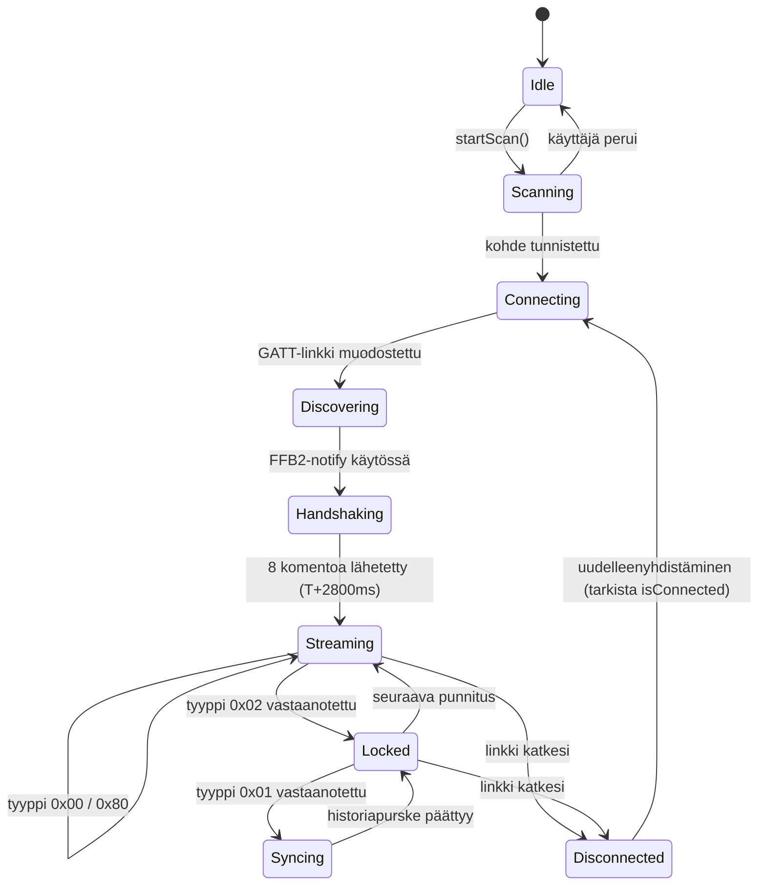

# AFU-WL-TZ-A1 · BLE-protokollan tekninen spesifikaatio

**Dokumenttityyppi**: toteutusspesifikaatio (Implementation Specification)  
**Kohdeyleisö**: ammattikehittäjät, joiden on toteutettava asiakasohjelma tyhjästä tai auditoitava tämä toteutus  
**Normatiivisuustaso**: jokainen kohta on merkitty `MUST` (pakollinen) / `SHOULD` (suositeltu) / `MAY` (valinnainen) RFC 2119 -semantiikan mukaisesti  
**Viitetoteutus**: `lib/core/protocol.dart` · `lib/ble/scale_ble.dart` (Flutter/Dart)  
**Todistejärjestelmä**: `[HCI]` virallisen sovelluksen HCI-kaappaus · `[OTA]` paikallisen laitteen BLE-ilmarajapintakaappaus · `[SRC]` viitetoteutuksen lähdekoodi · `[T]` kontrolloitu koe

> Opettavainen dokumentti samasta aiheesta: [PROTOCOL.md](PROTOCOL.md) (kansantajuinen versio). Tämä dokumentti ei toista käsitteiden selityksiä, vaan antaa vain spesifikaation.

---

## 0. Termit ja merkinnät

| Merkintä | Merkitys |
| --- | --- |
| `d[n]` | ilmoituksen hyötykuorman tavu n (0-pohjainen) |
| `f[n]` | kehyksen tavu n (0-pohjainen), kehyksen pituus aina 20 |
| `>>n` / `<<n` | siirto oikealle / vasemmalle n bittiä (etumerkitön) |
| `\|` | bittitai (bittikenttien yhdistämiseen) |
| `&` | bittija (maskin poimintaan) |
| `0xNN` | heksadesimaaliliteraali |
| LE / BE | Little-Endian / Big-Endian |
| PDU | Protocol Data Unit, tässä yhden kehyksen 20 tavun hyötykuorma |
| T_HS | kättelysekvenssin kokonaiskesto, toteutuksessa 8 × 400ms ≈ 3.2s |

---

## 1. Löytökerros (Discovery)

### 1.1 Mainonta-PDU:n rakenne

| Kenttä | AD Type | Arvo | Normatiivisuus | Todiste |
| --- | --- | --- | --- | --- |
| Flags | `0x01` | standardi | — | OTA |
| Complete Local Name | `0x09` | `AFU-WL-TZ-A1` | MUST identiteetin määritykseen | OTA |
| Complete List of 16-bit Service UUIDs | `0x03` | `0xFFB0`, `0x1530` | MAY identiteetin määritykseen | OTA |
| Manufacturer Specific Data | `0xFF` | Company ID `0x27AC` (LE: `AC 27`) + hyötykuorma | MAY | OTA |
| Service Data - 16-bit UUID | `0x16` | UUID `0x27AC` (LE: `AC 27`) + 6 tavua MAC (käänteisenä) + `0x01` | **MUST todellisen osoitteen poimintaan** | OTA |

### 1.2 Todellisen osoitteen poiminta (kriittinen)

Laitteen mainontaosoite (`peripheral.remoteId`) **ei ole taatusti sama kuin laitteen staattinen MAC**. Todellinen MAC otetaan Service Datasta:

```
Service Data AD -rakenne:
  [0] = 0x16                      // AD Type: Service Data 16-bit
  [1] = 0xAC, [2] = 0x27          // Service UUID 0x27AC (LE)
  [3] = 0x24 [4] = 0x76 [5] = 0x07
  [6] = 0xAB [7] = 0x82 [8] = 0xB0   // ← 6 tavua, järjestys on MACin käänteinen
  [9] = 0x01                      // kiinteä lippu

palautusalgoritmi:
  mac = reverse(serviceData[3..8])
  → AA:BB:CC:DD:EE:FF
```

- `MUST` kääntää 6 tavua ennen muotoilua, suoraan peräkkäin lukemalla saa väärän osoitteen.
- `MUST NOT` olettaa Manufacturer Datan etuliitettä (WeighTrace-dokumentaatio väittää sen sisältävän `AC 27` -etuliitteen, mitattuna sellaista ei ole). `[SRC]`

### 1.3 Skannausstrategia

| Parametri | Spesifikaatio | Peruste |
| --- | --- | --- |
| Palvelusuodatus (`startScan([uuid])`) | `MUST NOT` käyttää | `[T]` MIUI:ssa 240s ilman tulosta; täysi skannaus + callback-suodatus < 1s |
| Skannaustila | täysi skannaus, callback-puolella kolmiterminen predikaatti | `[T]` |
| Aikakatkaisu | ei kovaa aikakatkaisua; UI-kerros ilmoittaa käyttäjälle 5s jälkeen ja kehottaa uudelleenskannaukseen | toteutussopimus |

Identiteettipredikaatti (mikä tahansa osuma riittää kohdelaitteeksi):

```
isTarget(scanResult) =
    scanResult.advertisementData.advName.contains("AFU-WL")
 || scanResult.advertisementData.serviceData.containsKey(Guid("27AC"))
 || scanResult.advertisementData.serviceUuids.contains(Guid("FFB0"))
```

### 1.4 Android-alustan rajoitteet

| Rajoite | Selitys | Kierto |
| --- | --- | --- |
| `neverForLocation`-lippu | lipun kantava `BLUETOOTH_SCAN` käyttää järjestelmän denylistiä, tämän laitteen mainonta pudotetaan hiljaisesti | Manifestissa `MUST NOT` julistaa tätä lippua; logcat-oire `Skipping data matching denylist` |
| Lupayhdistelmä | Android 12+ vaatii `BLUETOOTH_SCAN` + `BLUETOOTH_CONNECT`; ≤11 vaatii `ACCESS_FINE_LOCATION` | ajonaikainen pyyntö `SDK_INT`-haaran mukaan |

---

## 2. Siirtokerros (GATT)

### 2.1 Palvelu ja ominaisuudet

```
Primary Service 0000FFB0-0000-1000-8000-00805F9B34FB
├── Characteristic 0000FFB1-...   Properties: WRITE (with response)
│                                 Permissions: Write
└── Characteristic 0000FFB2-...   Properties: NOTIFY
                                  Permissions: Read
                                  CCCD: 00002902-...
```

### 2.2 Kirjoitustilan rajoite (toteutusansa)

| Tila | Tuki | Todiste |
| --- | --- | --- |
| `WRITE` (ATT_WRITE_REQ / vastauksella) | ✅ pakollinen | `[T]` 8/8 onnistui |
| `WRITE_NO_RESPONSE` (ATT_WRITE_CMD) | ❌ heittää `PlatformException(not supported)` | `[T]` 8/8 epäonnistui |

- `MUST` käyttää vastauksella tehtävää kirjoitusta.
- Jokainen kirjoitus odottaa GATT-kuittausta ennen seuraavaa, väli `SHOULD >= 400ms` (mitattuna tämän alle paketteja hukkui satunnaisesti).

### 2.3 Ilmoituksen tilaus

```
await characteristic.setNotifyValue(true);   // kirjoita CCCD = 0x0001
// tämän jälkeen kaikki RX tulee onValueReceived-callbackin kautta, hyötykuorman pituus aina 20
```

- `MUST` suorittaa tilaus **ennen** kättelysekvenssin lähettämistä, muuten kättelyn aikaiset uplink-paketit hukkuvat (vaaka ei puskuroi eikä lähetä uudelleen).

### 2.4 Avustavat palvelut

| Palvelu | Ominaisuus | Arvo | Käyttö |
| --- | --- | --- | --- |
| `0x180A` DIS | `0x2A29` | `ICOMON` | valmistaja |
| | `0x2A24` | `FG2313UWB-D` | malli |
| | `0x2A26` | `1.2.3` | laiteohjelmistoversio |
| | `0x2A28` | `1.3.0` | ohjelmistoversio |
| `0x180F` BAS | `0x2A19` | — | **ei ole olemassa**, luettu arvo on merkityksetön (mitattuna `77`) |

---

## 3. Kehyksen koodaus

### 3.1 Rakenteen määritelmä

```
 0                   1                   2                             18      19
 +--------+--------+-----------------------------------------+--------+--------+
 |  0xAC  | devType|            payload[16]                 |  tail  | cksum  |
 +--------+--------+-----------------------------------------+--------+--------+
 |<--------------------- 20 octets ------------------------->|
```

| Siirtymä | Pituus | Kenttä | Koodaus | Selitys |
| --- | --- | --- | --- | --- |
| `f[0]` | 1 | SOF | `0xAC` kiinteä | kehyksen aloitusmerkki |
| `f[1]` | 1 | DeviceType | TX `0x27` / RX `0x29` | lähettäjän oma tyyppi, ei kohteen tyyppi |
| `f[2..17]` | 16 | Payload | komentokohtainen | ylimenevä osa katkaistaan (`MUST` hylätä yli 16B sisältö) |
| `f[18]` | 1 | Tail | komennon tunniste | liittyy `payload[0]`:aan mutta on **erikseen koodattu** |
| `f[19]` | 1 | Checksum | `Σ f[2..18] mod 256` | **sisältää tailin, ei itseään** |

### 3.2 Tarkistussumma (normatiivinen määritelmä)

```
checksum = (Σ f[i] for i in [2, 18]) & 0xFF
```

- `MUST` kattaa `f[2]`–`f[18]` (sisältäen häntätavun).
- `MUST NOT` kattaa `f[0]`, `f[1]`, `f[19]`.
- `MUST` tehdä sama tarkistus vastaanotetuille kehyksille, epätäsmäävä PDU hylätään (`SHOULD` kirjata lokiin mutta ei yrittää uudelleen).

### 3.3 Tavujärjestyssopimus (komentokohtainen, ei globaali)

| Data-alue | Järjestys | Sijainti |
| --- | --- | --- |
| Unix-aikaleima (`08`, `D0`) | **BE** | `payload[1..4]` |
| historiapaketin aikaleima | **BE** | `d[3..6]` |
| paino (reaaliaika/vakaa paketti) | BE-semantiikan erotuskoodaus | `d[3..5]` |
| paino (lukittu paketti) | BE | `d[10..12]` |
| impedanssi | BE | `d[4..5]` / `d[6..7]` (lukittu paketti) |
| paino (`01`/`D0` kirjoitus) | **BE** | kenttämääritelmän mukaan |

> Painolle on **kaksi koodausta**, sekä sijainti että poikkeama eroavat, toteutuksen `MUST` käsitellä ne pakettityypeittäin.
---

## 4. Komentojoukon spesifikaatio (TX)

### 4.0 Yleiset rajoitteet

| Kohta | Spesifikaatio |
| --- | --- |
| laitetyyppi `f[1]` | `0x27` (ei 0x29; 0x29:llä impedanssi ei laukea) |
| lähetysväli | 400ms (MUST, tämän alle havaittiin pakettihäviötä) |
| kirjoitustila | WRITE with response (ks. §2.2) |
| hyötykuorman yläraja | 16 tavua, ylimenevä katkaistaan |
| käyttämättömät tavut | MUST täyttää `0x00` (ei roskatavuja) |

### 4.1 Komento 08 aikasynkronointi (tail 0xDF)

```
f[2..7] = 08  t3  t2  t1  t0  tz
            |   +-------+----+   +-- UTC-poikkeama/15 min, u8
            |       +------------- Unix-aikaleima (s), u32 BE
            +--------------------- alikomento 0x08
f[8..17] = kaikki 0x00
f[18] = 0xDF      f[19] = checksum
```

| Kenttä | Siirtymä | Pituus | Koodaus | Rajoite |
| --- | --- | --- | --- | --- |
| subcmd | `p[0]` | 1 | `0x08` | kiinteä |
| timestamp | `p[1..4]` | 4 | u32 BE | Unix epoch -sekunnit |
| utcQuarters | `p[5]` | 1 | u8 | `(utcOffsetMinutes / 15) & 0xFF` |

**utcQuarters-laskentaesimerkki**

```
utcQuarters = truncate(utcOffsetMinutes / 15) & 0xFF

Kiina    UTC+8    = +480 min   ->  480/15 = 32  = 0x20
Japani   UTC+9    = +540 min   ->  540/15 = 36  = 0x24
Nepal    UTC+5:45 = +345 min   ->  345/15 = 23  = 0x17
```

### 4.2 Komento 01 käyttäjätiedot (tail 0xD1)

```
f[2..9] = 01  00  01  HH  WH  WL  AA  SS
            |   |   |   |   +--+    |   +-- sukupuoli: 1=mies 2=nainen
            |   |   |   |     |     +------ ikä u8
            |   |   |   |     +------------ paino x100, u16 BE
            |   |   |   +------------------ pituus cm, u8 kokonaislukuna
            |   |   +---------------------- kiinteä 0x01
            |   +-------------------------- varattu 0x00
            +------------------------------ alikomento 0x01
```

| Kenttä | Siirtymä | Pituus | Arvoalue | Koodaus |
| --- | --- | --- | --- | --- |
| subcmd | `p[0]` | 1 | `0x01` | — |
| reserved | `p[1]` | 1 | `0x00` | — |
| magic | `p[2]` | 1 | `0x01` | kiinteä |
| height | `p[3]` | 1 | 1..255 | cm, **kokonaisluvuksi katkaisten** (165.4 -> 165) |
| weight | `p[4..5]` | 2 | 0..65535 | `round(kg * 100)`, u16 BE |
| age | `p[6]` | 1 | 1..255 | kokonaiset vuodet |
| sex | `p[7]` | 1 | 1 / 2 | **1=mies, 2=nainen** (ei boolean 0/1) |

- MUST käyttää arvoja 1/2 eikä boolean-arvoa, sukupuolen väärä asetus siirtää koko rasva-algoritmia.
- Painon lähdeprioriteetti: jäsenprofiili -> viimeisin mittaus -> 60kg varalla.
### 4.3 Komento 02 käyttäjäpaikat (tail 0xD1)

Tämä komento kirjoittaa **kaksi** käyttäjäpaikkaa, kussakin 7 tavua. Vaaka valitsee painon läheisyyden perusteella, kumman paikan parametreja käytetään.

```
f[2..17] = 02 00 | 01 h1 w1H w1L a1 s1 00 | 02 h2 w2H w2L a2 s2 00
           +--+--+  +----------+-----------+  +----------+-----------+
              |              |                           |
              |              +-- paikka 1 (7 tavua)      +-- paikka 2 (7 tavua)
              +-- alikomento 02 + varattu 00

hyötykuorma on tasan 16 tavua, ei jää tilaa
```

**Paikan rakenne (7 tavua, molemmat paikat samanrakenteisia)**

| Paikan siirtymä | Pituus | Kenttä | Rajoite |
| --- | --- | --- | --- |
| +0 | 1 | slotIndex | `0x01` (paikka 1) / `0x02` (paikka 2) |
| +1 | 1 | height | cm, u8 |
| +2..3 | 2 | weight | `round(kg*100)`, u16 BE |
| +4 | 1 | age | u8 |
| +5 | 1 | sex | 1=mies / 2=nainen |
| +6 | 1 | reserved | `0x00` |

- SHOULD täyttää todelliset jäsenparametrit (verrattuna pelkkiin nolliin se parantaa vaa'an näytön yhdenmukaisuutta).
- Yhden jäsenen tapauksessa molempiin paikkoihin SHOULD kirjoittaa samat parametrit.
- Virallinen sovellus lähettää tämän komennon vain irrotuksessa; tämä toteutus lähettää sen joka yhteydellä ylittääkseen vaa'assa olevat jäänteet.
  Mahdolliset sivuvaikutukset ks. §8.

### 4.4 Komento D0 täysi kättely (tail 0xD0)

Yksi kehys kantaa koko kontekstin; se on datavirran laukaiseva avainkehys.

```
f[2..17] = t3 t2 t1 t0 | tz | 00 | 01 | HH | WH WL | AA | SS | TH TL | 03 | 00
           ++--+--+--+   |    |    |    |    +-+-+   |    |    +-+-+   |   +-- varattu
                 |        |    |    |    |      |     |    |      |     +------ kiinteä 0x03
                 |        |    |    |    |      |     |    |      +------------ tavoitepaino x100, u16 BE
                 |        |    |    |    |      |     |    +------------------- sukupuoli
                 |        |    |    |    |      |     +------------------------ ikä
                 |        |    |    |    |      +------------------------------ paino x100, u16 BE
                 |        |    |    |    +------------------------------------- pituus cm
                 |        |    |    +------------------------------------------ paikka 0x01
                 |        |    +----------------------------------------------- yksikkö 0x00 = kg
                 |        +---------------------------------------------------- utcQuarters
                 +------------------------------------------------------------- Unix-s u32 BE
```

| Siirtymä | Pituus | Kenttä | Koodaus | Rajoite |
| --- | --- | --- | --- | --- |
| `p[0..3]` | 4 | timestamp | u32 BE | Unix-s |
| `p[4]` | 1 | utcQuarters | u8 | kuten §4.1 |
| `p[5]` | 1 | unit | u8 | `0x00` = kg (muut arvot vahvistamatta) |
| `p[6]` | 1 | slotIndex | u8 | `0x01` |
| `p[7]` | 1 | height | u8 | cm |
| `p[8..9]` | 2 | weight | u16 BE | kg x100 |
| `p[10]` | 1 | age | u8 | kokonaiset vuodet |
| `p[11]` | 1 | sex | u8 | 1/2 |
| `p[12..13]` | 2 | targetWeight | u16 BE | kg x100, oletus `round(weight*0.75)` |
| `p[14]` | 1 | marker | u8 | `0x03` kiinteä |
| `p[15]` | 1 | reserved | u8 | `0x00` |
### 4.5 Komento 06 asetuskysely (tail 0xDF)

```
f[2] = 0x06，f[3..17] = 0x00
```

Vastaus: vaaka työntää peräkkäin 5 `type=0x06` -pakettia (`d[2]=0x06`, sisältää indeksin 00..04), sisältö on pitkälti toistuvaa, tämä toteutus ei jäsennä sitä.

### 4.6 Komento 04 D6 / 04 D8 (tail 0xDF)

```
f[2..3] = 04 D6   ->  nostaa reaaliaikapakettien tahtia (mitattuna 26 -> 77 pakettia/mittaus)
f[2..3] = 04 D8   ->  pyytää historiatietueet; tämä toteutus lähettää kahdesti (redundantti varmistus)
```

- **04 D6 ei ole impedanssikytkin**. Kontrolloitu A/B-vertailukoe: 04D6:n kanssa tai ilman, ilman fyysistä kontaktia impedanssi oli aina 0,
  vain reaaliaikapakettien tahti muuttui. Impedanssin määrää vain elektrodien johtavuus.
- 04 D8 ei ole historian työntämisen välttämätön ehto (ks. §6.4 laukaisuehto).

### 4.7 Koko komentosekvenssin ajoitus

```
hetki     komento      payload + tail
-------  ----------   ------------------------------------------
T+0ms    08 aikasynk   08 t3 t2 t1 t0 tz                    DF
T+400    01 käyttäjä   01 00 01 HH WH WL AA SS              D1
T+800    02 paikat     02 00 01 h1 w1H w1L a1 s1 00 02 ...  D1
T+1200   D0 kättely    t3 t2 t1 t0 tz 00 01 HH WH WL AA SS TH TL 03 00   D0
T+1600   06 kysely     06                                     DF
T+2000   04D6         04 D6                                  DF
T+2400   04D8 #1      04 D8                                  DF
T+2800   04D8 #2      04 D8                                  DF
```

- Järjestys MUST noudattaa tarkalleen tätä taulukkoa; ilman `01` käyttäjäkehystä impedanssi ei laukea (kontrolloitu koe).
- Jokainen MUST odottaa edellisen GATT-kirjoitusvastauksen ennen seuraavan lähettämistä.

---

## 5. Ilmoituspakettien spesifikaatio (RX)

### 5.1 Yleinen tunnistus

```
if d.length < 13 or d[0] != 0xAC:  DROP
pktType = d[2]
```

| `d[2]` | Tyypin nimi | Laukaisuhetki | Tahti |
| --- | --- | --- | --- |
| `0x00` | reaaliaikapaketti (Weighing / Realtime) | jatkuu mittauksen alettua | 100~150ms (04D6:n jälkeen noin 77 pkt/mittaus) |
| `0x80` | vakaa paketti (Stable) | painolukema vakiintuu | harva, sen jälkeen siirtyy 0x02:een |
| `0x02` | lukittu paketti (Locked / Final) | mittaus valmis, sisältää lopullisen impedanssin | toisto noin 6s |
| `0x01` | historiapaketti (History) | kättelyn jälkeen tarpeen mukaan | purske |
| `0x06` | asetuskortti (Config) | vastaa `06`-kyselyyn | 5 pakettia peräkkäin |

### 5.2 `type=0x00` reaaliaikapaketti

| Siirtymä | Pituus | Kenttä | Purku kaava |
| --- | --- | --- | --- |
| `d[3..5]` | 3 | weightRaw | `((d[3]-0x68)<<16 \| d[4]<<8 \| d[5])` |
| `d[8..9]` | 2 | adcRaw | yhden ryhmän ADC-raaka-arvo (reaaliaikavaihe, ei lopullinen impedanssi) |
| `d[11]` | 1 | batteryOrState | 7 alinta bittiä = varaus; arvo `0x64`(100) ilmaisee mittauksen valmistumistilan |

**Painon muunnos**

```
weightKg = weightRaw / 1000
huom: tämä kaava eroaa lukitun paketin kaavasta (poikkeama 0x68 eikä 0x680000, sijainti d[3..5])
```

**Varauksen hyväksymisehdot**

```
if pktType == 0x00 and batteryRaw > 0 and batteryRaw < 100:
    battery = batteryRaw & 0x7F
else:
    ohita (mittauksen aikana d[11] muuttuu 0x64-tilalipuksi)
```

### 5.3 `type=0x80` vakaa paketti

Rakenne sama kuin `0x00`. `d[11] >= 100` tulkitaan siirtymäksi impedanssimittausvaiheeseen.

### 5.4 `type=0x02` lukittu paketti (ydin)

```
tavut   0     1     2     3     4     5     6     7     8     9    10    11    12
     +-----+-----+-----+-----+-----+-----+-----+-----+-----+-----+-----+-----+-----+
     | AC  | 29  | 02  | ??  |  i1H|  i1L|  i2H|  i2L| ??  | ??  |  wH |  wL |  wL |
     +-----+-----+-----+-----+-----+-----+-----+-----+-----+-----+-----+-----+-----+
                                 +-----+-----+      +-----+-----+     +-----+-----+
                                 impedanssi 1       impedanssi 2        paino x3
```

| Kenttä | Siirtymä | Pituus | Purku |
| --- | --- | --- | --- |
| impedance1 | `d[4..5]` | 2 | `(d[4]<<8) \| d[5]`, yksikkö Ω |
| impedance2 | `d[6..7]` | 2 | `(d[6]<<8) \| d[7]`, yksikkö Ω |
| weight | `d[10..12]` | 3 | `(((d[10]<<16) \| (d[11]<<8) \| d[12]) - 0x680000) / 1000` |

**Rajaehdot**

| Ehto | Käsittely |
| --- | --- |
| `d.length < 13` | MUST hylätä |
| impedanssit molemmat 0 | kelvollinen tila, merkitsee ettei elektrodijohtavuutta ole, kehonkoostumusta ei voi laskea |
| weightRaw < 0 | laiton, `MUST` hylätä (negatiivinen paino) |
| weightKg < 20 | tulkitaan kevyeksi astumiseksi tai kelvottomaksi, `SHOULD` merkitä puutteelliseksi mittaukseksi |

**Testivektori** (mitattu kaappaus)

```
tulo: ac 29 02 00 01 ae 01 83 01 80 68 d9 c6 ...
  impedance1 = (0x01<<8)|0xAE = 430
  impedance2 = (0x01<<8)|0x83 = 387
  weightRaw  = (0x68<<16)|(0xD9<<8)|0xC6 = 0x68D9C6 = 6871494
  weightRaw  = 6871494 - 0x680000(6815744) = 55750
  weightKg   = 55.75
tulos: impedance=[430,387], weight=55.75kg
```

### 5.5 `type=0x01` historiapaketti

| Kenttä | Siirtymä | Pituus | Purku |
| --- | --- | --- | --- |
| timestamp | `d[3..6]` | 4 | `(d[3]<<24 \| d[4]<<16 \| d[5]<<8 \| d[6])`, u32 BE, Unix-s |
| weight | `d[8..10]` | 3 | `(((d[8]<<16) \| (d[9]<<8) \| d[10]) - 0x680000) / 1000` |
| impedance1 | `d[11..12]` | 2 | `(d[11]<<8) \| d[12]` |
| impedance2 | `d[13..14]` | 2 | `(d[13]<<8) \| d[14]` |

**Duplikaattien poistovaatimus**

```
sama looginen tietue voidaan toimittaa enintään 3 kertaa (BLE-uudelleenlähetys).
toteutuksen MUST poistaa duplikaatit avaimella (timestamp, weightKg) ennen tallennusta.
```

### 5.6 `type=0x06` asetuskortti

Vastaa `06`-kyselyyn, työntää 5 pakettia peräkkäin, sisältää indeksin `d[?]=00..04`. Tämä toteutus ei jäsennä sitä, vain lokittaa.
---

## 6. Tilakone ja elinkaari



### 6.1 Tilasiirtymien ehdot

| Mistä | Mihin | Ehto | Huomautus |
| --- | --- | --- | --- |
| Idle | Scanning | käyttäjän laukaisema | — |
| Scanning | Connecting | identiteettipredikaatti osui (§1.3) | MUST pysäyttää skannaus ennen yhdistämistä, muuten yhdistäminen epäonnistuu helposti Androidilla |
| Connecting | Discovering | GATT-yhteys muodostettu + MTU-neuvottelu valmis | — |
| Discovering | Handshaking | FFB2 `setNotifyValue(true)` onnistui | MUST suorittaa ennen kättelyä |
| Handshaking | Streaming | 8. komennon kirjoitus onnistui | kokonaiskesto noin 2.8s |
| Streaming | Locked | vastaanotettu `d[2]=0x02` | mittaustilaisuus voidaan lopettaa |
| Locked | Syncing | vastaanotettu `d[2]=0x01` | historiatyöntö voi lomittua lukitun paketin kanssa |
| any | Disconnected | GATT-katkos tapahtuma | MUST tarkistaa `isConnected` uudelleen, ks. §8.3 |

### 6.2 Mittausvaiheen määritys (UI-kerroksen käyttöön)

```
phase = "done"        if lastPktType == 0x02
      = "impedance"   if lastPktType in (0x00, 0x80) and d[11] >= 100
      = "weighing"    otherwise
```

---

## 7. Ajoitusparametrien yhteenveto

| Parametri | Arvo | Luonne | Peruste |
| --- | --- | --- | --- |
| mainontaväli | 999ms | laitteen toiminta | OTA |
| kättelykomentojen väli | 400ms | **toteutusrajoite** | kontrolloitu koe, tämän alle pakettihäviötä |
| kättelyn kokonaiskesto | ~2800ms | johdettu | 7 × 400ms |
| reaaliaikapaketin väli | 100~150ms | laitteen toiminta | OTA (04D6:n jälkeen nopeampi) |
| lukitun paketin toisto | ~6s | laitteen toiminta | OTA |
| ensimmäisen paketin viive yhteyden jälkeen | 450ms | toteutusvalinta | odotetaan GATTin vakiintumista ennen kättelyä |
| ilmoituksen aikakatkaisun määritys | suositus 15s | toteutusvalinta | aikakatkaisussa kehotetaan käyttäjää yrittämään uudelleen |
| historiapakettien eräväli | ei kiinteää väliä | laitteen toiminta | pursketyöntö |

---

## 8. Tunnetut poikkeamat ja kokeelliset ratkaisut

### 8.1 deviceType-arvo (`0x27` vs `0x29`)

| Arvo | Tulos | Peruste |
| --- | --- | --- |
| `0x27` | toimii normaalisti, impedanssi laukeaa | virallinen HCI + tämä toteutus |
| `0x29` | impedanssin laukeamista ei havaittu | kontrolloitu koe |

- `f[1]` MUST lähettää `0x27`.
- Huom: `ScaleProtocol.frame()`:n oletusparametri on `0x29`, kutsujan MUST antaa `0x27` eksplisiittisesti (tämä toteutus tekee niin).

### 8.2 `02` käyttäjäpaikat joka yhteydellä (kokeellinen)

| Kohta | Selitys |
| --- | --- |
| virallinen toiminta | lähetetään vain laitteen irrotuksessa |
| tämä toteutus | lähetetään joka yhteydellä |
| motiivi | ylikirjoittaa vaa'assa olevat jäänteet käyttäjäasetuksista (esiintyi tilanne, jossa pituus juuttui 111cm:iin eikä päivittynyt) |
| riski | ei täysin arvioitu. Jos historiatietueita havaitaan työnnettävän toistuvasti uudelleen, syytä epäillä ensisijaisesti tätä |
| varasuunnitelma | siirretään lähetettäväksi vain irrotusprosessissa |

### 8.3 Yhteystilan väpätys

GATTin muodostumishetkellä `connectionState` voi hetkellisesti ilmoittaa virheellisesti `disconnected`.

```
väärä tapa: onDisconnected -> heti scheduleReconnect()
  seuraus: sama tilaisuus kättelytetään kahdesti -> vaaka tulkitsee uudeksi synkronointitilaisuudeksi -> historia työnnetään uudelleen

oikea tapa: onDisconnected -> if (!isConnected) scheduleReconnect()
  ja lisäksi _connecting-samanaikaisuusvahti
```

### 8.4 Tarkistussumman laajuuserimielisyys

| Lähde | Laajuus | Tulos |
| --- | --- | --- |
| osa viitedokumenteista | `Σ f[2..17]` (vain payload) | tarkistus epäonnistuu |
| mitattuna oikein | `Σ f[2..18]` (**sisältää tailin**) | läpäisee |

### 8.5 Varauksen lukeminen

| Lähde | Arvo | Luotettava |
| --- | --- | --- |
| BAS `0x2A19` | 77% | ei (palvelua ei ole olemassa, arvo merkityksetön) |
| reaaliaikapaketti `d[11] & 0x7F` | 10% | kyllä (915 näytteen moodi) |

### 8.6 Historiatietueita ei voi poistaa

Viralliset 29 kirjoituskomentoa on auditoitu kokonaan, poisto- tai tyhjennyskomentoa **ei ole**.

```
seuraus: kun vaaka on merkinnyt tietueen synkronoiduksi, mikään asiakasohjelma ei saa sitä uudelleen.
rajoite: asiakasohjelman MUST välttää poikkeuksellista lopettamista yhteyden elinkaaren aikana, muuten tietue menetetään pysyvästi.
```

---

## 9. Yhteensopivuusmatriisi

| Ulottuvuus | Vahvistettu | Vahvistamatta |
| --- | --- | --- |
| vaa'an malli | AFU-WL-TZ-A1 (FG2313UWB-D) | muut ICOMON-mallit |
| laiteohjelmisto | 1.2.3 / ohjelmisto 1.3.0 | muut versiot |
| Android | 12~15 (MIUI/HyperOS mitattu) | muiden valmistajien mukautetut ROMit |
| BLE-kirjasto | flutter_blue_plus 1.35 | react-native-ble-plx (suorituskyky ei riitä, ks. §10.2) |
| kieli/alusta | Flutter (Android) | iOS (protokollakerros uudelleenkäytettävissä, BLE-kerros vaatii uudelleenkirjoituksen) |

---

## 10. Yhdenmukaisuustestauksen tarkistuslista

Kun toteuttaja on suorittanut seuraavat kohdat, voidaan katsoa sen olevan yhdenmukainen tämän spesifikaation kanssa:

### 10.1 Löytö ja yhdistäminen

- [ ] mainonnan nimestä jäsentyy `AFU-WL-TZ-A1`
- [ ] Service Data käänteisesti palauttaa oikean MACin
- [ ] ilman UUID-esisuodatusta laite löytyy silti 5s kuluessa
- [ ] `neverForLocation` ei ole julistettu, skannauksessa ei denylist-merkintöjä
- [ ] FFB2-ilmoitus on tilattu onnistuneesti ennen kättelyä

### 10.2 Kehyksen koodaus

- [ ] kehyksen pituus aina 20 tavua, `f[0]=0xAC`
- [ ] `f[1]=0x27`
- [ ] tarkistussumma kattaa `f[2..18]`
- [ ] yli 16 tavun payload katkaistaan

### 10.3 Komentosarja

- [ ] 8 komentoa oikeassa järjestyksessä
- [ ] peräkkäisten komentojen väli >= 400ms
- [ ] kaikki käyttävät vastauksella tehtävää kirjoitusta
- [ ] `01`-kehyksen sukupuolikenttä käyttää arvoja 1/2
- [ ] `D0`-kehyksen `p[14]=0x03`

### 10.4 Jäsennys

- [ ] lukitun paketin testivektori palauttaa `55.75kg` / `[430, 387]Ω`
- [ ] reaaliaikapaketin painokaava tuottaa saman tuloksen kuin lukitun paketin (saman mittauksen sisällä)
- [ ] historiapaketin aikaleima jäsennetään u32 BE -muodossa
- [ ] historiapaketit deduplikoidaan avaimella `(timestamp, weight)`
- [ ] varaus hyväksytään vain `type=0x00`-paketista ja kun `d[11] < 100`
- [ ] kun impedanssi on 0, kehonkoostumusta ei lasketa ja mittaus merkitään puutteelliseksi

### 10.5 Elinkaari

- [ ] ennen katkoksen jälkeistä uudelleenyhdistämistä tarkistetaan `isConnected`, kaksoiskättelyä ei synny
- [ ] ennen yhteyden poikkeuksellista päättymistä kaikki jäsennetyt tietueet on tallennettu kantaan

---

## 11. Minimaalinen viitetoteutuksen runko

```dart
// kehyksen koodaus
Uint8List frame(List<int> payload, {required int tail}) {
  final f = Uint8List(20);
  f[0] = 0xAC;
  f[1] = 0x27;                                  // huom: ei 0x29
  for (var i = 0; i < payload.length && i + 2 < 18; i++) {
    f[2 + i] = payload[i] & 0xFF;
  }
  f[18] = tail;
  var sum = 0;
  for (var i = 2; i < 19; i++) sum = (sum + f[i]) & 0xFF;   // sisältää tailin
  f[19] = sum;
  return f;
}

// lukitun paketin jäsennys
({double weightKg, int i1, int i2})? parseLocked(Uint8List d) {
  if (d.length < 13 || d[0] != 0xAC || d[2] != 0x02) return null;
  final i1 = (d[4] << 8) | d[5];
  final i2 = (d[6] << 8) | d[7];
  final raw = ((d[10] << 16) | (d[11] << 8) | d[12]) - 0x680000;
  if (raw < 0) return null;
  return (weightKg: raw / 1000, i1: i1, i2: i2);
}
```

---

## 12. Vastaavuus opettavan version kanssa

| Tämän spesifikaation luku | Opettavan version luku |
| --- | --- |
| §1 löytökerros | PROTOCOL.md §2 löydä se ilmasta |
| §2 siirtokerros | PROTOCOL.md §3 hae kaksi postilaatikkoa |
| §3 kehyksen koodaus | PROTOCOL.md §4 kirjekuoren muoto |
| §4 komentojoukko | PROTOCOL.md §5 kahdeksan komentoa |
| §5 ilmoituspaketit | PROTOCOL.md §6 ymmärrä mitä vaaka vastaa |
| §6 tilakone | PROTOCOL.md §7 täydellinen aikajana |
| §8 tunnetut poikkeamat | PROTOCOL.md §8 kymmenen sudenkuoppaa |
| §10 testilista | — (opettavassa versiossa ei ole) |
