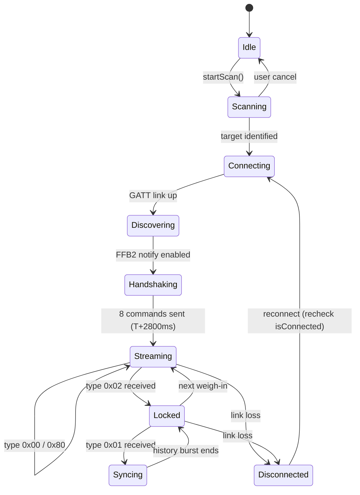

# AFU-WL-TZ-A1 · BLE プロトコル技術仕様

**文書種別**：実装仕様（Implementation Specification）  
**対象読者**：クライアントをゼロから実装する、または本実装を監査する専門開発者  
**規範レベル**：各条項に `MUST`（必須）/ `SHOULD`（推奨）/ `MAY`（任意）を付す。RFC 2119 の意味に従う  
**参照実装**：`lib/core/protocol.dart` · `lib/ble/scale_ble.dart`（Flutter/Dart）  
**証拠体系**：`[HCI]` 公式 App の HCI キャプチャ · `[OTA]` 本機の BLE 無線キャプチャ · `[SRC]` 参照実装のソース · `[T]` 統制実験

> 同じ主題の教学向け文書は [PROTOCOL.md](PROTOCOL.md)（通俗版）を参照。本文は概念説明を繰り返さず、仕様のみを与える。

---

## 0. 用語と記号

| 記号 | 意味 |
| --- | --- |
| `d[n]` | 通知ペイロードの第 n バイト（0 起点）|
| `f[n]` | フレームの第 n バイト（0 起点）。フレーム長は常に 20 |
| `>>n` / `<<n` | 右シフト／左シフト n ビット（符号なし）|
| `\|` | ビット単位 OR（ビットフィールドの連結に使用）|
| `&` | ビット単位 AND（マスク抽出に使用）|
| `0xNN` | 16 進リテラル |
| LE / BE | Little-Endian / Big-Endian |
| PDU | Protocol Data Unit。ここでは 20 バイトのフレーム 1 つを指す |
| T_HS | ハンドシェイク列の総所要時間。本実装では 8 × 400ms ≈ 3.2s |

---

## 1. 発見層（Discovery）

### 1.1 アドバタイジング PDU の構成

| フィールド | AD Type | 値 | 規範性 | 証拠 |
| --- | --- | --- | --- | --- |
| Flags | `0x01` | 標準 | — | OTA |
| Complete Local Name | `0x09` | `AFU-WL-TZ-A1` | MUST 身元判定に使用 | OTA |
| Complete List of 16-bit Service UUIDs | `0x03` | `0xFFB0`, `0x1530` | MAY 身元判定に使用 | OTA |
| Manufacturer Specific Data | `0xFF` | Company ID `0x27AC` (LE: `AC 27`) + payload | MAY | OTA |
| Service Data - 16-bit UUID | `0x16` | UUID `0x27AC` (LE: `AC 27`) + 6B MAC (reversed) + `0x01` | **MUST 実アドレスの抽出に使用** | OTA |

### 1.2 実アドレスの抽出（重要）

デバイスのアドバタイジングアドレス（`peripheral.remoteId`）は**デバイスの静的 MAC と等しいことを保証しない**。実 MAC は Service Data から取得する：

```
Service Data AD の構造：
  [0] = 0x16                          // AD Type: Service Data 16-bit
  [1] = 0xAC, [2] = 0x27              // Service UUID 0x27AC (LE)
  [3] = 0x24 [4] = 0x76 [5] = 0x07
  [6] = 0xAB [7] = 0x82 [8] = 0xB0    // ← 6 バイト、順序は MAC の逆順
  [9] = 0x01                          // 固定フラグ

復元アルゴリズム：
  mac = reverse(serviceData[3..8])
  → B0:82:AB:07:76:24
```

- `MUST` 6 バイトを逆順にしてから整形する。順序どおりに読むと誤ったアドレスになる。
- `MUST NOT` Manufacturer Data の接頭辞が存在すると仮定する（`[SRC]` WeighTrace の文書は `AC 27` 接頭辞を含むとしているが、実測では無い）。

### 1.3 スキャン戦略

| パラメータ | 仕様 | 根拠 |
| --- | --- | --- |
| サービスフィルタ（`startScan([uuid])`）| `MUST NOT` 使用 | `[T]` MIUI で 240s 結果なし。全量スキャン + コールバック絞り込みなら < 1s |
| スキャンモード | 全量スキャン、コールバック側で 3 重述語判定 | `[T]` |
| タイムアウト | ハードタイムアウト無し。UI 層が 5s 後にユーザーへ再スキャンを促す | 実装上の取り決め |

身元述語（いずれかが一致すれば対象デバイスと判定）：

```
isTarget(scanResult) =
    scanResult.advertisementData.advName.contains("AFU-WL")
 || scanResult.advertisementData.serviceData.containsKey(Guid("27AC"))
 || scanResult.advertisementData.serviceUuids.contains(Guid("FFB0"))
```

### 1.4 Android プラットフォームの制約

| 制約 | 説明 | 回避 |
| --- | --- | --- |
| `neverForLocation` フラグ | このフラグを伴う `BLUETOOTH_SCAN` はシステム denylist を使い、本デバイスのアドバタイジングは黙って破棄される | Manifest で `MUST NOT` この flag を宣言する。logcat の症状は `Skipping data matching denylist` |
| 権限の組み合わせ | Android 12+ は `BLUETOOTH_SCAN` + `BLUETOOTH_CONNECT` が必要。≤11 は `ACCESS_FINE_LOCATION` が必要 | 実行時に `SDK_INT` で分岐して要求する |

---

## 2. 転送層（GATT）

### 2.1 サービスとキャラクタリスティック

```
Primary Service 0000FFB0-0000-1000-8000-00805F9B34FB
├── Characteristic 0000FFB1-...   Properties: WRITE (with response)
│                                 Permissions: Write
└── Characteristic 0000FFB2-...   Properties: NOTIFY
                                  Permissions: Read
                                  CCCD: 00002902-...
```

### 2.2 書き込みモードの制約（実装の罠）

| モード | 対応 | 証拠 |
| --- | --- | --- |
| `WRITE`（ATT_WRITE_REQ / 応答あり）| ✅ 必須 | `[T]` 8/8 成功 |
| `WRITE_NO_RESPONSE`（ATT_WRITE_CMD）| ❌ `PlatformException(not supported)` を投げる | `[T]` 8/8 失敗 |

- `MUST` 応答付き書き込みを使う。
- 各書き込みは GATT の確認を待ってから次を送る。間隔は `SHOULD >= 400ms`（実測ではこれ未満で稀にパケット欠落が起きる）。

### 2.3 通知の購読

```
await characteristic.setNotifyValue(true);   // CCCD = 0x0001 を書き込む
// 以降の RX はすべて onValueReceived コールバック経由。ペイロード長は常に 20
```

- `MUST` ハンドシェイク列を送る**前に**購読を完了させる。そうしないとハンドシェイク中の上りパケットが失われる（秤はキャッシュして再送しない）。

### 2.4 補助サービス

| サービス | キャラクタリスティック | 値 | 用途 |
| --- | --- | --- | --- |
| `0x180A` DIS | `0x2A29` | `ICOMON` | メーカー |
| | `0x2A24` | `FG2313UWB-D` | 型番 |
| | `0x2A26` | `1.2.3` | ファームウェア版 |
| | `0x2A28` | `1.3.0` | ソフトウェア版 |
| `0x180F` BAS | `0x2A19` | — | **存在しない**。読み出した値は無意味（実測 `77`）|

---

## 3. フレーム符号化仕様

### 3.1 構造定義

```
 0                   1                   2                             18      19
 +--------+--------+-----------------------------------------+--------+--------+
 |  0xAC  | devType|            payload[16]                 |  tail  | cksum  |
 +--------+--------+-----------------------------------------+--------+--------+
 |<--------------------- 20 octets ------------------------->|
```

| オフセット | 長さ | フィールド | 符号化 | 説明 |
| --- | --- | --- | --- | --- |
| `f[0]` | 1 | SOF | `0xAC` 固定 | フレーム開始記号 |
| `f[1]` | 1 | DeviceType | TX `0x27` / RX `0x29` | 送信側自身のタイプであり、対象のタイプではない |
| `f[2..17]` | 16 | Payload | コマンド依存 | 超過分は切り捨てる（`MUST` 16B を超える内容を破棄する）|
| `f[18]` | 1 | Tail | コマンド識別子 | `payload[0]` と意味上は関連するが**独立に符号化**される |
| `f[19]` | 1 | Checksum | `Σ f[2..18] mod 256` | **tail を含み、自身は含まない** |

### 3.2 チェックサム（規範的定義）

```
checksum = (Σ f[i] for i in [2, 18]) & 0xFF
```

- `MUST` `f[2]` から `f[18]` までを対象とする（尾部バイトを含む）。
- `MUST NOT` `f[0]`、`f[1]`、`f[19]` を対象とする。
- `MUST` 受信フレームにも同じ検証を行い、一致しなければその PDU を破棄する（`SHOULD` ログを記録し、再試行はしない）。

### 3.3 バイトオーダーの取り決め（コマンド依存であり、全体共通ではない）

| データ領域 | オーダー | 位置 |
| --- | --- | --- |
| Unix タイムスタンプ（`08`、`D0`）| **BE** | `payload[1..4]` |
| 履歴パケットのタイムスタンプ | **BE** | `d[3..6]` |
| 体重（リアルタイム／安定パケット）| BE 意味の差分符号化 | `d[3..5]` |
| 体重（確定パケット）| BE | `d[10..12]` |
| インピーダンス | BE | `d[4..5]` / `d[6..7]`（確定パケット）|
| 体重（`01`/`D0` の書き込み）| **BE** | フィールド定義に従う |

> 体重には**2 系統の符号化**があり、位置もオフセットも異なる。実装は `MUST` パケット種別ごとに処理を分ける。
---

## 4. コマンド集仕様（TX）

### 4.0 共通制約

| 項目 | 仕様 |
| --- | --- |
| デバイスタイプ `f[1]` | `0x27`（0x29 ではない。0x29 に変えるとインピーダンスが発火しない）|
| 送信間隔 | 400ms（MUST。これ未満でパケット欠落を観測）|
| 書き込みモード | WRITE with response（§2.2 参照）|
| Payload 上限 | 16 バイト。超過分は切り捨て |
| 未使用バイト | MUST `0x00` を充填する（不定値にしない）|

### 4.1 コマンド 08 時刻合わせ（tail 0xDF）

```
f[2..7] = 08  t3  t2  t1  t0  tz
            |   +-------+----+   +-- UTC オフセット/15 分、u8
            |       +------------- Unix タイムスタンプ（秒）、u32 BE
            +--------------------- サブコマンド 0x08
f[8..17] = すべて 0x00
f[18] = 0xDF      f[19] = checksum
```

| フィールド | オフセット | 長さ | 符号化 | 制約 |
| --- | --- | --- | --- | --- |
| subcmd | `p[0]` | 1 | `0x08` | 固定 |
| timestamp | `p[1..4]` | 4 | u32 BE | Unix epoch 秒 |
| utcQuarters | `p[5]` | 1 | u8 | `(utcOffsetMinutes / 15) & 0xFF` |

**utcQuarters の計算例**

```
utcQuarters = truncate(utcOffsetMinutes / 15) & 0xFF

中国   UTC+8    = +480 min   ->  480/15 = 32  = 0x20
日本   UTC+9    = +540 min   ->  540/15 = 36  = 0x24
ネパール UTC+5:45 = +345 min   ->  345/15 = 23  = 0x17
```

### 4.2 コマンド 01 ユーザー情報（tail 0xD1）

```
f[2..9] = 01  00  01  HH  WH  WL  AA  SS
            |   |   |   |   +--+    |   +-- 性別：1=男性 2=女性
            |   |   |   |     |     +------ 年齢 u8
            |   |   |   |     +------------ 体重 x100、u16 BE
            |   |   |   +------------------ 身長 cm、u8 整数化
            |   |   +---------------------- 固定 0x01
            |   +-------------------------- 予約 0x00
            +------------------------------ サブコマンド 0x01
```

| フィールド | オフセット | 長さ | 値の範囲 | 符号化 |
| --- | --- | --- | --- | --- |
| subcmd | `p[0]` | 1 | `0x01` | — |
| reserved | `p[1]` | 1 | `0x00` | — |
| magic | `p[2]` | 1 | `0x01` | 固定 |
| height | `p[3]` | 1 | 1..255 | cm、**整数化して切り捨て**（168.6 -> 168）|
| weight | `p[4..5]` | 2 | 0..65535 | `round(kg * 100)`、u16 BE |
| age | `p[6]` | 1 | 1..255 | 整数の年 |
| sex | `p[7]` | 1 | 1 / 2 | **1=男性、2=女性**（真偽値 0/1 ではない）|

- MUST 真偽値ではなく 1/2 を使う。性別の取り違えは体脂肪アルゴリズム全体をずらす。
- 体重の取得優先順位：メンバープロフィール -> 直近の測定記録 -> 60kg でフォールバック。
### 4.3 コマンド 02 ユーザースロット（tail 0xD1）

このコマンドは**2 つ**のユーザースロットを書き込み、各 7 バイト。秤は体重の近さによってどちらのスロットのパラメータを使うかを選ぶ。

```
f[2..17] = 02 00 | 01 h1 w1H w1L a1 s1 00 | 02 h2 w2H w2L a2 s2 00
           +--+--+  +----------+-----------+  +----------+-----------+
              |              |                           |
              |              +-- スロット1（7 バイト）      +-- スロット2（7 バイト）
              +-- サブコマンド 02 + 予約 00

payload はちょうど 16 バイトで、余りは無い
```

**スロット構造（7 バイト、2 スロット同型）**

| スロット内オフセット | 長さ | フィールド | 制約 |
| --- | --- | --- | --- |
| +0 | 1 | slotIndex | `0x01`（スロット1）/ `0x02`（スロット2）|
| +1 | 1 | height | cm、u8 |
| +2..3 | 2 | weight | `round(kg*100)`、u16 BE |
| +4 | 1 | age | u8 |
| +5 | 1 | sex | 1=男性 / 2=女性 |
| +6 | 1 | reserved | `0x00` |

- SHOULD 実際のメンバーパラメータを入れる（全 0 に比べて秤画面の表示一致度が上がる）。
- 単一メンバーの場合は両スロットに SHOULD 同じパラメータを書く。
- 公式 App は紐付け解除時のみこのコマンドを送る。本実装は秤内に残った設定を上書きするため、接続のたびに送る。
  潜在的な副作用は §8 を参照。

### 4.4 コマンド D0 完全ハンドシェイク（tail 0xD0）

1 フレームで全コンテキストを運ぶ、データフローを開始させる鍵となるフレーム。

```
f[2..17] = t3 t2 t1 t0 | tz | 00 | 01 | HH | WH WL | AA | SS | TH TL | 03 | 00
           ++--+--+--+   |    |    |    |    +-+-+   |    |    +-+-+   |   +-- 予約
                 |        |    |    |    |      |     |    |      |     +------ 固定 0x03
                 |        |    |    |    |      |     |    |      +------------ 目標体重 x100, u16 BE
                 |        |    |    |    |      |     |    +------------------- 性別
                 |        |    |    |    |      |     +------------------------ 年齢
                 |        |    |    |    |      +------------------------------ 体重 x100, u16 BE
                 |        |    |    |    +------------------------------------- 身長 cm
                 |        |    |    +------------------------------------------ スロット 0x01
                 |        |    +----------------------------------------------- 単位 0x00 = kg
                 |        +---------------------------------------------------- utcQuarters
                 +------------------------------------------------------------- Unix 秒 u32 BE
```

| オフセット | 長さ | フィールド | 符号化 | 制約 |
| --- | --- | --- | --- | --- |
| `p[0..3]` | 4 | timestamp | u32 BE | Unix 秒 |
| `p[4]` | 1 | utcQuarters | u8 | §4.1 と同じ |
| `p[5]` | 1 | unit | u8 | `0x00` = kg（その他の値は未検証）|
| `p[6]` | 1 | slotIndex | u8 | `0x01` |
| `p[7]` | 1 | height | u8 | cm |
| `p[8..9]` | 2 | weight | u16 BE | kg x100 |
| `p[10]` | 1 | age | u8 | 整数の年 |
| `p[11]` | 1 | sex | u8 | 1/2 |
| `p[12..13]` | 2 | targetWeight | u16 BE | kg x100、既定値 `round(weight*0.75)` |
| `p[14]` | 1 | marker | u8 | `0x03` 固定 |
| `p[15]` | 1 | reserved | u8 | `0x00` |
### 4.5 コマンド 06 設定照会（tail 0xDF）

```
f[2] = 0x06、f[3..17] = 0x00
```

応答：秤は `type=0x06` のパケットを 5 個連続で送る（`d[2]=0x06`、索引 00..04 を含む）。内容の重複度が高く、本実装では解析しない。

### 4.6 コマンド 04 D6 / 04 D8（tail 0xDF）

```
f[2..3] = 04 D6   ->  リアルタイムパケットの頻度を上げる（実測 26 -> 77 パケット/測定）
f[2..3] = 04 D8   ->  履歴記録を要求する。本実装では 2 回送る（冗長な保険）
```

- **04 D6 はインピーダンスのスイッチではない**。統制 A/B 対照実験：04D6 の有無にかかわらず、物理的な接触が無いときのインピーダンスは 0 のままで、
  観測されたのはリアルタイムパケットの頻度変化だけだった。インピーダンスは電極の導通だけで決まる。
- 04 D8 は履歴送出の必要条件ではない（§6.4 の発火条件を参照）。

### 4.7 コマンドシーケンス全体のタイミング

```
時刻      コマンド       payload + tail
-------  -----------   ------------------------------------------
T+0ms    08 時刻合わせ  08 t3 t2 t1 t0 tz                    DF
T+400    01 ユーザー    01 00 01 HH WH WL AA SS              D1
T+800    02 スロット    02 00 01 h1 w1H w1L a1 s1 00 02 ...  D1
T+1200   D0 ハンドシェイク  t3 t2 t1 t0 tz 00 01 HH WH WL AA SS TH TL 03 00   D0
T+1600   06 照会       06                                     DF
T+2000   04D6         04 D6                                  DF
T+2400   04D8 #1      04 D8                                  DF
T+2800   04D8 #2      04 D8                                  DF
```

- 順序は MUST この表に厳密に従う。`01` ユーザーフレームを欠くとインピーダンスが発火しない（統制実験）。
- 各コマンドは MUST 前のコマンドの GATT 書き込み応答を待ってから送る。

---

## 5. 通知パケット仕様（RX）

### 5.1 共通判定

```
if d.length < 13 or d[0] != 0xAC:  DROP
pktType = d[2]
```

| `d[2]` | 種別名 | 発火タイミング | 頻度 |
| --- | --- | --- | --- |
| `0x00` | リアルタイムパケット（Weighing / Realtime）| 測定開始後は継続 | 100~150ms（04D6 送信後は約 77 pkt/測定）|
| `0x80` | 安定パケット（Stable）| 体重の読み値が安定 | 頻度は低く、その後 0x02 に移る |
| `0x02` | 確定パケット（Locked / Final）| 測定完了、確定インピーダンスを含む | 約 6s のループ |
| `0x01` | 履歴パケット（History）| ハンドシェイク完了後に必要に応じて送出 | バースト |
| `0x06` | 設定ブロック（Config）| `06` 照会への応答 | 5 パケット連続 |

### 5.2 `type=0x00` リアルタイムパケット

| オフセット | 長さ | フィールド | 復号式 |
| --- | --- | --- | --- |
| `d[3..5]` | 3 | weightRaw | `((d[3]-0x68)<<16 \| d[4]<<8 \| d[5])` |
| `d[8..9]` | 2 | adcRaw | 単組の ADC 生値（リアルタイム段階。確定インピーダンスではない）|
| `d[11]` | 1 | batteryOrState | 下位 7 ビットがバッテリー残量。値 `0x64`(100) は測定完了状態を表す |

**体重の換算**

```
weightKg = weightRaw / 1000
注意：この式は確定パケットとは異なる（オフセットは 0x680000 ではなく 0x68、位置は d[3..5]）
```

**バッテリー残量を採用する条件**

```
if pktType == 0x00 and batteryRaw > 0 and batteryRaw < 100:
    battery = batteryRaw & 0x7F
else:
    無視する（測定中は d[11] が 0x64 の状態フラグになる）
```

### 5.3 `type=0x80` 安定パケット

構造は `0x00` と同じ。`d[11] >= 100` をインピーダンス測定段階への移行とみなす。

### 5.4 `type=0x02` 確定パケット（中核）

```
        0      1      2      3      4      5      6      7      8      9     10     11     12
     +-----+-----+-----+-----+-----+-----+-----+-----+-----+-----+-----+-----+-----+
     | AC  | 29  | 02  | ??  |  i1H|  i1L|  i2H|  i2L| ??  | ??  |  wH |  wL |  wL |
     +-----+-----+-----+-----+-----+-----+-----+-----+-----+-----+-----+-----+-----+
                                 +-----+-----+      +-----+-----+     +-----+-----+
                               インピーダンス1  インピーダンス2     体重 x3
```

| フィールド | オフセット | 長さ | 復号 |
| --- | --- | --- | --- |
| impedance1 | `d[4..5]` | 2 | `(d[4]<<8) \| d[5]`、単位 Ω |
| impedance2 | `d[6..7]` | 2 | `(d[6]<<8) \| d[7]`、単位 Ω |
| weight | `d[10..12]` | 3 | `(((d[10]<<16) \| (d[11]<<8) \| d[12]) - 0x680000) / 1000` |

**境界条件**

| 条件 | 処理 |
| --- | --- |
| `d.length < 13` | MUST 破棄 |
| impedance がいずれも 0 | 有効な状態。電極の導通が無く、体組成は算出できないことを意味する |
| weightRaw < 0 | 不正。`MUST` 破棄する（負の体重）|
| weightKg < 20 | 軽く乗っただけ／無効とみなし、`SHOULD` 不完全な測定として印付ける |

**テストベクタ**（実測キャプチャ）

```
入力：ac 29 02 00 01 ae 01 83 01 80 68 d9 c6 ...
  impedance1 = (0x01<<8)|0xAE = 430
  impedance2 = (0x01<<8)|0x83 = 387
  weightRaw  = (0x68<<16)|(0xD9<<8)|0xC6 = 0x68D9C6 = 6871494
  weightRaw  = 6871494 - 0x680000(6815744) = 55750
  weightKg   = 55.75
出力：impedance=[430,387], weight=55.75kg
```

### 5.5 `type=0x01` 履歴パケット

| フィールド | オフセット | 長さ | 復号 |
| --- | --- | --- | --- |
| timestamp | `d[3..6]` | 4 | `(d[3]<<24 \| d[4]<<16 \| d[5]<<8 \| d[6])`、u32 BE、Unix 秒 |
| weight | `d[8..10]` | 3 | `(((d[8]<<16) \| (d[9]<<8) \| d[10]) - 0x680000) / 1000` |
| impedance1 | `d[11..12]` | 2 | `(d[11]<<8) \| d[12]` |
| impedance2 | `d[13..14]` | 2 | `(d[13]<<8) \| d[14]` |

**重複排除の要件**

```
同一の論理レコードは最大 3 回まで配送されうる（BLE の再送）。
実装は MUST (timestamp, weightKg) を冪等キーとして重複排除してから保存する。
```

### 5.6 `type=0x06` 設定ブロック

応答 `06` 照会。5 パケット連続で送られ、索引 `d[?]=00..04` を含む。本実装では解析せず、ログ記録のみ行う。
---

## 6. 状態機械とライフサイクル



### 6.1 状態遷移の条件

| 遷移元 | 遷移先 | 条件 | 備考 |
| --- | --- | --- | --- |
| Idle | Scanning | ユーザー操作 | — |
| Scanning | Connecting | 身元述語が一致（§1.3）| MUST 先にスキャンを停止してから接続する。そうしないと Android では接続が失敗しやすい |
| Connecting | Discovering | GATT 接続の確立 + MTU 交渉の完了 | — |
| Discovering | Handshaking | FFB2 の `setNotifyValue(true)` 成功 | MUST ハンドシェイク前に完了させる |
| Handshaking | Streaming | 8 番目のコマンドの書き込み成功 | 総所要時間は約 2.8s |
| Streaming | Locked | `d[2]=0x02` を受信 | 測定セッションを終了できる |
| Locked | Syncing | `d[2]=0x01` を受信 | 履歴送出が確定パケットと交錯することがある |
| any | Disconnected | GATT 切断イベント | MUST `isConnected` を再確認する。§8.3 参照 |

### 6.2 測定段階の判定（UI 層が消費する）

```
phase = "done"        if lastPktType == 0x02
      = "impedance"   if lastPktType in (0x00, 0x80) and d[11] >= 100
      = "weighing"    otherwise
```

---

## 7. タイミングパラメータ一覧

| パラメータ | 値 | 性質 | 根拠 |
| --- | --- | --- | --- |
| アドバタイジング間隔 | 999ms | デバイスの挙動 | OTA |
| ハンドシェイクのコマンド間隔 | 400ms | **実装上の制約** | 統制実験。これ未満ではパケット欠落 |
| ハンドシェイクの総所要時間 | ~2800ms | 導出値 | 7 × 400ms |
| リアルタイムパケットの間隔 | 100~150ms | デバイスの挙動 | OTA（04D6 送信後に速くなる）|
| 確定パケットのループ | ~6s | デバイスの挙動 | OTA |
| 接続後の初回パケット遅延 | 450ms | 実装上の選択 | GATT が安定するのを待ってからハンドシェイクを送る |
| 通知タイムアウトの判定 | 15s を推奨 | 実装上の選択 | タイムアウトしたらユーザーに再試行を促す |
| 履歴パケットのバッチ間隔 | 固定間隔なし | デバイスの挙動 | バースト送出 |

---

## 8. 既知の逸脱と実験的設計

### 8.1 deviceType の値（`0x27` vs `0x29`）

| 値 | 結果 | 根拠 |
| --- | --- | --- |
| `0x27` | 正常に動作し、インピーダンスが発火 | 公式 HCI + 本実装 |
| `0x29` | インピーダンスの発火は観測されず | 統制実験 |

- `f[1]` は MUST `0x27` を送る。
- 注意：`ScaleProtocol.frame()` の既定パラメータは `0x29` であり、呼び出し側は MUST 明示的に `0x27` を渡す（本実装はそのようになっている）。

### 8.2 `02` ユーザースロットを接続ごとに送信（実験的）

| 項目 | 説明 |
| --- | --- |
| 公式の挙動 | デバイスの紐付け解除時のみ送信 |
| 本実装 | 接続のたびに送信 |
| 動機 | 秤内に残留したユーザー設定を上書きする（身長が 111cm に張り付いて更新できなくなった事例あり）|
| リスク | 完全には評価していない。履歴記録が繰り返し再送されるのを観測したら、まずこれを疑うべき |
| 回避策 | 紐付け解除のフロー内でのみ送信するよう変更する |

### 8.3 接続状態のゆらぎ

GATT 確立の瞬間、`connectionState` が一瞬 `disconnected` と誤報されることがある。

```
誤ったやり方: onDisconnected -> 直ちに scheduleReconnect()
  結果: 同一セッションでハンドシェイクが 2 回 -> 秤は新しい同期セッションとみなす -> 履歴が再送される

正しいやり方: onDisconnected -> if (!isConnected) scheduleReconnect()
  _connecting による排他ガードを併用する
```

### 8.4 チェックサムの範囲に関する見解の相違

| 出典 | 範囲 | 結果 |
| --- | --- | --- |
| 一部の参考文書 | `Σ f[2..17]`（payload のみ）| 検証失敗 |
| 実測で正しい | `Σ f[2..18]`（**tail を含む**）| 通過 |

### 8.5 バッテリー残量の読み出し

| 出典 | 値 | 信頼できるか |
| --- | --- | --- |
| BAS `0x2A19` | 77% | いいえ（サービスが存在せず、戻り値は無意味）|
| リアルタイムパケット `d[11] & 0x7F` | 10% | はい（915 件サンプルの最頻値）|

### 8.6 履歴記録は削除できない

公式の書き込みコマンド 29 件を全数監査済みで、削除／クリアの命令は**存在しない**。

```
結果: 秤が同期済みと印付けた後は、どのクライアントもその記録を再取得できない。
制約: クライアントは MUST 接続ライフサイクル内で異常終了を避ける。そうしないと記録は永久に失われる。
```

---

## 9. 互換性マトリクス

| 次元 | 検証済み | 未検証 |
| --- | --- | --- |
| 秤の機種 | AFU-WL-TZ-A1（FG2313UWB-D）| その他の ICOMON 機種 |
| ファームウェア | 1.2.3 / ソフトウェア 1.3.0 | その他のバージョン |
| Android | 12~15（MIUI/HyperOS で実測）| 他ベンダーのカスタム ROM |
| BLE ライブラリ | flutter_blue_plus 1.35 | react-native-ble-plx（性能が要件に合わない。§10.2 参照）|
| 言語／プラットフォーム | Flutter (Android) | iOS（プロトコル層は再利用可能、BLE 層は書き直しが必要）|

---

## 10. 適合性テストチェックリスト

実装者が次の項目を完了した時点で、本仕様に適合しているとみなせる：

### 10.1 発見と接続

- [ ] アドバタイジング名から `AFU-WL-TZ-A1` を解析できる
- [ ] Service Data から逆順に復元して正しい MAC が得られる
- [ ] UUID の事前フィルタを使わなくても 5s 以内にデバイスを発見できる
- [ ] `neverForLocation` を宣言しておらず、スキャンに denylist の記録が無い
- [ ] FFB2 の通知をハンドシェイク前に購読できる

### 10.2 フレーム符号化

- [ ] フレーム長が常に 20 バイトで、`f[0]=0xAC`
- [ ] `f[1]=0x27`
- [ ] チェックサムが `f[2..18]` を対象とする
- [ ] payload が 16 バイトを超えた場合に切り捨てられる

### 10.3 コマンドシーケンス

- [ ] 8 つのコマンドの順序が正しい
- [ ] 隣接コマンドの間隔が >= 400ms
- [ ] すべて応答付き書き込みを使用
- [ ] `01` フレームの性別フィールドが 1/2
- [ ] `D0` フレームの `p[14]=0x03`

### 10.4 解析

- [ ] 確定パケットのテストベクタが `55.75kg` / `[430, 387]Ω` を復元する
- [ ] リアルタイムパケットの体重式の出力が確定パケットと一致する（同一測定内）
- [ ] 履歴パケットのタイムスタンプを u32 BE として解析する
- [ ] 履歴パケットを `(timestamp, weight)` で重複排除する
- [ ] バッテリー残量は `type=0x00` かつ `d[11] < 100` のときだけ採用する
- [ ] インピーダンスが 0 のときは体組成を算出せず、不完全として印付ける

### 10.5 ライフサイクル

- [ ] 切断後の再接続前に `isConnected` を再確認し、二重ハンドシェイクを起こさない
- [ ] 接続が異常終了する前に、解析済みの記録をすべて保存済みである

---

## 11. 最小参照実装の骨子

```dart
// フレーム符号化
Uint8List frame(List<int> payload, {required int tail}) {
  final f = Uint8List(20);
  f[0] = 0xAC;
  f[1] = 0x27;                                  // 注意：0x29 ではない
  for (var i = 0; i < payload.length && i + 2 < 18; i++) {
    f[2 + i] = payload[i] & 0xFF;
  }
  f[18] = tail;
  var sum = 0;
  for (var i = 2; i < 19; i++) sum = (sum + f[i]) & 0xFF;   // tail を含む
  f[19] = sum;
  return f;
}

// 確定パケットの解析
({double weightKg, int i1, int i2})? parseLocked(Uint8List d) {
  if (d.length < 13 || d[0] != 0xAC || d[2] != 0x02) return null;
  final i1 = (d[4] << 8) | d[5];
  final i2 = (d[6] << 8) | d[7];
  final raw = ((d[10] << 16) | (d[11] << 8) | d[12]) - 0x680000;
  if (raw < 0) return null;
  return (weightKg: raw / 1000, i1: i1, i2: i2);
}
```

---

## 12. 教学版との対応関係

| 本仕様の節 | 教学版の節 |
| --- | --- |
| §1 発見層 | PROTOCOL.md §2 空中で見つける |
| §2 転送層 | PROTOCOL.md §3 2 つの私書箱を手に入れる |
| §3 フレーム符号化 | PROTOCOL.md §4 封筒の書式 |
| §4 コマンド集 | PROTOCOL.md §5 8 つのコマンド |
| §5 通知パケット | PROTOCOL.md §6 秤の返事を読み解く |
| §6 状態機械 | PROTOCOL.md §7 完全なタイムライン |
| §8 既知の逸脱 | PROTOCOL.md §8 10 の落とし穴 |
| §10 テストチェックリスト | —（教学版には無い）|
