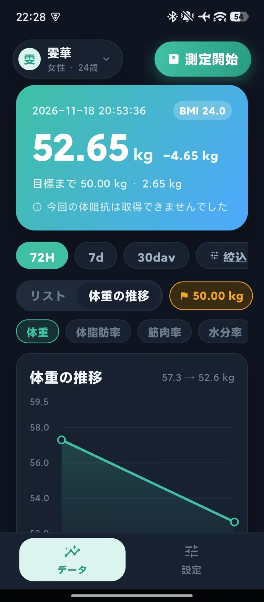
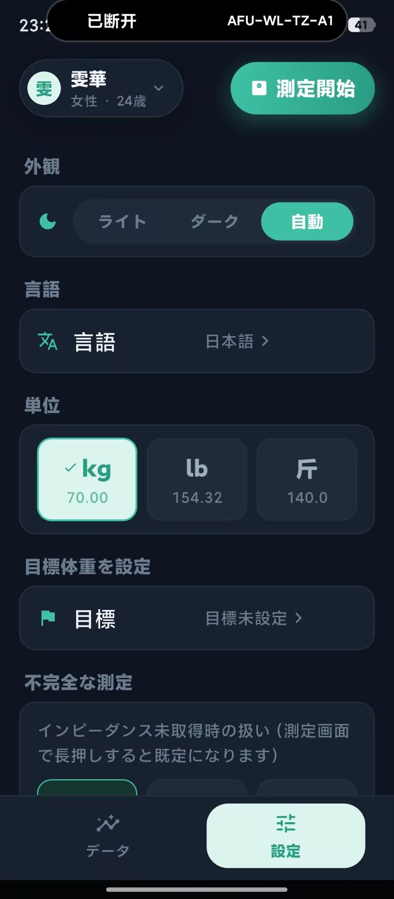

# AFU

<p align="center">
  <a href="../../../README.md">简体中文</a> &middot; <a href="../zh-Hant/README.md">繁體中文</a> &middot; <b>日本語</b> &middot; <a href="../de/README.md">Deutsch</a> &middot; <a href="../fi/README.md">Suomi</a> &middot; <a href="../en/README.md">English</a>
</p>


**AFU-WL-TZ-A1**（Ant Afu × Welland ICOMON）体組成計の Android クライアント · Flutter リライト版  
ローカルファースト · アカウント不要 · クラウド同期なし · 5 言語 · ライト／ダークテーマ

<p align="center">
  
  &nbsp;&nbsp;
  
  &nbsp;&nbsp;
  
</p>

<p align="center"><sub>データページ · 機能一覧 · 通信ログ（デバッグモードで表示）</sub></p>

## 機能

- **スキャン 1 秒以内**：同じスマホと同じ体重計で、旧 React Native 版は 7 分かかっていた
- **リング型ダッシュボード**：計量 → インピーダンス → 完了 の 3 段階アニメーション
- **複数メンバー**：プロフィール管理、名前変更に追従する履歴更新、孤立レコードの修復
- **データ**：72H / 7d / 30day / カスタム期間フィルタ、トレンドグラフ、一括プッシュ · 転送 · 削除
- **LAN 同期**：自前で立てた受信側へ HTTP プッシュ
- **アルゴリズムを完全公開**：BIA の式と各係数を 1 つずつ解説し、論文の原式と実測による校正値を区別
- 5 言語 · ライト／ダークテーマ · kg / lb / 斤

## ドキュメント

| ドキュメント | 内容 |
| --- | --- |
| [プロトコル · 通俗版](PROTOCOL.md) | 「どうやって秤を見つけるか」から「バイトがどう体重になるか」まで、実測で踏んだ 10 の落とし穴付き |
| [プロトコル · 仕様版](PROTOCOL_SPEC.md) | 実装者向けの技術仕様：フィールドレベルの定義、状態機械、テストベクタ、準拠チェックリスト |
| [体組成アルゴリズム](ALGORITHM.md) | 体脂肪率／水分／筋肉／骨格筋をどう算出するか、式と係数の出典表記付き |
| [ビルドとインストール](BUILD.md) | 環境要件、必ず踏む 2 つの落とし穴、ワイヤレスインストール |
| [データ移行](MIGRATION.md) | 旧 RN 版から履歴記録をインポート |
| [よくある質問](FAQ.md) | BMI が性別で変わらない理由、インピーダンスが 0、バッテリー残量、履歴の仕組み |

## クイックスタート

```bash
git clone https://github.com/Linmord/afu-scale-flutter.git
cd afu-scale-flutter
flutter pub get
flutter build apk --release
```

> ⚠️ プロジェクトのパスに**中国語を含められません**。含めると Gradle がそのままエラーを出します。詳細は[ビルドドキュメント](BUILD.md)。

`main` へのプッシュごとに APK が自動ビルドされます（[`.github/workflows/build.yml`](../../../.github/workflows/build.yml)）。成果物は Actions の Artifacts にあります。

## 旧バージョン

React Native 版は**メンテナンス終了** → [Linmord/afu-scale-app](https://github.com/Linmord/afu-scale-app)

## 免責事項

非公式クライアントであり、Ant Afu / Welland（ICOMON）とは一切関係ありません。プロトコルは公開パケットキャプチャとリバースエンジニアリングから導出したもので、ファームウェア更新により使えなくなる可能性があります。  
体組成値は BIA 式による推定値であり、個人のトレンド参考用で、医学的診断の根拠にはなりません。
