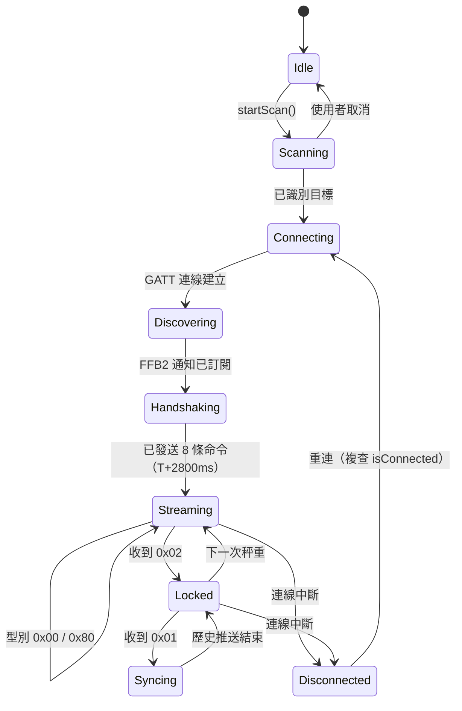

# AFU-WL-TZ-A1 · BLE 協議技術規格

**文件型別**：實作規格（Implementation Specification）  
**目標讀者**：需要從零實作用戶端或稽核本實作的專業開發者  
**規範性級別**：每個條目標註 `MUST`（必須）/ `SHOULD`（應當）/ `MAY`（可選），遵循 RFC 2119 語意  
**參照實作**：`lib/core/protocol.dart` · `lib/ble/scale_ble.dart`（Flutter/Dart）  
**證據體系**：`[HCI]` 官方 App HCI 擷取封包 · `[OTA]` 本機 BLE 空中擷取封包 · `[SRC]` 參考實作原始碼 · `[T]` 受控實驗

> 教學向的同主題文件見 [PROTOCOL.md](PROTOCOL.md)（通俗版）。本文不重複概念解釋，只給規格。

---

## 0. 術語與符號

| 記號 | 含義 |
| --- | --- |
| `d[n]` | 通知載荷第 n 位元組（0-based）|
| `f[n]` | 幀（frame）第 n 位元組（0-based），幀長恆 20 |
| `>>n` / `<<n` | 右移 / 左移 n 位（無符號）|
| `\|` | 按位或（用於拼接位域）|
| `&` | 按位與（用於遮罩提取）|
| `0xNN` | 十六進位字面量 |
| LE / BE | Little-Endian / Big-Endian |
| PDU | Protocol Data Unit，此處指一幀 20 位元組載荷 |
| T_HS | 握手序列總時長，實作取 8 × 400ms ≈ 3.2s |

---

## 1. 發現層（Discovery）

### 1.1 廣播 PDU 組成

| 欄位 | AD Type | 值 | 規範性 | 證據 |
| --- | --- | --- | --- | --- |
| Flags | `0x01` | 標準 | — | OTA |
| Complete Local Name | `0x09` | `AFU-WL-TZ-A1` | MUST 用於身分判定 | OTA |
| Complete List of 16-bit Service UUIDs | `0x03` | `0xFFB0`, `0x1530` | MAY 用於身分判定 | OTA |
| Manufacturer Specific Data | `0xFF` | Company ID `0x27AC` (LE: `AC 27`) + payload | MAY | OTA |
| Service Data - 16-bit UUID | `0x16` | UUID `0x27AC` (LE: `AC 27`) + 6B MAC (reversed) + `0x01` | **MUST 用於提取真實位址** | OTA |

### 1.2 真實位址提取（關鍵）

裝置廣播位址（`peripheral.remoteId`）**不保證等於裝置靜態 MAC**。真實 MAC 取自 Service Data：

```
Service Data AD 結構：
  [0] = 0x16                      // AD Type: Service Data 16-bit
  [1] = 0xAC, [2] = 0x27          // Service UUID 0x27AC (LE)
  [3] = 0x24 [4] = 0x76 [5] = 0x07
  [6] = 0xAB [7] = 0x82 [8] = 0xB0   // ← 6 位元組，順序為 MAC 的逆序
  [9] = 0x01                      // 固定標誌

還原演算法：
  mac = reverse(serviceData[3..8])
  → AA:BB:CC:DD:EE:FF
```

- `MUST` 對 6 位元組做逆序後再格式化，直接順序讀取會得到錯誤位址。
- `MUST NOT` 假定 Manufacturer Data 前綴存在（`[SRC]` WeighTrace 文件聲稱含 `AC 27` 前綴，實測無）。

### 1.3 掃描策略

| 參數 | 規格 | 依據 |
| --- | --- | --- |
| 服務過濾（`startScan([uuid])`）| `MUST NOT` 使用 | `[T]` MIUI 上 240s 無結果；全掃 + 回呼篩選 < 1s |
| 掃描模式 | 全量掃描，回呼側三重謂詞判定 | `[T]` |
| 逾時 | 無硬性逾時；由 UI 層在 5s 後提示使用者觸發重掃 | 實作約定 |

身分謂詞（任一命中即判定為目標裝置）：

```
isTarget(scanResult) =
    scanResult.advertisementData.advName.contains("AFU-WL")
 || scanResult.advertisementData.serviceData.containsKey(Guid("27AC"))
 || scanResult.advertisementData.serviceUuids.contains(Guid("FFB0"))
```

### 1.4 Android 平台約束

| 約束 | 說明 | 規避 |
| --- | --- | --- |
| `neverForLocation` 標誌 | 攜帶該標誌的 `BLUETOOTH_SCAN` 會使用系統 denylist，本裝置廣播被靜默丟棄 | Manifest `MUST NOT` 宣告該 flag；logcat 症狀 `Skipping data matching denylist` |
| 權限組合 | Android 12+ 需 `BLUETOOTH_SCAN` + `BLUETOOTH_CONNECT`；≤11 需 `ACCESS_FINE_LOCATION` | 執行時按 `SDK_INT` 分支申請 |

---

## 2. 傳輸層（GATT）

### 2.1 服務與特徵值

```
Primary Service 0000FFB0-0000-1000-8000-00805F9B34FB
├── Characteristic 0000FFB1-...   Properties: WRITE (with response)
│                                 Permissions: Write
└── Characteristic 0000FFB2-...   Properties: NOTIFY
                                  Permissions: Read
                                  CCCD: 00002902-...
```

### 2.2 寫入模式約束（實作陷阱）

| 模式 | 支援 | 證據 |
| --- | --- | --- |
| `WRITE`（ATT_WRITE_REQ / 有回應）| ✅ 必需 | `[T]` 8/8 成功 |
| `WRITE_NO_RESPONSE`（ATT_WRITE_CMD）| ❌ 拋出 `PlatformException(not supported)` | `[T]` 8/8 失敗 |

- `MUST` 使用帶回應寫入。
- 每條寫入需等待 GATT 確認後再發下一條，間隔 `SHOULD >= 400ms`（實測低於此值偶有丟包）。

### 2.3 通知訂閱

```
await characteristic.setNotifyValue(true);   // 寫 CCCD = 0x0001
// 之後所有 RX 透過 onValueReceived 回呼，載荷長度恆 20
```

- `MUST` 在發送握手序列**之前**完成訂閱，否則握手期間的上行封包會遺失（秤不快取重發）。

### 2.4 輔助服務

| 服務 | 特徵值 | 值 | 用途 |
| --- | --- | --- | --- |
| `0x180A` DIS | `0x2A29` | `ICOMON` | 製造商 |
| | `0x2A24` | `FG2313UWB-D` | 型號 |
| | `0x2A26` | `1.2.3` | 韌體版本 |
| | `0x2A28` | `1.3.0` | 軟體版本 |
| `0x180F` BAS | `0x2A19` | — | **不存在**，讀取返回值無意義（實測 `77`）|

---

## 3. 幀編碼規範

### 3.1 結構定義

```
 0                   1                   2                             18      19
 +--------+--------+-----------------------------------------+--------+--------+
 |  0xAC  | devType|            payload[16]                 |  tail  | cksum  |
 +--------+--------+-----------------------------------------+--------+--------+
 |<--------------------- 20 octets ------------------------->|
```

| 偏移 | 長度 | 欄位 | 編碼 | 說明 |
| --- | --- | --- | --- | --- |
| `f[0]` | 1 | SOF | `0xAC` 固定 | 幀起始符 |
| `f[1]` | 1 | DeviceType | TX `0x27` / RX `0x29` | 發送方自身型別，非目標型別 |
| `f[2..17]` | 16 | Payload | 命令相關 | 超長部分被截斷（`MUST` 丟棄超出 16B 的內容）|
| `f[18]` | 1 | Tail | 命令標識 | 與 `payload[0]` 語意相關但**獨立編碼** |
| `f[19]` | 1 | Checksum | `Σ f[2..18] mod 256` | **含 tail，不含自身** |

### 3.2 校驗和（規範性定義）

```
checksum = (Σ f[i] for i in [2, 18]) & 0xFF
```

- `MUST` 覆蓋 `f[2]` 至 `f[18]`（含尾位元組）。
- `MUST NOT` 覆蓋 `f[0]`、`f[1]`、`f[19]`。
- `MUST` 對接收幀做同樣校驗，不匹配則丟棄該 PDU（`SHOULD` 記錄日誌但不重試）。

### 3.3 位元組序約定（與命令相關，非全域）

| 資料域 | 序 | 位置 |
| --- | --- | --- |
| Unix 時間戳（`08`、`D0`）| **BE** | `payload[1..4]` |
| 歷史封包時間戳 | **BE** | `d[3..6]` |
| 體重（即時/穩定封包）| BE 語意的差分編碼 | `d[3..5]` |
| 體重（鎖定封包）| BE | `d[10..12]` |
| 阻抗 | BE | `d[4..5]` / `d[6..7]`（鎖定封包）|
| 體重（`01`/`D0` 寫入）| **BE** | 按欄位定義 |

> 體重存在**兩套編碼**，位置與偏移量都不同，實作 `MUST` 按封包型別分別處理。
---

## 4. 命令集規格（TX）

### 4.0 通用約束

| 項 | 規格 |
| --- | --- |
| 裝置類型 `f[1]` | `0x27`（不是 0x29；改用 0x29 時阻抗不觸發）|
| 發送間隔 | 400ms（MUST，低於此值觀察到丟包）|
| 寫入模式 | WRITE with response（見 §2.2）|
| Payload 上限 | 16 位元組，超出截斷 |
| 未使用位元組 | MUST 填 `0x00`（非垃圾值）|

### 4.1 命令 08 對時（tail 0xDF）

```
f[2..7] = 08  t3  t2  t1  t0  tz
            |   +-------+----+   +-- UTC 偏移/15 分鐘，u8
            |       +------------- Unix 時間戳（秒），u32 BE
            +--------------------- 子命令 0x08
f[8..17] = 全 0x00
f[18] = 0xDF      f[19] = checksum
```

| 欄位 | 偏移 | 長度 | 編碼 | 約束 |
| --- | --- | --- | --- | --- |
| subcmd | `p[0]` | 1 | `0x08` | 固定 |
| timestamp | `p[1..4]` | 4 | u32 BE | Unix epoch 秒 |
| utcQuarters | `p[5]` | 1 | u8 | `(utcOffsetMinutes / 15) & 0xFF` |

**utcQuarters 計算範例**

```
utcQuarters = truncate(utcOffsetMinutes / 15) & 0xFF

中國   UTC+8    = +480 min   ->  480/15 = 32  = 0x20
日本   UTC+9    = +540 min   ->  540/15 = 36  = 0x24
尼泊爾 UTC+5:45 = +345 min   ->  345/15 = 23  = 0x17
```

### 4.2 命令 01 使用者資訊（tail 0xD1）

```
f[2..9] = 01  00  01  HH  WH  WL  AA  SS
            |   |   |   |   +--+    |   +-- 性別：1=男 2=女
            |   |   |   |     |     +------ 年齡 u8
            |   |   |   |     +------------ 體重 x100，u16 BE
            |   |   |   +------------------ 身高 cm，u8 取整
            |   |   +---------------------- 固定 0x01
            |   +-------------------------- 保留 0x00
            +------------------------------ 子命令 0x01
```

| 欄位 | 偏移 | 長度 | 取值範圍 | 編碼 |
| --- | --- | --- | --- | --- |
| subcmd | `p[0]` | 1 | `0x01` | — |
| reserved | `p[1]` | 1 | `0x00` | — |
| magic | `p[2]` | 1 | `0x01` | 固定 |
| height | `p[3]` | 1 | 1..255 | cm，**取整截斷**（165.4 -> 168）|
| weight | `p[4..5]` | 2 | 0..65535 | `round(kg * 100)`，u16 BE |
| age | `p[6]` | 1 | 1..255 | 整數年 |
| sex | `p[7]` | 1 | 1 / 2 | **1=男，2=女**（不是布林 0/1）|

- MUST 使用 1/2 而非布林值，性別錯配會導致體脂演算法整體偏移。
- 體重來源優先順序：成員檔案 -> 最近測量記錄 -> 60kg 兜底。
### 4.3 命令 02 使用者槽位（tail 0xD1）

此命令寫**兩個**使用者槽位，各 7 位元組。秤按體重接近度選擇使用哪個槽位的參數。

```
f[2..17] = 02 00 | 01 h1 w1H w1L a1 s1 00 | 02 h2 w2H w2L a2 s2 00
           +--+--+  +----------+-----------+  +----------+-----------+
              |              |                           |
              |              +-- 槽位1（7 位元組）        +-- 槽位2（7 位元組）
              +-- 子命令 02 + 保留 00

payload 恰好 16 位元組，無剩餘空間
```

**槽位結構（7 位元組，兩槽同構）**

| 槽內偏移 | 長度 | 欄位 | 約束 |
| --- | --- | --- | --- |
| +0 | 1 | slotIndex | `0x01`（槽1）/ `0x02`（槽2）|
| +1 | 1 | height | cm，u8 |
| +2..3 | 2 | weight | `round(kg*100)`，u16 BE |
| +4 | 1 | age | u8 |
| +5 | 1 | sex | 1=男 / 2=女 |
| +6 | 1 | reserved | `0x00` |

- SHOULD 填真實成員參數（相比全 0 能提升秤屏顯示一致性）。
- 單成員時兩槽 SHOULD 寫同一參數。
- 官方 App 僅在解綁時發送此命令；本實作每次連線都發，用於覆蓋秤內殘留設定。
  潛在副作用見 §8。

### 4.4 命令 D0 完整握手（tail 0xD0）

單幀攜帶全部上下文，是觸發資料流的關鍵幀。

```
f[2..17] = t3 t2 t1 t0 | tz | 00 | 01 | HH | WH WL | AA | SS | TH TL | 03 | 00
           ++--+--+--+   |    |    |    |    +-+-+   |    |    +-+-+   |   +-- 保留
                 |        |    |    |    |      |     |    |      |     +------ 固定 0x03
                 |        |    |    |    |      |     |    |      +------------ 目標體重 x100, u16 BE
                 |        |    |    |    |      |     |    +------------------- 性別
                 |        |    |    |    |      |     +------------------------ 年齡
                 |        |    |    |    |      +------------------------------ 體重 x100, u16 BE
                 |        |    |    |    +------------------------------------- 身高 cm
                 |        |    |    +------------------------------------------ 槽位 0x01
                 |        |    +----------------------------------------------- 單位 0x00 = kg
                 |        +---------------------------------------------------- utcQuarters
                 +------------------------------------------------------------- Unix 秒 u32 BE
```

| 偏移 | 長度 | 欄位 | 編碼 | 約束 |
| --- | --- | --- | --- | --- |
| `p[0..3]` | 4 | timestamp | u32 BE | Unix 秒 |
| `p[4]` | 1 | utcQuarters | u8 | 同 §4.1 |
| `p[5]` | 1 | unit | u8 | `0x00` = kg（其他值未驗證）|
| `p[6]` | 1 | slotIndex | u8 | `0x01` |
| `p[7]` | 1 | height | u8 | cm |
| `p[8..9]` | 2 | weight | u16 BE | kg x100 |
| `p[10]` | 1 | age | u8 | 整數年 |
| `p[11]` | 1 | sex | u8 | 1/2 |
| `p[12..13]` | 2 | targetWeight | u16 BE | kg x100，預設 `round(weight*0.75)` |
| `p[14]` | 1 | marker | u8 | `0x03` 固定 |
| `p[15]` | 1 | reserved | u8 | `0x00` |
### 4.5 命令 06 設定查詢（tail 0xDF）

```
f[2] = 0x06，f[3..17] = 0x00
```

回應：秤連推 5 個 `type=0x06` 封包（`d[2]=0x06`，含索引 00..04），內容重複度高，本實作不解析。

### 4.6 命令 04 D6 / 04 D8（tail 0xDF）

```
f[2..3] = 04 D6   ->  提升即時封包頻率（實測 26 -> 77 包/次測量）
f[2..3] = 04 D8   ->  請求歷史記錄；本實作發兩次（冗餘保險）
```

- **04 D6 不是阻抗開關**。受控 A/B 對照實驗：有無 04D6，無物理接觸時阻抗均為 0，
  僅觀測到即時封包頻率變化。阻抗只由電極導通決定。
- 04 D8 不是歷史推送的必要條件（見 §6.4 觸發條件）。

### 4.7 完整命令序列時序

```
時刻      命令         payload + tail
-------  ----------   ------------------------------------------
T+0ms    08 對時      08 t3 t2 t1 t0 tz                    DF
T+400    01 使用者    01 00 01 HH WH WL AA SS              D1
T+800    02 槽位      02 00 01 h1 w1H w1L a1 s1 00 02 ...  D1
T+1200   D0 握手      t3 t2 t1 t0 tz 00 01 HH WH WL AA SS TH TL 03 00   D0
T+1600   06 查詢      06                                     DF
T+2000   04D6         04 D6                                  DF
T+2400   04D8 #1      04 D8                                  DF
T+2800   04D8 #2      04 D8                                  DF
```

- 順序 MUST 嚴格按此表；缺少 `01` 使用者幀時阻抗不觸發（受控實驗）。
- 每條 MUST 等待前一條 GATT 寫回應後再發送下一條。

---

## 5. 通知封包規格（RX）

### 5.1 通用判別

```
if d.length < 13 or d[0] != 0xAC:  DROP
pktType = d[2]
```

| `d[2]` | 型別名 | 觸發時機 | 頻率 |
| --- | --- | --- | --- |
| `0x00` | 即時封包（Weighing / Realtime）| 測量開始後持續 | 100~150ms（發 04D6 後約 77 pkt/次）|
| `0x80` | 穩定封包（Stable）| 體重讀數穩定 | 低，隨後轉 0x02 |
| `0x02` | 鎖定封包（Locked / Final）| 測量完成，含最終阻抗 | 循環約 6s |
| `0x01` | 歷史封包（History）| 握手完成後按需推送 | 突發 |
| `0x06` | 設定區塊（Config）| 應答 `06` 查詢 | 連推 5 包 |

### 5.2 `type=0x00` 即時封包

| 偏移 | 長度 | 欄位 | 解碼公式 |
| --- | --- | --- | --- |
| `d[3..5]` | 3 | weightRaw | `((d[3]-0x68)<<16 \| d[4]<<8 \| d[5])` |
| `d[8..9]` | 2 | adcRaw | 單組 ADC 原始值（即時階段，非最終阻抗）|
| `d[11]` | 1 | batteryOrState | 低 7 位為電量；值 `0x64`(100) 表示測量完成狀態 |

**體重換算**

```
weightKg = weightRaw / 1000
注意：此式與鎖定封包不同（偏移量為 0x68 而非 0x680000，位置為 d[3..5]）
```

**電量採信條件**

```
if pktType == 0x00 and batteryRaw > 0 and batteryRaw < 100:
    battery = batteryRaw & 0x7F
else:
    忽略（測量中 d[11] 會變成 0x64 狀態標誌）
```

### 5.3 `type=0x80` 穩定封包

結構與 `0x00` 相同。`d[11] >= 100` 視作進入阻抗測量階段。

### 5.4 `type=0x02` 鎖定封包（核心）

```
偏移:  0     1     2     3     4     5     6     7     8     9    10    11    12
     +-----+-----+-----+-----+-----+-----+-----+-----+-----+-----+-----+-----+-----+
     | AC  | 29  | 02  | ??  |  i1H|  i1L|  i2H|  i2L| ??  | ??  |  wH |  wL |  wL |
     +-----+-----+-----+-----+-----+-----+-----+-----+-----+-----+-----+-----+-----+
                                 +-----+-----+      +-----+-----+     +-----+-----+
                                   阻抗1              阻抗2             體重 x3
```

| 欄位 | 偏移 | 長度 | 解碼 |
| --- | --- | --- | --- |
| impedance1 | `d[4..5]` | 2 | `(d[4]<<8) \| d[5]`，單位 Ω |
| impedance2 | `d[6..7]` | 2 | `(d[6]<<8) \| d[7]`，單位 Ω |
| weight | `d[10..12]` | 3 | `(((d[10]<<16) \| (d[11]<<8) \| d[12]) - 0x680000) / 1000` |

**邊界條件**

| 條件 | 處理 |
| --- | --- |
| `d.length < 13` | MUST 丟棄 |
| impedance 均為 0 | 有效狀態，表示無電極導通，體成分不可算 |
| weightRaw < 0 | 非法，`MUST` 丟棄（負體重）|
| weightKg < 20 | 視為輕踩/無效，`SHOULD` 標記為不完整測量 |

**測試向量**（實測擷取封包）

```
輸入：ac 29 02 00 01 ae 01 83 01 80 68 d9 c6 ...
  impedance1 = (0x01<<8)|0xAE = 430
  impedance2 = (0x01<<8)|0x83 = 387
  weightRaw  = (0x68<<16)|(0xD9<<8)|0xC6 = 0x68D9C6 = 6871494
  weightRaw  = 6871494 - 0x680000(6815744) = 55750
  weightKg   = 55.75
輸出：impedance=[430,387], weight=55.75kg
```

### 5.5 `type=0x01` 歷史封包

| 欄位 | 偏移 | 長度 | 解碼 |
| --- | --- | --- | --- |
| timestamp | `d[3..6]` | 4 | `(d[3]<<24 \| d[4]<<16 \| d[5]<<8 \| d[6])`，u32 BE，Unix 秒 |
| weight | `d[8..10]` | 3 | `(((d[8]<<16) \| (d[9]<<8) \| d[10]) - 0x680000) / 1000` |
| impedance1 | `d[11..12]` | 2 | `(d[11]<<8) \| d[12]` |
| impedance2 | `d[13..14]` | 2 | `(d[13]<<8) \| d[14]` |

**去重規範**

```
同一邏輯記錄最多可被投遞 3 次（BLE 重傳）。
實作 MUST 以 (timestamp, weightKg) 為冪等鍵去重後再入庫。
```

### 5.6 `type=0x06` 設定區塊

應答 `06` 查詢，連推 5 包，含索引 `d[?]=00..04`。本實作不解析，僅記錄日誌。
---

## 6. 狀態機與生命週期



### 6.1 狀態轉移條件

| 從 | 到 | 條件 | 備註 |
| --- | --- | --- | --- |
| Idle | Scanning | 使用者觸發 | — |
| Scanning | Connecting | 身分謂詞命中（§1.3）| MUST 先停止掃描再連線，否則 Android 上連線易失敗 |
| Connecting | Discovering | GATT 連線建立 + MTU 協商完成 | — |
| Discovering | Handshaking | FFB2 `setNotifyValue(true)` 成功 | MUST 在握手前完成 |
| Handshaking | Streaming | 第 8 條命令寫入成功 | 總耗時約 2.8s |
| Streaming | Locked | 收到 `d[2]=0x02` | 可結束測量工作階段 |
| Locked | Syncing | 收到 `d[2]=0x01` | 歷史推送可能與鎖定封包交錯 |
| any | Disconnected | GATT 斷開事件 | MUST 複查 `isConnected`，見 §8.3 |

### 6.2 測量階段判定（供 UI 層取用）

```
phase = "done"        if lastPktType == 0x02
      = "impedance"   if lastPktType in (0x00, 0x80) and d[11] >= 100
      = "weighing"    otherwise
```

---

## 7. 時序參數彙總

| 參數 | 值 | 性質 | 依據 |
| --- | --- | --- | --- |
| 廣播間隔 | 999ms | 裝置行為 | OTA |
| 握手命令間隔 | 400ms | **實作約束** | 受控實驗，低於此值丟包 |
| 握手總時長 | ~2800ms | 推導 | 7 × 400ms |
| 即時封包間隔 | 100~150ms | 裝置行為 | OTA（發 04D6 後加快）|
| 鎖定封包循環 | ~6s | 裝置行為 | OTA |
| 連線後首包延遲 | 450ms | 實作選擇 | 等待 GATT 穩定後發握手 |
| 通知逾時判定 | 建議 15s | 實作選擇 | 逾時則提示使用者重試 |
| 歷史封包批間隔 | 無固定間隔 | 裝置行為 | 突發推送 |

---

## 8. 已知偏差與實驗性設計

### 8.1 deviceType 取值（`0x27` vs `0x29`）

| 值 | 結果 | 依據 |
| --- | --- | --- |
| `0x27` | 正常工作，阻抗觸發 | 官方 HCI + 本實作 |
| `0x29` | 未觀察到阻抗觸發 | 受控實驗 |

- `f[1]` MUST 發 `0x27`。
- 注意 `ScaleProtocol.frame()` 的預設參數為 `0x29`，呼叫方 MUST 顯式傳 `0x27`（本實作已如此）。

### 8.2 `02` 使用者槽位每次連線發送（實驗性）

| 項 | 說明 |
| --- | --- |
| 官方行為 | 僅在解除綁定裝置時發送 |
| 本實作 | 每次連線都發 |
| 動機 | 覆蓋秤內殘留使用者設定（曾出現身高卡在 111cm 無法更新的情況）|
| 風險 | 未完全評估。若觀察到歷史記錄被反覆重推，應優先懷疑此項 |
| 回退方案 | 改為僅在解綁流程中發送 |

### 8.3 連線狀態抖動

GATT 建立瞬間，`connectionState` 可能短暫誤報 `disconnected`。

```
錯誤做法: onDisconnected -> 立即 scheduleReconnect()
  後果: 同一工作階段握手兩次 -> 秤視為新同步工作階段 -> 歷史被重推

正確做法: onDisconnected -> if (!isConnected) scheduleReconnect()
  並加 _connecting 並發守衛
```

### 8.4 校驗和範圍分歧

| 來源 | 範圍 | 結果 |
| --- | --- | --- |
| 部分參考文件 | `Σ f[2..17]`（僅 payload）| 校驗失敗 |
| 實測正確 | `Σ f[2..18]`（**含 tail**）| 通過 |

### 8.5 電量讀取

| 來源 | 值 | 是否可信 |
| --- | --- | --- |
| BAS `0x2A19` | 77% | 否（服務不存在，返回值無意義）|
| 即時封包 `d[11] & 0x7F` | 10% | 是（915 條取樣眾數）|

### 8.6 歷史記錄不可刪除

官方 29 條寫命令已全量稽核，**不存在**刪除/清空指令。

```
後果: 秤標記已同步後，任何用戶端都無法重新取得該記錄。
約束: 用戶端 MUST 在連線生命週期內避免異常退出，否則記錄永久遺失。
```

---

## 9. 相容性矩陣

| 維度 | 已驗證 | 未驗證 |
| --- | --- | --- |
| 秤型號 | AFU-WL-TZ-A1（FG2313UWB-D）| 其他 ICOMON 型號 |
| 韌體 | 1.2.3 / 軟體 1.3.0 | 其他版本 |
| Android | 12~15（MIUI/HyperOS 實測）| 其他廠商定製 ROM |
| BLE 程式庫 | flutter_blue_plus 1.35 | react-native-ble-plx（效能不符，見 §10.2）|
| 語言/平台 | Flutter (Android) | iOS（協議層可重用，BLE 層需重寫）|

---

## 10. 一致性測試清單

實作方完成下列條目後，可認為與本規格一致：

### 10.1 發現與連線

- [ ] 廣播名解析出 `AFU-WL-TZ-A1`
- [ ] Service Data 逆序還原出正確 MAC
- [ ] 不使用 UUID 前置過濾仍能在 5s 內發現裝置
- [ ] 未宣告 `neverForLocation`，掃描無 denylist 記錄
- [ ] FFB2 通知在握手前訂閱成功

### 10.2 幀編碼

- [ ] 幀長恆為 20 位元組，`f[0]=0xAC`
- [ ] `f[1]=0x27`
- [ ] 校驗和覆蓋 `f[2..18]`
- [ ] payload 超 16 位元組被截斷

### 10.3 命令序列

- [ ] 8 條命令順序正確
- [ ] 相鄰命令間隔 >= 400ms
- [ ] 全部使用帶回應寫入
- [ ] `01` 幀性別欄位使用 1/2
- [ ] `D0` 幀 `p[14]=0x03`

### 10.4 解析

- [ ] 鎖定封包測試向量還原 `55.75kg` / `[430, 387]Ω`
- [ ] 即時封包體重公式產出與鎖定封包一致（同一次測量內）
- [ ] 歷史封包時間戳按 u32 BE 解析
- [ ] 歷史封包按 `(timestamp, weight)` 去重
- [ ] 電量僅從 `type=0x00` 且 `d[11] < 100` 採信
- [ ] 阻抗為 0 時不計算體成分且標記為不完整

### 10.5 生命週期

- [ ] 斷線重連前複查 `isConnected`，不產生雙握手
- [ ] 連線異常退出前已落庫所有已解析記錄

---

## 11. 最小參考實作骨架

```dart
// 幀編碼
Uint8List frame(List<int> payload, {required int tail}) {
  final f = Uint8List(20);
  f[0] = 0xAC;
  f[1] = 0x27;                                  // 注意：不是 0x29
  for (var i = 0; i < payload.length && i + 2 < 18; i++) {
    f[2 + i] = payload[i] & 0xFF;
  }
  f[18] = tail;
  var sum = 0;
  for (var i = 2; i < 19; i++) sum = (sum + f[i]) & 0xFF;   // 含 tail
  f[19] = sum;
  return f;
}

// 鎖定封包解析
({double weightKg, int i1, int i2})? parseLocked(Uint8List d) {
  if (d.length < 13 || d[0] != 0xAC || d[2] != 0x02) return null;
  final i1 = (d[4] << 8) | d[5];
  final i2 = (d[6] << 8) | d[7];
  final raw = ((d[10] << 16) | (d[11] << 8) | d[12]) - 0x680000;
  if (raw < 0) return null;
  return (weightKg: raw / 1000, i1: i1, i2: i2);
}
```

---

## 12. 與教學版的對應關係

| 本規格章節 | 教學版章節 |
| --- | --- |
| §1 發現層 | PROTOCOL.md §2 在空氣裡找到它 |
| §2 傳輸層 | PROTOCOL.md §3 拿到兩個信箱 |
| §3 幀編碼 | PROTOCOL.md §4 信封格式 |
| §4 命令集 | PROTOCOL.md §5 八條命令 |
| §5 通知封包 | PROTOCOL.md §6 讀懂秤回的話 |
| §6 狀態機 | PROTOCOL.md §7 完整時間軸 |
| §8 已知偏差 | PROTOCOL.md §8 十個坑 |
| §10 測試清單 | —（教學版無）|
