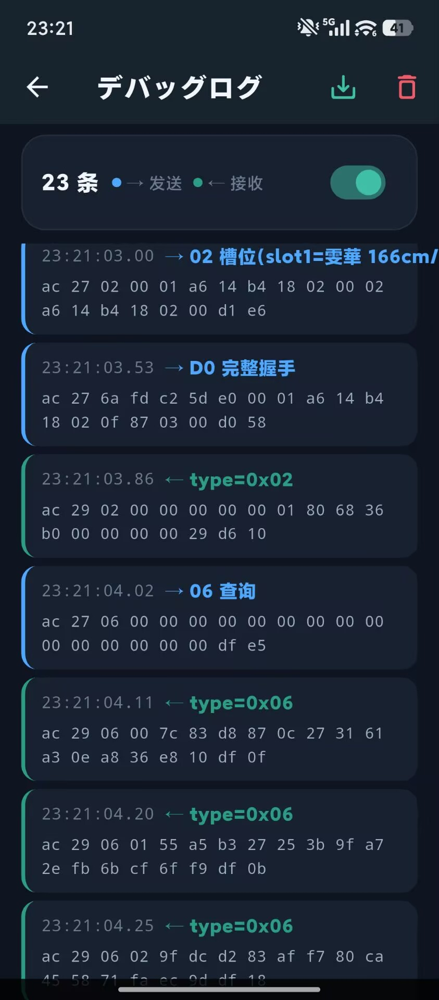

# AFU

<p align="center">
  <a href="../../../README.md">简体中文</a> &middot; <b>繁體中文</b> &middot; <a href="../ja/README.md">日本語</a> &middot; <a href="../de/README.md">Deutsch</a> &middot; <a href="../fi/README.md">Suomi</a> &middot; <a href="../en/README.md">English</a>
</p>


**AFU-WL-TZ-A1**（螞蟻阿福 × 沃萊 ICOMON）體脂計的 Android 用戶端 · Flutter 重寫版  
本機優先 · 無帳號 · 無雲端同步 · 5 語言 · 深淺雙主題

<p align="center">
  
  &nbsp;&nbsp;
  
  &nbsp;&nbsp;
  
</p>

<p align="center"><sub>資料頁 · 功能一覽 · 通訊日誌（偵錯模式下可見）</sub></p>

## 特性

- **掃描 1 秒內**：同一支手機同一台體脂計，舊 React Native 版需要 7 分鐘
- **環形儀表板**：秤重 → 阻抗 → 完成，三段式動畫
- **多成員**：檔案管理、改名同步歷史、孤兒紀錄修復
- **資料**：72H / 7d / 30day / 自訂區間篩選，趨勢圖，批次推送 · 轉移 · 刪除
- **區域網路同步**：HTTP 推送到自建接收端
- **演算法完全公開**：BIA 公式與每個係數逐條說明，區分論文原式與實測校準值
- 5 語言 · 深淺雙主題 · kg / lb / 斤

## 文件

| 文件 | 內容 |
| --- | --- |
| [協議 · 通俗版](PROTOCOL.md) | 從「怎麼找到秤」講到「位元組怎麼變成體重」，含 10 個實測坑 |
| [協議 · 規格版](PROTOCOL_SPEC.md) | 面向實作者的技術規格：欄位級定義、狀態機、測試向量、一致性清單 |
| [體成分演算法](ALGORITHM.md) | 體脂率/水分/肌肉/骨骼肌怎麼算出來的，含公式與係數來源標註 |
| [建置與安裝](BUILD.md) | 環境需求、兩個必踩的坑、無線安裝 |
| [資料遷移](MIGRATION.md) | 從舊 RN 版匯入歷史記錄 |
| [常見問題](FAQ.md) | BMI 為何不隨性別變、阻抗為 0、電量、歷史機制 |

## 快速開始

```bash
git clone https://github.com/Linmord/afu-scale-flutter.git
cd afu-scale-flutter
flutter pub get
flutter build apk --release
```

> ⚠️ 專案路徑**不能含中文**，否則 Gradle 直接報錯。詳見 [建置文件](BUILD.md)。

每次推送到 `main` 會自動建置 APK（[`.github/workflows/build.yml`](../../../.github/workflows/build.yml)），產物在 Actions 的 Artifacts 裡。

## 舊版

React Native 版已**停止維護** → [Linmord/afu-scale-app](https://github.com/Linmord/afu-scale-app)

## 免責聲明

非官方用戶端，與螞蟻阿福 / 沃萊（ICOMON）無關聯。協議透過公開擷取封包與逆向推導得出，可能隨韌體升級失效。
體成分為 BIA 公式估算值，僅供個人趨勢參考，不作為醫學診斷依據。
